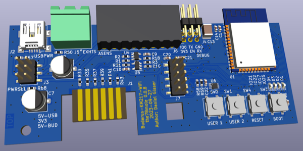
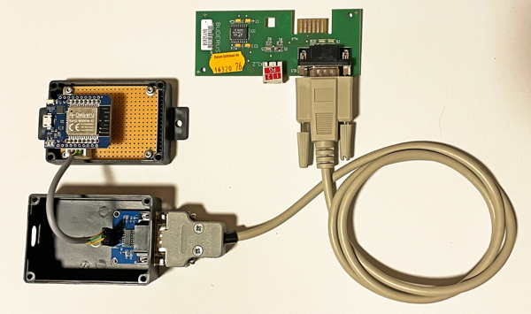
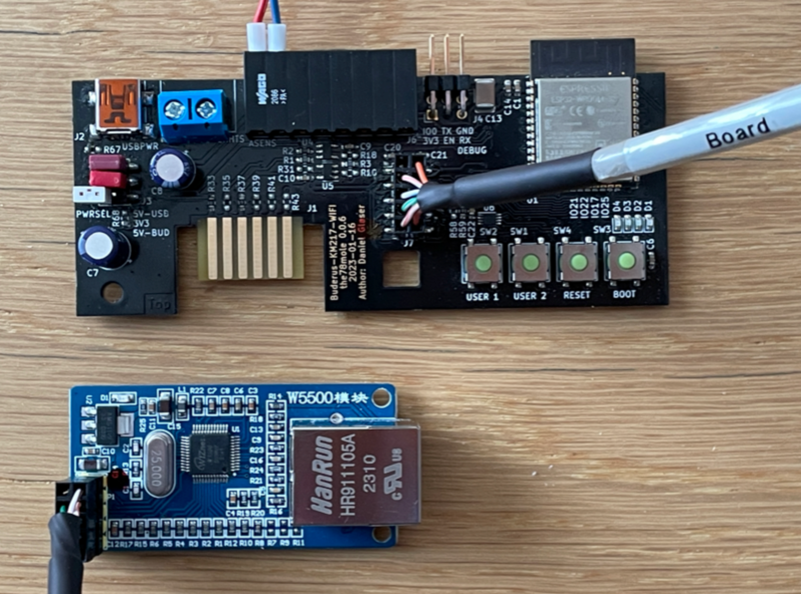
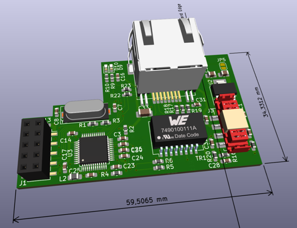
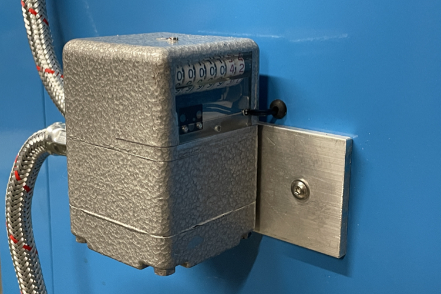
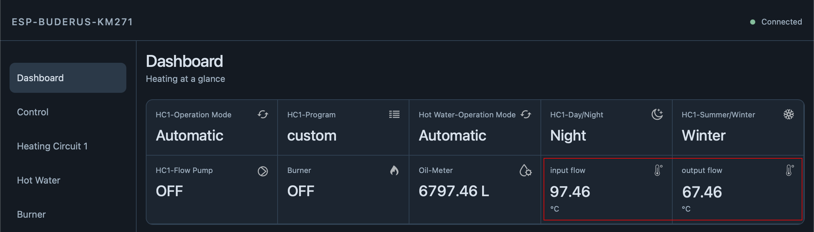
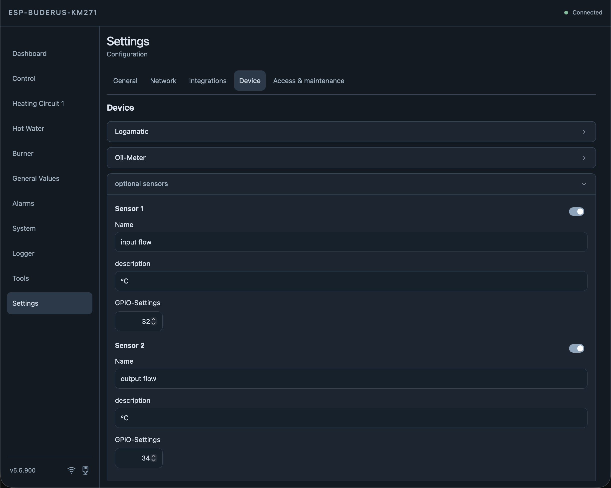
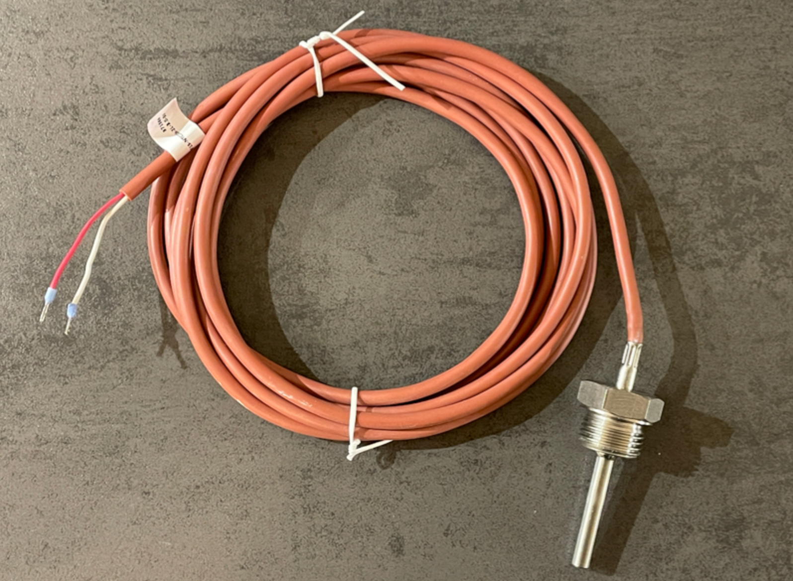

# Hardware

[Deutsch](hardware_DE.md) · [Back to the guide](../README.md)

## Table of Contents

- [Option 1 - Board from the78mole](#option-1---board-from-the78mole)
  - [KM271-WiFi v2.0 (ESP32-S3)](#km271-wifi-v20-esp32-s3)
- [Option 2 - ESP32 with original Buderus KM271](#option-2---esp32-with-original-buderus-km271)
- [Optional: Ethernet Module W5500](#optional-ethernet-module-w5500)
  - [Option 1 - single W5500 board](#option-1---single-w5500-board)
  - [KM271-WiFi v0.0.6–1.x (ESP32)](#km271-wifi-v0061x-esp32)
  - [Option 2 - Board from the78mole](#option-2---board-from-the78mole)
- [Optional: FM244 solar module](#optional-fm244-solar-module)
- [Optional: Hardware Oil Meter](#optional-hardware-oil-meter)
- [Optional: OneWire Sensor](#optional-onewire-sensor)
- [Optional: Exhaust Sensor](#optional-exhaust-sensor)
- [GPIO presets](#gpio-presets)

## Option 1 - Board from the78mole

One option is the integrated KM271-WiFi interface by Daniel Glaser. Thanks for his work on this hardware!
You can find more information here: <https://github.com/the78mole/km271-wifi>
You can order it here: <https://www.tindie.com/products/24664/>

In this case you only need this DIY interface and nothing more.
It includes the RS232/TTL Adapter and also an ESP32.

### KM271-WiFi v2.0 (ESP32-S3)

The new revision uses an ESP32-S3-WROOM-1-N8R2. Install **ESP32-S3 firmware** and select **Board 2.0 (ESP32-S3)** under Device → GPIO. RX/TX are 18/17; WiFi/heartbeat/logmode LEDs are 21/38/39. The 0.0.6–1.x preset remains available for older ESP32 boards.

Fresh S3 configurations already use these defaults. OneWire defaults to GPIO15; channel 2 has no GPIO assigned. Sensors remain disabled by default. Keep GPIO19/20 free for native USB. The GPIO preset only changes communication/LED pins and disables the oil meter GPIOs; check existing sensor and Ethernet settings separately and restart afterwards.

W5500 extension: SCLK 12, MOSI 11, MISO 13, CS 10, INT 14, RST 16; no level shifter enable. Fresh S3 configurations use these defaults with Ethernet disabled.

Pin assignments follow the [v2.0 software requirements](https://github.com/the78mole/km271-wifi/blob/148b85529cf4247615d486f39032ff758c389e69/KM217-WiFi/req/05_software_requirements.sdoc) and [Ethernet requirements](https://github.com/the78mole/km271-wifi/blob/148b85529cf4247615d486f39032ff758c389e69/EXTENSIONS/ETH_W5500/req/05_software_requirements.sdoc). Older hardware repository documents still contain classic ESP32 pin assignments.




## Option 2 - ESP32 with original Buderus KM271

The other option is, to use the original Buderus KM271 Module that has a serial interface (RS232).
In combination with a RS232 TTL Adapter (MAX3232) it can be connected to the TX/RX Port of the ESP.

Logamatic R2107 => KM271 => RS232/TTL Adapter => ESP

Example configuration:

The arrows below describe signal direction. Converter labels and RS232 pinouts
depend on the module; verify them against its documentation. Do not assume that
matching TX/RX labels or a particular straight/null-modem cable will always work.

```text
(ESP32) TX output -> converter TTL input -> RS232 output -> KM271 receive
(ESP32) RX input <- converter TTL output <- RS232 input <- KM271 transmit
(ESP32) GND <-> converter GND <-> RS232 signal ground
```



## Optional: Ethernet Module W5500

### Option 1 - single W5500 board

It is also possible to connect a W5500 Ethernet module to the Board or a generic ESP32. For the KM271 Board´s from Daniel you can connect the W5500 to the J7 Connector of the Board.

> [!IMPORTANT]
> The connection cable should be as short as possible (approx 10cm)

### KM271-WiFi v0.0.6–1.x (ESP32)

These pins apply to classic ESP32 boards, not v2.0 (ESP32-S3); see [KM271-WiFi v2.0](#km271-wifi-v20-esp32-s3) for S3 pins.

| Signal | GPIO          | Pin (J7) |
|--------|---------------|----------|
| VCC    |               | J7.2     |
| GND    |               | J7.10    |
| CLK    |  18           | J7.9     |
| MOSI   |  23           | J7.7     |
| MISO   |  19           | J7.5     |
| CS     |  15           | J7.3     |
| INT    |  14           | J7.8     |
| RST    |  13           | J7.6     |


Example for generic ESP32-Mini (choose other pins if they conflict with the configured serial RX/TX or another peripheral)

| Signal| GPIO |
|-------|------|
| CLK   | 18   |
| MOSI  | 23   |
| MISO  | 19   |
| CS    | 5    |
| INT   | 16   |
| RST   | 17   |



### Option 2 - Board from the78mole

A matching Ethernet expansion for the KM271-WiFi board is documented here:

https://www.tindie.com/products/the78mole/km271-wifi-ethernet-extension



## Optional: FM244 solar module

Solar values require the **Buderus FM244 solar module**. It normally occupies the same slot as the KM271 or KM271-WiFi interface. Using both therefore requires a suitable adapter/expansion solution; the two modules cannot simply occupy the same slot.

Solar values come from the FM244 through the Logamatic. Enabling Solar in the WebUI alone does not provide these values. See [issue #64](https://github.com/dewenni/ESP_Buderus_KM271/issues/64) for background on using both modules and solar support.

## Optional: Hardware Oil Meter

The software is also prepared to connect an Oil Meter. A well-known manufacturer of oil meters is Braun with the models HZ-5 or HZ6.
These are already available with a potential-free contact.
I have used one without potential-free contact and have subsequently attached a reed contact. This was also very simple and works very reliably.



> [!NOTE]
> but this is only optional and can be used additionally to the Information´s that the software will read from the Logamatic.


Configure pulses per litre and debounce time under Device → Oil meter. The input requires a suitable external signal/pull-up; input-only GPIOs such as GPIO35 have no internal pull-up. Keep GPIO levels within 3.3 V.

## Optional: OneWire Sensor

You can also configure additional OneWire Sensors (e.g. DS18B20). In the configuration you can setup one or two sensors.
The Sensor value will shown on the Dashboard and will also be send by mqtt with Topic `sensor` and the name that you can configure.
Depending on the hardware used, an additional resistor may need to be installed. A typical OneWire connection uses a 4.7 kΩ pull-up between the data line and 3.3 V. Check the sensor/module wiring; ESP GPIOs must not receive 5 V.
Only the GPIO to which the sensor cable is connected is specified in the configuration. The rest is hardware-dependent wiring.

> [!NOTE]
> The sensor must be connected when the ESP is started, otherwise it will not be found. Changes to the cabling or the GPIO settings require a restart.




(dashboard controls)



(settings)

> [!NOTE]
> but this is only optional and can be used additionally to the Information´s that the software will read from the Logamatic.

## Optional: Exhaust Sensor

It is also possible to connect a optional exhaust sensor (NTC 100K) to the Connector J5 of the Board. In some cases you have to add some missing components to the Board.


| Component | Value        |
|-----------|--------------|
| D5        | BZX84C5V1    |
| R17       | 3.3K         |
| R11       | 100K         |
| C11       | 100nF        |
| C12       | 33nF         |
| R35       | 0            |
| R39       | 0            |

There is no need to configure the sensor in the software. The logamatic itself will automatically detect the sensor and send the value similar to the other values.



## GPIO presets

Presets are not hardware detection; select firmware that matches the ESP chip. Selecting a preset disables the oil meter GPIOs. Check existing sensor and Ethernet assignments separately.

| Preset | RX | TX | Wi-Fi LED | Heartbeat LED | Logmode LED |
| --- | ---: | ---: | ---: | ---: | ---: |
| Generic ESP32 | 16 | 17 | 21 | — | — |
| KM271-WiFi v0.0.5 | 4 | 2 | 21 | 22 | 23 |
| KM271-WiFi v0.0.6–1.x (ESP32) | 4 | 2 | 21 | 22 | 17 |
| KM271-WiFi v2.0 (ESP32-S3) | 18 | 17 | 21 | 38 | 39 |
