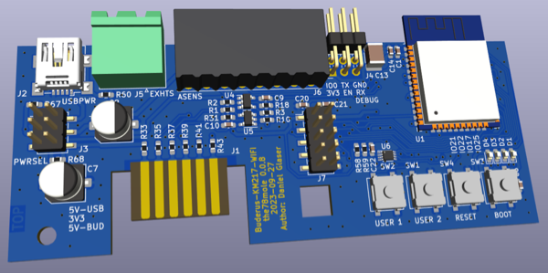
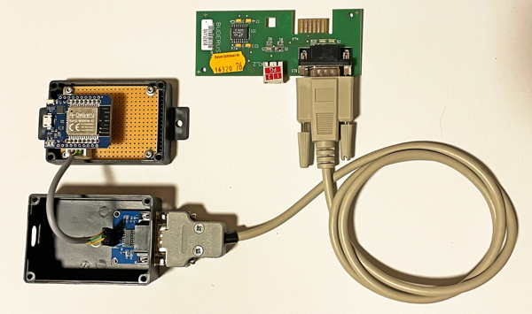
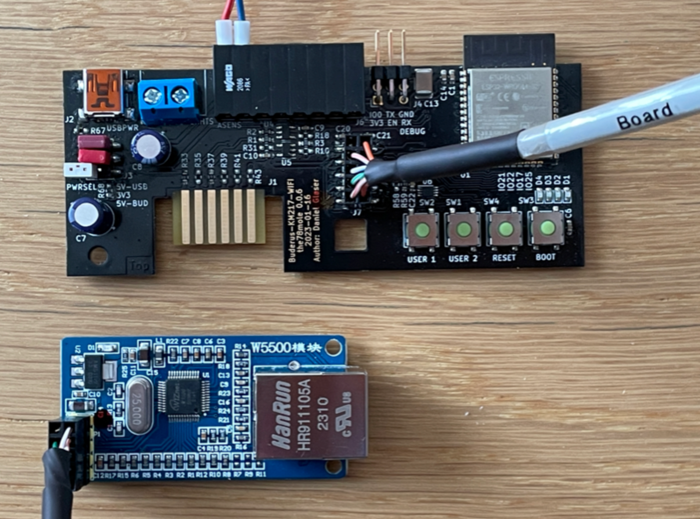
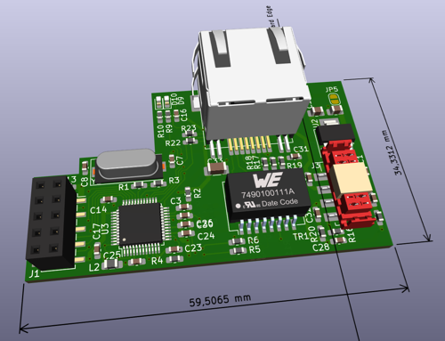
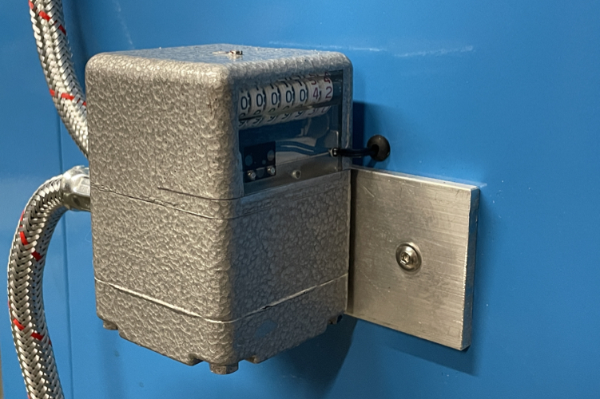
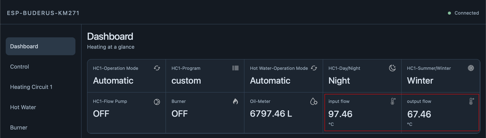
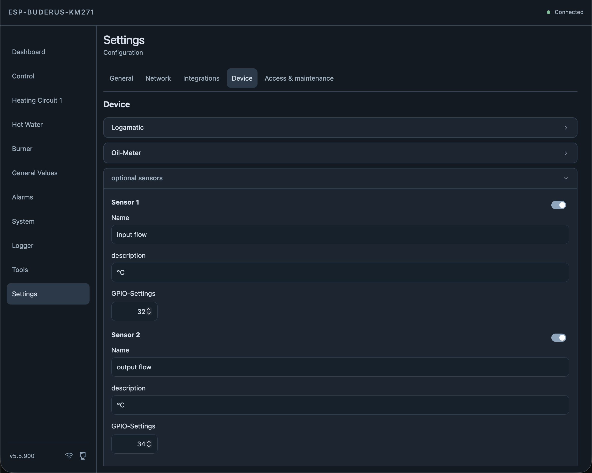
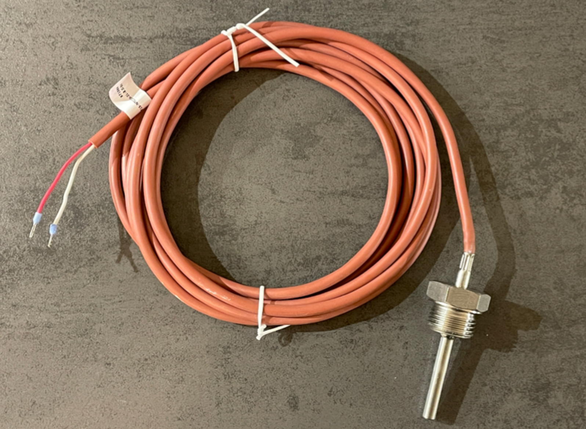

# Hardware

[English](hardware.md) · [Zurück zur Anleitung](../README_DE.md)

## Inhaltsverzeichnis

- [Option 1 - Board von the78mole](#option-1---board-von-the78mole)
  - [KM271-WiFi v2.0 (ESP32-S3)](#km271-wifi-v20-esp32-s3)
- [Option 2 - ESP32 mit original Buderus KM271](#option-2---esp32-mit-original-buderus-km271)
- [Optional: Ethernet Modul W5500](#optional-ethernet-modul-w5500)
  - [Option 1 - einzelnes W5500 Modul](#option-1---einzelnes-w5500-modul)
  - [KM271-WiFi v0.0.6–1.x (ESP32)](#km271-wifi-v0061x-esp32)
  - [Option 2 - Board von the78mole](#option-2---board-von-the78mole)
- [Optional: Solarmodul FM244](#optional-solarmodul-fm244)
- [Optional: Hardware Ölzähler](#optional-hardware-ölzähler)
- [Optional: OneWire Sensor](#optional-onewire-sensor)
- [Optional: Abgas Sensor](#optional-abgas-sensor)
- [GPIO-Presets](#gpio-presets)

## Option 1 - Board von the78mole

Eine Möglichkeit ist das integrierte KM271-WiFi-Interface von Daniel Glaser. Vielen Dank für seine Arbeit an dieser Hardware!
Weitere Informationen findest du hier: <https://github.com/the78mole/km271-wifi>
Bestellen kann man es hier: <https://www.tindie.com/products/24664/>

In diesem Fall brauchst du nur dieses DIY-Interface und nichts weiter.
Es beinhaltet den RS232/TTL Adapter und auch einen ESP32.

### KM271-WiFi v2.0 (ESP32-S3)

Die neue Boardrevision verwendet einen ESP32-S3-WROOM-1-N8R2. Dafür die **ESP32-S3-Firmware** verwenden und unter Gerät → GPIO das Preset **Board 2.0 (ESP32-S3)** wählen. RX/TX liegen auf 18/17, WLAN-/Heartbeat-/Logmode-LEDs auf 21/38/39. Das bisherige Preset 0.0.6–1.x bleibt für ältere ESP32-Boards erhalten.

Bei einer frischen S3-Konfiguration sind diese Pins bereits voreingestellt. OneWire verwendet GPIO15; Kanal 2 ist ohne GPIO vorbelegt. Sensoren bleiben optional deaktiviert. GPIO19/20 für natives USB freihalten. Das GPIO-Preset ändert nur die Kommunikations- und LED-Pins und deaktiviert die Ölzähler-GPIOs; vorhandene Sensor- und Ethernet-Einstellungen separat prüfen und anschließend neu starten.

Für die W5500-Erweiterung: SCLK 12, MOSI 11, MISO 13, CS 10, INT 14, RST 16; kein Pegelwandler-Enable. Diese Werte sind bei einer frischen S3-Konfiguration vorbelegt, Ethernet bleibt deaktiviert.

Die Pinbelegung folgt den [v2.0-Software-Anforderungen](https://github.com/the78mole/km271-wifi/blob/148b85529cf4247615d486f39032ff758c389e69/KM217-WiFi/req/05_software_requirements.sdoc) und den [Ethernet-Anforderungen](https://github.com/the78mole/km271-wifi/blob/148b85529cf4247615d486f39032ff758c389e69/EXTENSIONS/ETH_W5500/req/05_software_requirements.sdoc). Ältere Texte im Hardware-Repository enthalten noch ESP32-Pins.




## Option 2 - ESP32 mit original Buderus KM271

Das originale KM271-Modul besitzt eine RS232-Schnittstelle. Ein geeigneter RS232/TTL-Wandler (MAX3232) verbindet sie mit dem ESP.

Die Pfeile zeigen die Signalrichtung. Wandler-Beschriftungen und RS232-Pinbelegungen sind modulabhängig; passende TX-/RX-Namen allein garantieren keine richtige Verbindung. Ob ein gerades oder ein Nullmodemkabel erforderlich ist, muss anhand der tatsächlichen Pinbelegung geprüft werden.

```text
(ESP32) TX-Ausgang -> TTL-Eingang des Wandlers -> RS232-Ausgang -> KM271-Empfang
(ESP32) RX-Eingang <- TTL-Ausgang des Wandlers <- RS232-Eingang <- KM271-Senden
(ESP32) GND <-> Wandler-GND <-> RS232-Signalmasse
```



## Optional: Ethernet Modul W5500

### Option 1 - einzelnes W5500 Modul

Es ist auch möglich, ein W5500 Ethernet Modul an das Board oder einen generischen ESP32 anzuschließen. Bei den KM271-Boards von Daniel kann das W5500 an dem J7-Anschluss des Boards angeschlossen werden.

> [!IMPORTANT]
> Das Anschlusskabel sollte so kurz wie möglich sein (ca. 10 cm).

### KM271-WiFi v0.0.6–1.x (ESP32)

Diese Pins gelten für klassische ESP32-Boards, nicht für v2.0 (ESP32-S3); die S3-Pins stehen unter [KM271-WiFi v2.0](#km271-wifi-v20-esp32-s3).

| Signal | GPIO          | Pin (J7) |
|--------|---------------|----------|
| VCC    |               | J7.2     |
| GND    |               | J7.10    |
| CLK    |  18           | J7.9     |
| MOSI   |  23           | J7.7     |
| MISO   |  19           | J7.5     |
| CS     |  15           | J7.3     |
| INT    |  14           | J7.8     |
| RST    |  13           | J7.6     |


Beispiel für einen generischen ESP32-Mini (bei Überschneidung mit seriellen RX-/TX-GPIOs oder anderen Komponenten andere freie Pins wählen)

| Signal| GPIO |
|-------|------|
| CLK   | 18   |
| MOSI  | 23   |
| MISO  | 19   |
| CS    | 5    |
| INT   | 16   |
| RST   | 17   |



### Option 2 - Board von the78mole

Eine passende Ethernet-Erweiterung für das KM271-WiFi-Board ist hier dokumentiert:

https://www.tindie.com/products/the78mole/km271-wifi-ethernet-extension



## Optional: Solarmodul FM244

Für die Solarwerte ist das **Buderus-Solarmodul FM244** erforderlich. Es belegt normalerweise denselben Steckplatz wie das KM271 beziehungsweise das KM271-WiFi-Interface. Für den gleichzeitigen Betrieb ist deshalb eine geeignete Adapter-/Erweiterungslösung erforderlich; die beiden Module können nicht einfach denselben Steckplatz belegen.

Die Solarwerte stammen vom FM244 über die Logamatic. Das Aktivieren von Solar in der WebUI allein stellt diese Werte nicht bereit. Hinweise zum gemeinsamen Betrieb und zur Solar-Unterstützung stehen in [Issue #64](https://github.com/dewenni/ESP_Buderus_KM271/issues/64).

## Optional: Hardware Ölzähler

Die Software ist auch für den Anschluss eines Ölzählers vorbereitet. Ein bekannter Hersteller von Ölzählern ist Braun mit den Modellen HZ-5 oder HZ6.
Diese sind bereits mit einem potentialfreien Kontakt erhältlich.
Ich habe einen ohne potentialfreien Kontakt verwendet und nachträglich einen Reedkontakt angebracht. Das war auch sehr einfach und funktioniert sehr zuverlässig.



> [!NOTE]
> Dies ist jedoch nur optional und kann zusätzlich zu den Informationen, die die Software aus der Logamatic liest, verwendet werden.


Impulse pro Liter und Entprellzeit werden unter Gerät → Ölzähler eingestellt. Der Eingang benötigt ein geeignetes externes Signal beziehungsweise einen Pull-up. Reine Eingangs-GPIOs wie GPIO35 besitzen keinen internen Pull-up. Die GPIO-Pegel müssen bei maximal 3,3 V bleiben.

## Optional: OneWire Sensor

Es können auch zusätzliche OneWire-Sensoren (z. B. DS18B20) konfiguriert werden. In der Konfiguration kann man einen oder zwei Sensoren einrichten.
Der Sensorwert wird auf dem Dashboard angezeigt und wird auch von mqtt mit dem Topic `sensor` und dem Namen, den man konfigurieren kann, gesendet.
Abhängig von der verwendeten Hardware muss eventuell ein zusätzlicher Widerstand installiert werden. Klassischerweise werden die OneWire-Sensoren mit einem Widerstand von 4,7kOhm zwischen VCC und dem Sensorkabel angeschlossen und mit 3,3 V betrieben.
In der Konfiguration wird nur der GPIO angegeben, an dem das Sensorkabel angeschlossen ist. Der Rest ist eine hardwareabhängige Verdrahtung.


> [!NOTE]
> Der Sensor muss beim Start des ESP angeschlossen sein, sonst wird er nicht gefunden. Änderungen an der Verkabelung oder den GPIO-Einstellungen erfordern einen Neustart.




(Dashboard Elemente)



(Einstellungen)

> [!NOTE]
> Dies ist jedoch nur optional und kann zusätzlich zu den Informationen, die die Software aus der Logamatic liest, verwendet werden.

## Optional: Abgas Sensor

Es ist auch möglich, einen optionalen Abgassensor (NTC 100K) an den Anschluss J5 der Platine anzuschließen. In einigen Fällen müssen einige fehlende Komponenten auf der Platine ergänzt werden.


| Komponente | Wert        |
|-----------|--------------|
| D5        | BZX84C5V1    |
| R17       | 3.3K         |
| R11       | 100K         |
| C11       | 100nF        |
| C12       | 33nF         |
| R35       | 0            |
| R39       | 0            |

Es besteht keine Notwendigkeit, den Sensor in der Software zu konfigurieren. Die Logamatic selbst erkennt den Sensor automatisch und sendet den Wert wie die anderen Werte.



## GPIO-Presets

Presets erkennen die Hardware nicht automatisch; die Firmware muss zum ESP-Chip passen. Beim Anwenden eines Presets werden die GPIOs des Ölzählers deaktiviert. Vorhandene Sensor- und Ethernet-Zuordnungen separat prüfen.

| Preset | RX | TX | WLAN-LED | Heartbeat-LED | Logmode-LED |
| --- | ---: | ---: | ---: | ---: | ---: |
| Generischer ESP32 | 16 | 17 | 21 | — | — |
| KM271-WiFi v0.0.5 | 4 | 2 | 21 | 22 | 23 |
| KM271-WiFi v0.0.6–1.x (ESP32) | 4 | 2 | 21 | 22 | 17 |
| KM271-WiFi v2.0 (ESP32-S3) | 18 | 17 | 21 | 38 | 39 |
