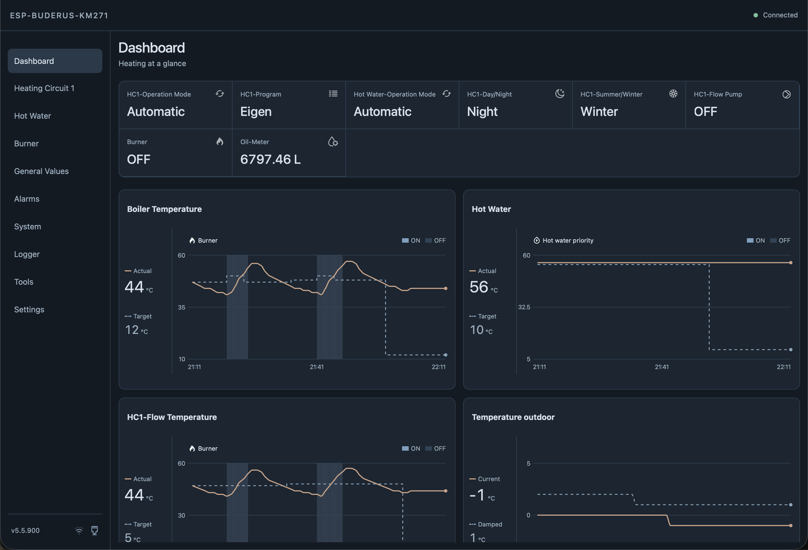
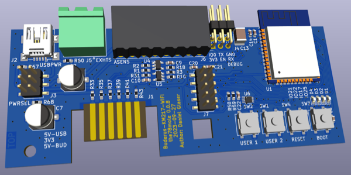
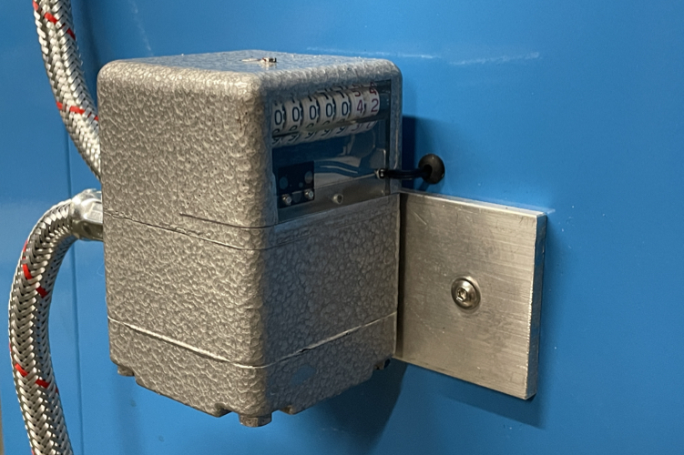
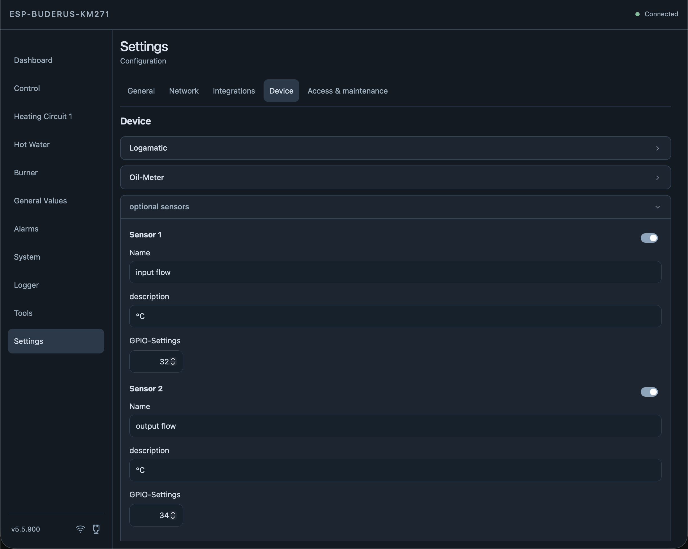
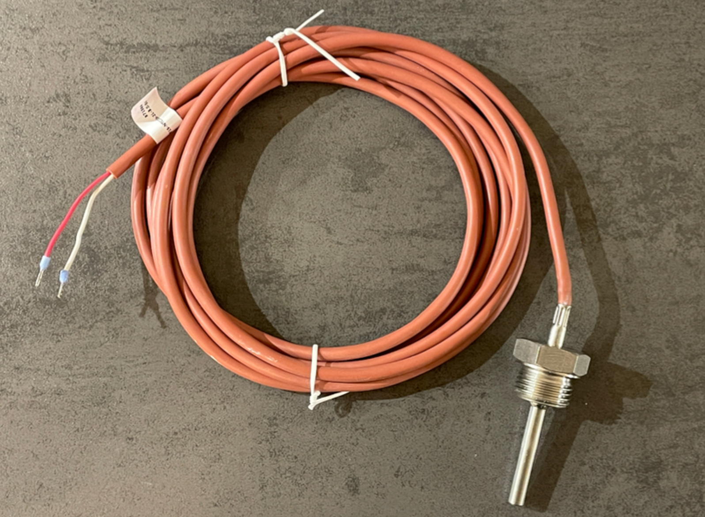
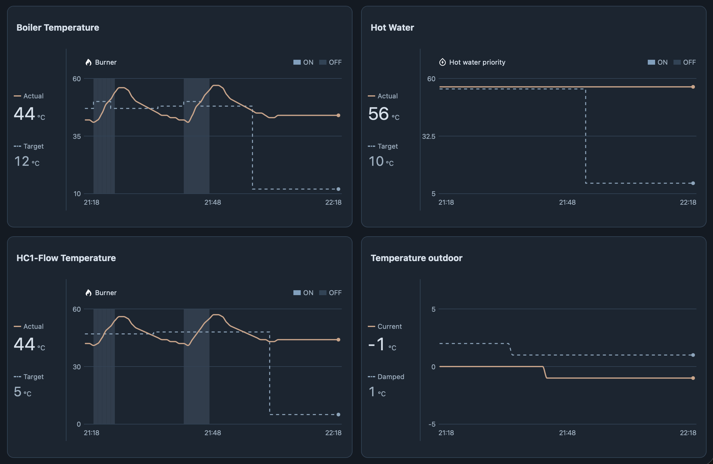
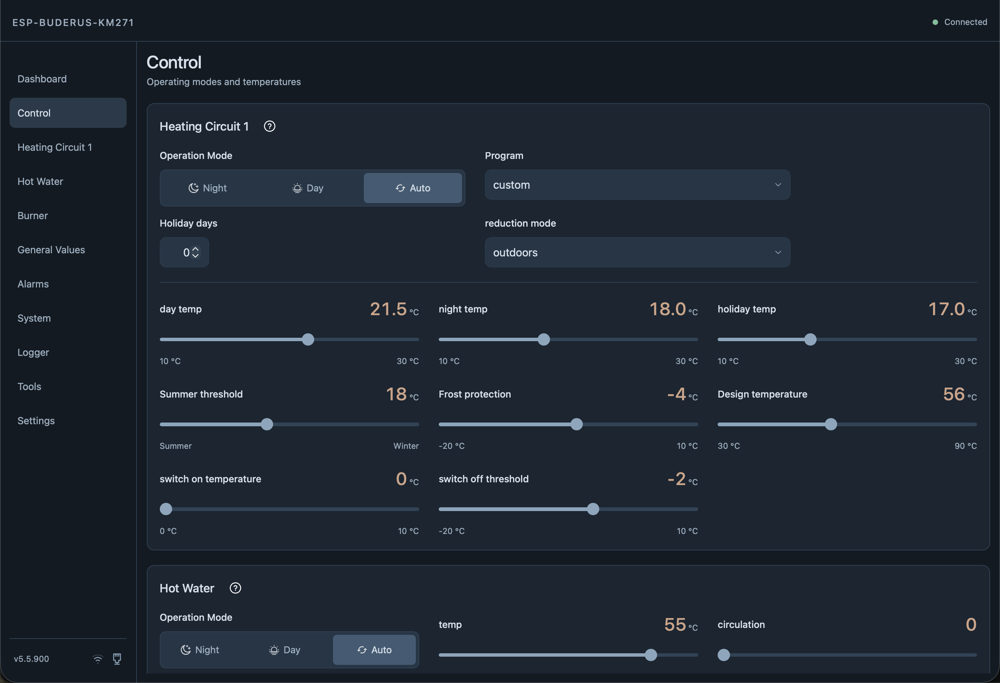
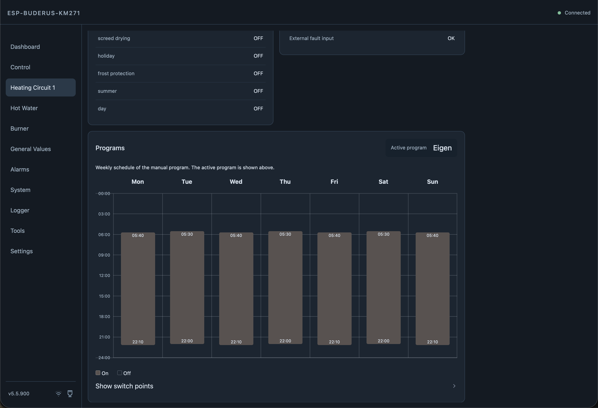

<div align="center">


<h3 style="text-align: center;">ESP-Buderus-KM271</h3>
</div>

-----

**[🇩🇪 Deutsche Version der Beschreibung](README_DE.md)**

-----

<div align="center">

[](https://github.com/dewenni/ESP_Buderus_KM271/releases/latest)


[](https://github.com/dewenni/ESP_Buderus_KM271/stargazers/)

</div>


-----

<div align="center">
If you like this project, feel free to push the <b>[Star ⭐️]</b> button and click <b>[Watch 👁]</b> to stay updated.
<br><br>
And if you'd like to support my work, you can also<p>

[](https://github.com/sponsors/dewenni)

</div>

-----

Control your Buderus Logamatic R2107 / HS 2105 with ESP32 and MQTT

Read heating values, understand operating states and adjust supported Logamatic parameters through the integrated WebUI or MQTT.

The dashboard includes short-term temperature trends. MQTT also allows long-term recording with external systems such as InfluxDB and Grafana.

The responsive WebUI works without additional home-automation software and supports German and English.



(Desktop Version)

The WebUI is responsive and also offers a mobile layout.


(Mobile Version)

For a first impression of the functions and the WebUI, a limited demo is also available.
This can be accessed via the following link: [WebUI-DEMO](https://dewenni.github.io/ESP_Buderus_KM271/)

-----

# Table of Contents

- [Overview](#overview)
  - [Optional oil consumption measurement](#optional-oil-consumption-measurement)
- [Hardware](#hardware)
  - [Option 1 - Board from the78mole](#option-1---board-from-the78mole)
  - [Option 2 - ESP32 with original Buderus KM271](#option-2---esp32-with-original-buderus-km271)
  - [Optional: Ethernet Module W5500](#optional-ethernet-module-w5500)
  - [Optional: FM244 solar module](#optional-fm244-solar-module)
  - [Optional: Hardware Oil Meter](#optional-hardware-oil-meter)
  - [Optional: OneWire Sensor](#optional-onewire-sensor)
  - [Optional: Exhaust Sensor](#optional-exhaust-sensor)
- [Getting started](#getting-started)
  - [PlatformIO](#platformio)
  - [Prebuilt firmware](#prebuilt-firmware)
  - [OTA updates](#ota-updates)
  - [Setup Mode](#setup-mode)
  - [Configuration](#configuration)
  - [Access and passwords](#access-and-passwords)
  - [Configuration backup and restore](#configuration-backup-and-restore)
- [WebUI](#webui)
  - [Dashboard](#dashboard)
  - [Control](#control)
  - [Heating circuits, hot water, solar and burner](#heating-circuits-hot-water-solar-and-burner)
  - [Logger](#logger)
  - [System](#system)
  - [Alarms](#alarms)
  - [Tools](#tools)
  - [Settings](#settings)
  - [Help](#help)
- [MQTT](#mqtt)
  - [Received values](#received-values)
  - [Commands](#commands)
  - [Home Assistant](#home-assistant)
- [Optional messaging](#optional-messaging)
  - [Pushover](#pushover)
  - [Telnet](#telnet)
- [Optional Components](#optional-components)
  - [node-red](#node-red)
  - [grafana](#grafana)
- [FAQ](#faq)
  - [No connection to the Logamatic / no heating values](#no-connection-to-the-logamatic--no-heating-values)
  - [Network or MQTT connection is lost](#network-or-mqtt-connection-is-lost)
  - [Oil counter changes unexpectedly](#oil-counter-changes-unexpectedly)
  - [Use with ioBroker](#use-with-iobroker)
  - [OTA update fails](#ota-update-fails)

-----

# Overview

The project communicates with the Buderus Logamatic through the KM271 interface using the 3964R protocol. The original communication code is based on the work of **Michael Mayer**, extended to support common write commands as well as reading values.

The WebUI provides a dashboard with trends, controls, heating information, logs, system status, updates, grouped settings and offline help. Optional features include HC2, Solar, oil counters, OneWire sensors, MQTT/Home Assistant and Pushover. Available values depend on the connected heating system and enabled components.

Translations are maintained in [language.h](include/language.h) and [lang.js](web/js/lang.js). The WebUI and MQTT languages can be selected separately.

## Optional oil consumption measurement

A hardware pulse counter can measure oil consumption, for example using a Braun HZ-5R/HZ-5DR or a suitable reed-contact retrofit. Configure its GPIO, pulses per litre and debounce time. The counter is stored persistently; the displayed unit is litres.

Alternatively, the virtual oil meter estimates consumption from burner runtime, configured fuel throughput, density and offset. This is a calculated estimate rather than an independent measurement.

# Hardware

## Option 1 - Board from the78mole

One option is the integrated KM271-WiFi interface by Daniel Glaser. Thanks for his work on this hardware!
You can find more information here: <https://github.com/the78mole/km271-wifi>
You can order it here: <https://www.tindie.com/products/24664/>

In this case you only need this DIY interface and nothing more.
It includes the RS232/TTL Adapter and also an ESP32.




## Option 2 - ESP32 with original Buderus KM271

The other option is, to use the original Buderus KM271 Module that has a serial interface (RS232).
In combination with a RS232 TTL Adapter (MAX3232) it can be connected to the TX/RX Port of the ESP.

Logamatic R2107 => KM271 => RS232/TTL Adapter => ESP

Example configuration:

The arrows below describe signal direction. Converter labels and RS232 pinouts
depend on the module; verify them against its documentation. Do not assume that
matching TX/RX labels or a particular straight/null-modem cable will always work.

```text
(ESP32) TX output -> converter TTL input -> RS232 output -> KM271 receive
(ESP32) RX input <- converter TTL output <- RS232 input <- KM271 transmit
(ESP32) GND <-> converter GND <-> RS232 signal ground
```


## Optional: Ethernet Module W5500

### Option 1 - single W5500 board

It is also possible to connect a W5500 Ethernet module to the Board or a generic ESP32. For the KM271 Board´s from Daniel you can connect the W5500 to the J7 Connector of the Board.

> [!IMPORTANT]
> The connection cable should be as short as possible (approx 10cm)

Board >= 0.0.6

| Signal | GPIO          | Pin (J7) |
|--------|---------------|----------|
| VCC    |               | J7.2     |
| GND    |               | J7.10    |
| CLK    |  18           | J7.9     |
| MOSI   |  23           | J7.7     |
| MISO   |  19           | J7.5     |
| CS     |  15           | J7.3     |
| INT    |  14           | J7.8     |
| RST    |  13           | J7.6     |


Example for generic ESP32-Mini (choose other pins if they conflict with the configured serial RX/TX or another peripheral)

| Signal| GPIO |
|-------|------|
| CLK   | 18   |
| MOSI  | 23   |
| MISO  | 19   |
| CS    | 5    |
| INT   | 16   |
| RST   | 17   |


### Option 2 - Board from the78mole

A matching Ethernet expansion for the KM271-WiFi board is documented here:

https://www.tindie.com/products/the78mole/km271-wifi-ethernet-extension


## Optional: FM244 solar module

Solar values require the **Buderus FM244 solar module**. It normally occupies the same slot as the KM271 or KM271-WiFi interface. Using both therefore requires a suitable adapter/expansion solution; the two modules cannot simply occupy the same slot.

Solar values come from the FM244 through the Logamatic. Enabling Solar in the WebUI alone does not provide these values. See [issue #64](https://github.com/dewenni/ESP_Buderus_KM271/issues/64) for background on using both modules and solar support.

## Optional: Hardware Oil Meter

The software is also prepared to connect an Oil Meter. A well-known manufacturer of oil meters is Braun with the models HZ-5 or HZ6.
These are already available with a potential-free contact.
I have used one without potential-free contact and have subsequently attached a reed contact. This was also very simple and works very reliably.



> [!NOTE]
> but this is only optional and can be used additionally to the Information´s that the software will read from the Logamatic.


Configure pulses per litre and debounce time under Device → Oil meter. The input requires a suitable external signal/pull-up; input-only GPIOs such as GPIO35 have no internal pull-up. Keep GPIO levels within 3.3 V.

## Optional: OneWire Sensor

You can also configure additional OneWire Sensors (e.g. DS18B20). In the configuration you can setup one or two sensors.
The Sensor value will shown on the Dashboard and will also be send by mqtt with Topic `sensor` and the name that you can configure.
Depending on the hardware used, an additional resistor may need to be installed. A typical OneWire connection uses a 4.7 kΩ pull-up between the data line and 3.3 V. Check the sensor/module wiring; ESP GPIOs must not receive 5 V.
Only the GPIO to which the sensor cable is connected is specified in the configuration. The rest is hardware-dependent wiring.

> [!NOTE]
> The sensor must be connected when the ESP is started, otherwise it will not be found. Changes to the cabling or the GPIO settings require a restart.


(dashboard controls)



(settings)

> [!NOTE]
> but this is only optional and can be used additionally to the Information´s that the software will read from the Logamatic.

## Optional: Exhaust Sensor

It is also possible to connect a optional exhaust sensor (NTC 100K) to the Connector J5 of the Board. In some cases you have to add some missing components to the Board.


| Component | Value        |
|-----------|--------------|
| D5        | BZX84C5V1    |
| R17       | 3.3K         |
| R11       | 100K         |
| C11       | 100nF        |
| C12       | 33nF         |
| R35       | 0            |
| R39       | 0            |

There is no need to configure the sensor in the software. The logamatic itself will automatically detect the sensor and send the value similar to the other values.



-----

# Getting started

Install the firmware, configure the network and select the hardware preset before changing heating settings. MQTT and additional sensors are optional; the WebUI also works on its own.

## PlatformIO

Clone the repository and open it in Visual Studio Code with PlatformIO. Select the appropriate environment and USB upload port in `platformio.ini`, then build and upload. Python is required by the build scripts, which also generate and compress the WebUI files.

## Prebuilt firmware

Prebuilt binaries are available under [Releases](https://github.com/dewenni/ESP_Buderus_KM271/releases).

- **Initial USB installation:** use `buderus_km271_esp32_flash_vx.x.x.bin`. This merged image includes bootloader, partition table and application and is flashed at address **0x00** with a compatible ESP flashing tool.
- **Update of an existing installation:** use `buderus_km271_ota_update_vx.x.x.bin` with the WebUI.

Use the image intended for your board. Export the configuration before updating an existing installation.

## OTA updates

The **Tools → Firmware update** card separates two update methods:

- **Local file:** select the OTA `.bin` file from your computer, then select **Install file**. Selecting a file does not start the update.
- **From GitHub:** select **Check GitHub version**, review the installed and available versions, then explicitly start the installation. The ESP downloads the release itself; internet access is required.

The version number in the navigation leads to the update area on the Tools page. Progress and the result are shown there. Wait for completion and the subsequent restart.


Remote ArduinoOTA is also available through PlatformIO. Configure the device address and OTA authentication in `platformio.ini`; this uses the **service password**, not the optional WebUI login.

## Setup Mode

Without a valid initial WiFi configuration, the ESP enters Setup Mode and creates the access point **`ESP-Buderus-km271`**. Connect to it and open **http://192.168.4.1**.

The recovery login is always **`admin` / `km271-2026!`**, including when `config.json` is missing or damaged. These credentials apply to Setup Mode, independently of the normal WebUI credentials.

Setup Mode can also be requested using the multiple-reset sequence: the current build settings use **five detected starts in quick succession**, with less than **five seconds** between starts (`MRD_RETRIES` / `MRD_TIMEOUT` in `platformio.ini`).

Configure the network, then use the ESP's network address after restarting. The setup address is only for its access point.

## Configuration

Settings are grouped into five categories:

| Category | Contents |
| --- | --- |
| General | WebUI language, NTP server/time zone, setting the Logamatic date and time |
| Network | WiFi, SSID search, optional fixed BSSID, W5500 Ethernet, IP configuration |
| Integrations | MQTT, Home Assistant discovery, Pushover |
| Device | Logamatic components, oil meter, additional sensors, GPIO assignment and board presets |
| Access & maintenance | Optional WebUI authentication, service password, Telnet enable switch, simulation |

Changes are saved automatically. Restart when required by a hardware or network setting. Only enable the Logamatic components actually installed; the visible pages and dashboard elements depend on these settings.

WiFi search lists available SSIDs. AP search lists access points for the selected SSID and can copy a BSSID into the field. Leave the BSSID empty for automatic AP selection. A fixed BSSID prevents switching to another AP; changing the SSID clears the old selection. Hidden SSIDs can be entered manually.

When using a static IP, reserve it for the correct interface MAC address or keep it outside the DHCP range. WiFi and Ethernet have separate addresses; avoid duplicate IP assignments.

The MQTT language is configured independently of the WebUI language. Changing it can change topic names and textual payloads, so check existing automations first.


## Access and passwords

| Access | Authentication |
| --- | --- |
| Normal WebUI, including web firmware/configuration tools | Optional username and password under WebUI authentication; can be disabled |
| Setup Mode WebUI | Fixed recovery login: `admin` / `km271-2026!`, independent of the configuration |
| Telnet | Must be enabled explicitly; uses the service password |
| Remote ArduinoOTA | Uses the service password |

In normal operation, Telnet and remote ArduinoOTA require a non-empty service password. In Setup Mode, the recovery password is used for service access. The service password is separate from the normal WebUI password; the web updater has no additional password of its own.

## Configuration backup and restore

Under **Tools → Configuration**, view, export or import `config.json`. The selected import file may have any name; it is always stored as `config.json`. Valid JSON with the project's section is checked before replacement. The device restarts automatically after a successful import or restore.

**Backup on device** copies the already saved configuration to `config_backup.json`. Restoring replaces the current configuration and keeps the backup. Both files show their last save time, or “Time unknown” if no valid device time was available. Write or space errors preserve the previous destination file.

Use **Export backup** to download the saved snapshot as `config_backup.json` without restoring it first.

The local backup uses the same flash and does not replace exporting a copy to a computer. It contains credentials and covers configuration only, not separately stored counters or history. Treat exported files as private and do not publish them unredacted.

# WebUI

The WebUI works on desktop and mobile devices. The navigation moves to a dropdown on narrow screens. Optional components are shown only when enabled. The connection indicator in the header reports the **browser's WebSocket connection to the ESP**, not the connection to the Logamatic or MQTT broker.


## Dashboard

The overview shows operating modes, active heating programs, pumps, burner and optional oil meters/sensors. Active pump and burner states use the orange accent colour.

The temperature widgets display current values and trends:

| Trend | Series | Background overlay |
| --- | --- | --- |
| Boiler flow | Target / actual | Burner ON |
| Heating circuits 1 and 2 | Target / actual flow | Burner ON |
| Hot water | Target / actual | Hot-water priority reported by HC1 |
| Solar | Collector / hot water | — |
| Outdoor temperature | Current / damped | — |

The ESP keeps the last **60 minutes at one-minute intervals in a RAM ring buffer**, even without an open browser. Opening the page or reconnecting loads this history. It is lost when the ESP restarts and does not replace a long-term archive such as InfluxDB/Grafana. Current values can update more frequently than the history samples.

Hover over the chart to inspect values. Thin, faded bridges indicate missing data; they connect known points without representing additional measurements. The labels identify each series: the actual temperature is normally solid orange and the target dashed blue. The outdoor-temperature chart highlights the current temperature; the damped temperature is dashed.



## Control

Each category has a combined card: HC1, optional HC2, hot water and optional oil meter. Set operating mode, heating program, temperatures and the other supported parameters here. Help icons explain the values and special slider settings. Controls remain visible rather than hiding parameters in additional submenus.

The oil-meter control sets a counter value and shows the current value as feedback. Input uses **hundredths of a litre**: **123.45 L → `12345`**. This is a counter correction, not a consumption increment.



## Heating circuits, hot water, solar and burner

The information pages separate configuration, current values and operating states. HC2 and Solar are shown when enabled. These pages help explain the controller's behaviour; the Control page contains the available write operations.

### Heating circuits

The heating-circuit page brings together the configured parameters, current flow temperatures and operating states. HC2 follows the same layout when enabled.


### Weekly program

The heating-circuit weekly view always shows the switching times of the **custom program**. The badge names the program currently selected in the Logamatic, which may be a different program. The switching-point list can be expanded for details. Selecting a program is supported; editing its individual weekly switching times is not implemented.



### Solar

The Solar page shows configuration, temperatures and operating states reported by the FM244 through the Logamatic. This requires an installed **FM244**, a suitable adapter solution for using it alongside the KM271 interface, and Solar enabled in the settings. See [Hardware: FM244 solar module](#optional-fm244-solar-module).


## Logger

Select **KM271** to inspect Logamatic communication and choose the relevant filter. The recording switch enables or disables logging. Use Refresh to retrieve the current log and Clear to remove its contents.


Select **SYSTEM** for startup, network, MQTT and other firmware messages. The level selects the displayed severity; Debug is useful for troubleshooting but produces more output. Both logs are bounded diagnostic buffers, not permanent archives.

Under **Settings → Access & maintenance → Crash diagnostics**, use the service password to inspect, download or explicitly delete saved core dumps. Downloads preserve the report on the ESP. Each build also archives the matching firmware ELF in a debug ZIP. See [crash diagnostics](Doc/Absturzdiagnose.md) for analysis instructions and limitations (German).


## System

Separate cards show WiFi, Ethernet, MQTT and KM271 connection information. A working network connection does not by itself prove communication with the heating controller. The last MQTT error is retained and may describe an earlier failure.

Device information includes firmware version, uptime and restart reason. Memory information distinguishes firmware-partition usage from free RAM, the largest free block and the lowest free RAM since startup.


## Alarms

The message memory shows the last four Logamatic fault entries when alarm messages are enabled. Entries may include previously acknowledged faults; an entry does not necessarily mean the fault is still active. Diagnose the heating system using the controller's own indications as well.


## Tools

Install a local firmware file or check and install a GitHub release in the separate update areas. Configuration import/export is in its own card. The same page displays update progress and results; no separate version popup is required.


## Settings

Use the five categories described under [Configuration](#configuration). Within a category, opening another settings section closes the previous one. Home Assistant has its own section under Integrations and requires an enabled, working MQTT connection.


## Help

The offline Help page is available in German and English using the selected WebUI language. Shortcuts lead to operation, setup and troubleshooting. Expandable sections cover trends, board presets, RS232 wiring, MQTT/Home Assistant and service access. Only one section opens at a time. External links lead to the full project documentation and require internet access.


# MQTT

The MQTT language is selected under Integrations → MQTT independently of the WebUI language. Below, `<base>` denotes the configured base topic, for example `esp_heizung`.

## Received values

| Topic | Contents |
| --- | --- |
| `<base>/config/...` | Configuration read from the Logamatic; retaining these messages is configurable |
| `<base>/status/...` | Operating states and measurements from the Logamatic |
| `<base>/sensor/<name>` | Optional OneWire sensor with its configured name |
| `<base>/oilcounter` | Hardware oil counter as an integer in hundredths of a litre |
| `<base>/alarm/...` | Alarm messages when processing is enabled |
| `<base>/wifi`, `<base>/info`, `<base>/message` | Network/device information and messages |

Depending on the parameter, payloads are numbers, formatted values with units or language-dependent text. See [param.txt](Doc/param.txt) for the parameter overview and [language.h](include/language.h) for the topic names.

## Commands

Read values are not written back to the same topic. Use `<base>/setvalue/...` to set parameters and `<base>/cmd/...` for device commands. Example: `esp_heizung/setvalue/hc1_day_temp` with payload `21.5` when English MQTT topics are selected.

The table lists the suffix **after `<base>/`** and numeric payloads. Use a decimal point for fractional temperatures. Supported text alternatives depend on the selected MQTT language.

| Parameter | DE topic | EN topic | Payload |
| --- | --- | --- | --- |
| HC1: Operating mode | `setvalue/HK1_Betriebsart` | `setvalue/hc1_operation_mode` | 0=night, 1=day, 2=AUTO |
| HC1: Program | `setvalue/HK1_Programm` | `setvalue/hc1_program` | 0=custom, 1=family, 2=early, 3=late, 4=AM, 5=PM, 6=noon, 7=single, 8=senior |
| HC1: Day temperature | `setvalue/HK1_Tagtemperatur` | `setvalue/hc1_day_temp` | 10…30 °C, 0.5 °C steps |
| HC1: Night temperature | `setvalue/HK1_Nachttemperatur` | `setvalue/hc1_night_temp` | 10…30 °C, 0.5 °C steps |
| HC1: Holiday temperature | `setvalue/HK1_Urlaubtemperatur` | `setvalue/hc1_holiday_temp` | 10…30 °C, 0.5 °C steps |
| HC1: Holiday days | `setvalue/HK1_Ferien_Tage` | `setvalue/hc1_holiday_days` | 0…99 days |
| HC1: Design temperature | `setvalue/HK1_Auslegung` | `setvalue/hc1_interpretation` | 30…90 °C, 1 °C steps |
| HC1: Switch-on temperature | `setvalue/HK1_Aufschalttemperatur` | `setvalue/hc1_switch_on_temperature` | 0…10 °C, 1 °C steps |
| HC1: Reduction switch-off threshold | `setvalue/HK1_Aussenhalt_ab` | `setvalue/hc1_switch_off_threshold` | −20…10 °C, 1 °C steps |
| HC1: Frost protection | `setvalue/HK1_Frost_ab` | `setvalue/hc1_frost_protection_threshold` | −20…10 °C, 1 °C steps |
| HC1: Summer threshold | `setvalue/HK1_Sommer_ab` | `setvalue/hc1_summer_mode_threshold` | 9=summer, 10…30 °C=threshold, 31=winter |
| HC1: Reduction mode | `setvalue/HK1_Absenkungsart` | `setvalue/hc1_reduction_mode` | 0=off, 1=fixed, 2=room, 3=outdoors |
| HC2: Operating mode | `setvalue/HK2_Betriebsart` | `setvalue/hc2_operation_mode` | 0=night, 1=day, 2=AUTO |
| HC2: Program | `setvalue/HK2_Programm` | `setvalue/hc2_program` | 0=custom, 1=family, 2=early, 3=late, 4=AM, 5=PM, 6=noon, 7=single, 8=senior |
| HC2: Day temperature | `setvalue/HK2_Tagtemperatur` | `setvalue/hc2_day_temp` | 10…30 °C, 0.5 °C steps |
| HC2: Night temperature | `setvalue/HK2_Nachttemperatur` | `setvalue/hc2_night_temp` | 10…30 °C, 0.5 °C steps |
| HC2: Holiday temperature | `setvalue/HK2_Urlaubtemperatur` | `setvalue/hc2_holiday_temp` | 10…30 °C, 0.5 °C steps |
| HC2: Holiday days | `setvalue/HK2_Ferien_Tage` | `setvalue/hc2_holiday_days` | 0…99 days |
| HC2: Design temperature | `setvalue/HK2_Auslegung` | `setvalue/hc2_interpretation` | 30…90 °C, 1 °C steps |
| HC2: Switch-on temperature | `setvalue/HK2_Aufschalttemperatur` | `setvalue/hc2_switch_on_temperature` | 0…10 °C, 1 °C steps |
| HC2: Reduction switch-off threshold | `setvalue/HK2_Aussenhalt_ab` | `setvalue/hc2_switch_off_threshold` | −20…10 °C, 1 °C steps |
| HC2: Frost protection | `setvalue/HK2_Frost_ab` | `setvalue/hc2_frost_protection_threshold` | −20…10 °C, 1 °C steps |
| HC2: Summer threshold | `setvalue/HK2_Sommer_ab` | `setvalue/hc2_summer_mode_threshold` | 9=summer, 10…30 °C=threshold, 31=winter |
| HC2: Reduction mode | `setvalue/HK2_Absenkungsart` | `setvalue/hc2_reduction_mode` | 0=off, 1=fixed, 2=room, 3=outdoors |
| Hot water: operating mode | `setvalue/WW_Betriebsart` | `setvalue/ww_operation_mode` | 0=night, 1=day, 2=AUTO |
| Hot water: temperature | `setvalue/WW_Temperatur` | `setvalue/ww_temp` | 30…60 °C, 1 °C steps |
| Hot water: circulation | `setvalue/WW_Zirkulation` | `setvalue/ww_circulation` | 0=OFF, 1…6 cycles/hour, 7=ON |

### Device and diagnostic commands

| Topic suffix | Payload / effect |
| --- | --- |
| `setvalue/setdatetime` | Empty; send the current ESP time to the Logamatic |
| `setvalue/oilcounter` | Non-negative integer, e.g. `12345` for 123.45 L; replaces the counter value |
| `cmd/restart` | Empty; restart the ESP |
| `cmd/debug` | `0` / `1` for debug recording off/on |
| `cmd/setdebugflt` | 11 hex values separated by `_`, with `XX` as a wildcard, e.g. `08_15_XX_XX_XX_XX_XX_XX_XX_XX_XX` |
| `cmd/getdebugflt` | Empty; request the current filter |
| `setvalue/HK1_Max_Temperatur`, `setvalue/HK2_Max_Temperatur` / `setvalue/hc1_max_temp`, `setvalue/hc2_max_temp` | Maximum flow temperature 20–90 °C; HC2 underfloor up to 60 °C |
| `setvalue/HK1_Temperatur_Offset`, `setvalue/HK2_Temperatur_Offset` / `setvalue/hc1_temp_offset`, `setvalue/hc2_temp_offset` | Room temperature adjustment −5 to +5 °C, 0.5 °C steps |
| `setvalue/HK1_Heizsystem`, `setvalue/HK2_Heizsystem` / `setvalue/hc1_heating_system`, `setvalue/hc2_heating_system` | Heating system 0=Off, 1=Radiator; HC2 additionally 3=Underfloor |
| `setvalue/WW_Aufbereitung` / `setvalue/ww_processing` | System-level hot water heating Off/On (0/1) |
| `setvalue/WW_Vorrang` / `setvalue/ww_priority` | Hot water priority for HC2 Off/On (0/1) |
| `cmd/service` | Expert function: 8 hex values separated by `_` as a raw command; requires verified protocol knowledge |

Do not send commands with Retain: stored commands can execute again after reconnecting. Delete old retained messages on `setvalue`/`cmd` topics at the broker; a new status value on another topic does not overwrite them. Invalid oil-counter payloads such as `offline` are rejected and logged.

## Home Assistant

First enable MQTT and verify the broker connection. Under **Integrations → Home Assistant**, enable discovery and configure the discovery topic and device name. Home Assistant needs its MQTT integration connected to the same broker. The Logamatic appears as a device with measurements and supported controls.

HC1/HC2 maximum temperature and room temperature adjustment are exposed as
sliders; heating systems, hot-water processing and hot-water priority use
select entities. HC2 underfloor heating limits the maximum temperature to 60 °C.
The eight previous sensor discovery entries are removed automatically. Changing
from `sensor` to `number`/`select` changes entity IDs; update affected dashboards
and automations. Mapping and migration details are recorded in
[Additional configuration commands](Doc/KM271-Zusaetzliche-Parameter.md).

Topic and payload language follow the MQTT setting. Check existing entities and automations after changing it.


# Optional messaging

## Pushover

Configure API token, user key and message filter under **Integrations → Pushover**. Use the test message to check delivery. A Pushover account and internet access are required. Create the application's API token on the [Pushover website](https://pushover.net/apps/build).


## Telnet

Enable Telnet under **Access & maintenance → Service access** and set a service password. Connect to the ESP address, for example `telnet 192.168.178.31`, and authenticate with that password. Enter `help` for the available commands. Telnet is separate from the optional WebUI login and is not an encrypted connection.


# Optional Components

## node-red

For long-term recording, I use [Node-RED](https://nodered.org/) to receive MQTT messages and write them to [InfluxDB](https://www.influxdata.com/). This runs in Docker on my Synology NAS, but other MQTT-compatible recording systems can be used as well.


If you are interested in my flows, you can use this export file:
[node-red.json](/Doc/node-red.json)

## grafana

[Grafana](https://grafana.com) visualizes the recorded InfluxDB data and allows analysis over longer periods than the WebUI's short-term trends. These screenshots show examples of my heating dashboard:


The example dashboard is available as an export:
[grafana.json](/Doc/grafana.json)

> [!NOTE]
> The example uses InfluxDB 2.0, Flux queries and German MQTT topics. Adapt the data source, topic names and queries to your own installation after importing it.

# FAQ

## No connection to the Logamatic / no heating values

1. **Identify the hardware.** A KM271-WiFi board plugs into the controller directly. An original KM271 with an RS232 connector requires a suitable RS232/TTL converter. Never connect RS232 voltage levels directly to ESP GPIOs.
2. **Check GPIOs under Settings → Device.** Generic ESP32 presets use RX 16 / TX 17; KM271-WiFi v0.0.5 and ≥ v0.0.6 presets use RX 4 / TX 2. These are presets, not automatic detection. Wiring must match the configured pins; avoid duplicate assignments and restart after GPIO changes.
3. **Check signal direction and cable continuity.** ESP TX must feed the converter's TTL input; its TTL output must feed ESP RX, with common ground. Converter labels vary. Verify the RS232 pinout and whether your converter requires straight or crossed wiring. A null-modem cable is not universally correct. See [discussion #174](https://github.com/dewenni/ESP_Buderus_KM271/discussions/174).
4. **Check System → KM271 and Logger → KM271.** A working WebUI/MQTT connection, received bytes or a successful loopback test alone do not prove valid Logamatic communication. Look for protocol setup followed by current heating values. After two minutes without serial reception, the firmware treats the link as down and retries setup.
5. **Check supply and connectors.** Follow the board's documentation, including any required identification resistor. Perform electrical checks with the equipment powered off.

The WebUI Help page contains an offline wiring and troubleshooting checklist. Simulation values are test data and do not establish that the physical heating connection works. For support, include controller/board model, firmware version, RX/TX GPIOs and a short relevant log excerpt, without credentials.

## Network or MQTT connection is lost

Check the System cards and SYSTEM log first. WiFi and Ethernet have separate IP addresses; a duplicate static IP can cause HTTP, WebSocket and OTA failures even while the Ethernet link remains up. Reserve addresses for the correct MACs.

The firmware retries network/MQTT connections automatically. MQTT uses reconnect backoff and transport recovery rather than restarting the ESP after five failed attempts. If WiFi remains unavailable and Ethernet is also unavailable, network recovery can eventually restart the ESP. The System page shows the last restart reason.

## Oil counter changes unexpectedly

Check **pulses per litre**, debounce time and GPIO wiring first. With 50 pulses/litre, one accepted cycle represents 0.02 L. The hardware input is active LOW; a cycle is counted after stable activation followed by stable release. The debounce setting must suit the actual output signal.

A counter correction received via `setvalue/oilcounter` is a separate action and is logged. Inspect MQTT for retained commands and automations that write to this topic. The status topic is `oilcounter`; writing a status value there does not clear a retained command on `setvalue/oilcounter`.

## Use with ioBroker

Use the read topics for status and the documented `setvalue` topics for changes. Disable **Publish states on subscribe** and **Publish own states when connecting** for command topics to avoid replaying commands when connecting.

## OTA update fails

Check that you selected the OTA image for the correct device and exported the configuration. Read the SYSTEM log for the exact error. Verify stable power and network connectivity; if WiFi and Ethernet are both configured, compare them and check for duplicate IPs. Do not interrupt power during installation. If the device cannot be recovered over the network, use the USB flash image.

# ❗️ use at own risk ❗️

**Feel free to use this project and adapt it to your needs.**

**Contributions and suggestions are welcome.**

❓ If you have a question, use the [Discussions](https://github.com/dewenni/ESP_Buderus_KM271/discussions)
🐞 If there is an issue or bug, use the [Issues](https://github.com/dewenni/ESP_Buderus_KM271/issues)
