

<h3 style="text-align: center;">ESP-Buderus-KM271</h3>

-----

**[🇩🇪 Deutsche Version der Beschreibung](README_DE.md)**

-----

-----

If you like this project, feel free to push the <b>[Star ⭐️]</b> button and click <b>[Watch 👁]</b> to stay updated.
  
And if you'd like to support my work, you can also

-----

Control your Buderus Logamatic R2107 / HS 2105 with ESP32 and MQTT

Read heating values, understand operating states and adjust supported Logamatic parameters through the integrated WebUI or MQTT.

The dashboard includes short-term temperature trends. MQTT also allows long-term recording with external systems such as InfluxDB and Grafana.

The responsive WebUI works without additional home-automation software and supports German and English.

(Desktop Version)

The WebUI is responsive and also offers a mobile layout.

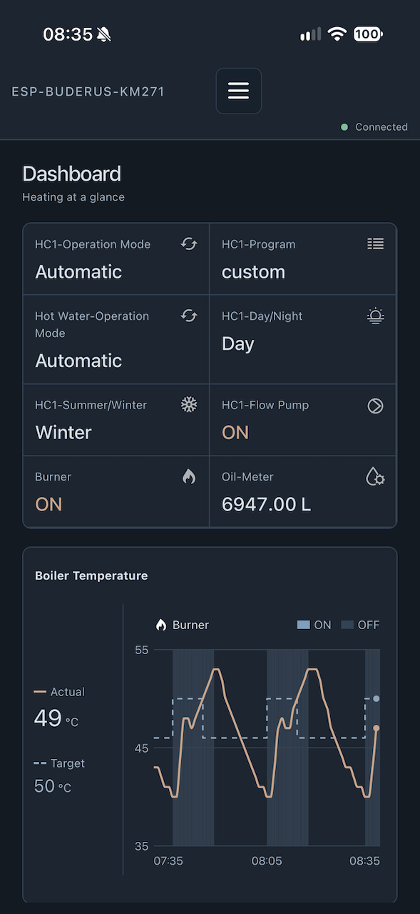
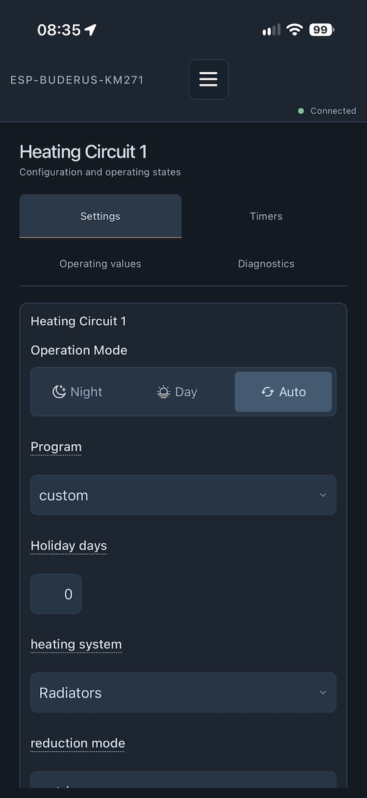
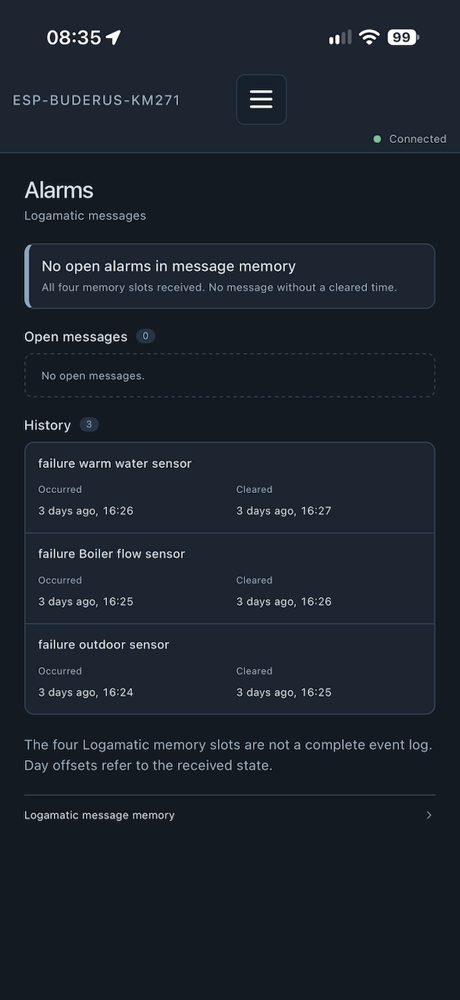
 
(Mobile Version)

For a first impression of the functions and the WebUI, a limited demo is also available.
This can be accessed via the following link: [WebUI-DEMO](https://dewenni.github.io/ESP_Buderus_KM271/)

-----

# Table of Contents

- [Overview](#overview)
  - [Optional oil consumption measurement](#optional-oil-consumption-measurement)
- [Hardware](#hardware)
- [Getting started](#getting-started)
  - [PlatformIO](#platformio)
  - [Prebuilt firmware](#prebuilt-firmware)
  - [Setup Mode](#setup-mode)
  - [Configuration](#configuration)
- [Using the WebUI](#using-the-webui)
  - [Dashboard](#dashboard)
  - [Equipment pages](#equipment-pages)
    - [Heating circuits](#heating-circuits)
      - [Weekly program](#weekly-program)
    - [Hot Water](#hot-water)
    - [Solar](#solar)
    - [Burner](#burner)
    - [General](#general)
  - [Alarms](#alarms)
  - [System](#system)
  - [Logger](#logger)
  - [Tools](#tools)
  - [Settings](#settings)
    - [Correct the oil meter reading](#correct-the-oil-meter-reading)
  - [Help](#help)
- [Updates, backup and diagnostics](#updates-backup-and-diagnostics)
  - [OTA updates](#ota-updates)
  - [Configuration backup and restore](#configuration-backup-and-restore)
  - [Access and passwords](#access-and-passwords)
  - [Telnet](#telnet)
  - [Crash diagnostics](#crash-diagnostics)
- [Integrations](#integrations)
  - [MQTT](#mqtt)
  - [Home Assistant](#home-assistant)
  - [Pushover](#pushover)
  - [Node-RED and Grafana](#node-red-and-grafana)
- [Troubleshooting and support](#troubleshooting-and-support)
  - [No connection to the Logamatic / no heating values](#no-connection-to-the-logamatic--no-heating-values)
  - [Network or MQTT connection is lost](#network-or-mqtt-connection-is-lost)
  - [Oil counter changes unexpectedly](#oil-counter-changes-unexpectedly)
  - [Use with ioBroker](#use-with-iobroker)
  - [OTA update fails](#ota-update-fails)

-----

# Overview

The project communicates with the Buderus Logamatic through the KM271 interface using the 3964R protocol. The original communication code is based on the work of **Michael Mayer**, extended to support common write commands as well as reading values.

The WebUI provides a dashboard with trends, controls, heating information, logs, system status, updates, grouped settings and offline help. Optional features include HC2, Solar, oil counters, OneWire sensors, MQTT/Home Assistant and Pushover. Available values depend on the connected heating system and enabled components.

Translations are maintained in [language.h](include/language.h) and [lang.js](web/js/lang.js). The WebUI and MQTT languages can be selected separately.

## Optional oil consumption measurement

A hardware pulse counter can measure oil consumption, for example using a Braun HZ-5R/HZ-5DR or a suitable reed-contact retrofit. Configure its GPIO, pulses per litre and debounce time. The counter is stored persistently; the displayed unit is litres.

Alternatively, the virtual oil meter estimates consumption from burner runtime, configured fuel throughput, density and offset. This is a calculated estimate rather than an independent measurement.

# Hardware

Choose the interface that matches your Logamatic. The [hardware guide](Doc/hardware.md) contains wiring, pin assignments and component details.

| Option | Summary | Details |
| --- | --- | --- |
| Integrated KM271-WiFi board | Older revisions use classic ESP32; v2.0 uses ESP32-S3 and requires matching firmware. | [KM271-WiFi](Doc/hardware.md#option-1---board-from-the78mole) |
| Original KM271 with ESP32 | Connect the original module through a suitable RS232/TTL converter. | [Original KM271](Doc/hardware.md#option-2---esp32-with-original-buderus-km271) |

| Extension | Adds | Details |
| --- | --- | --- |
| W5500 Ethernet | Wired network connection. | [W5500](Doc/hardware.md#optional-ethernet-module-w5500) |
| FM244 solar module | Solar data; simultaneous use with KM271 requires a suitable slot adapter. | [FM244](Doc/hardware.md#optional-fm244-solar-module) |
| Hardware oil meter | Pulse-based oil consumption measurement. | [Oil meter](Doc/hardware.md#optional-hardware-oil-meter) |
| DS18B20 sensors | Up to two OneWire temperature sensors. | [OneWire](Doc/hardware.md#optional-onewire-sensor) |
| Exhaust sensor | NTC100K readings, depending on the board. | [Exhaust sensor](Doc/hardware.md#optional-exhaust-sensor) |

-----

# Getting started

Install the firmware, configure the network and select the hardware preset before changing heating settings. MQTT and additional sensors are optional; the WebUI also works on its own.

## PlatformIO

Clone the repository and open it in Visual Studio Code with PlatformIO. Select the appropriate environment and USB upload port in `platformio.ini`, then build and upload. Python is required by the build scripts, which also generate and compress the WebUI files.

Build with `pio run -e esp32s3` (classic ESP32: `pio run -e esp32`). PSRAM is not required. Both builds use the existing `min_spiffs.csv` OTA partition layout; the extra flash capacity is initially unused.

## Prebuilt firmware

Prebuilt binaries are available under [Releases](https://github.com/dewenni/ESP_Buderus_KM271/releases).

- **Initial USB installation:** use `buderus_km271_esp32_flash_vx.x.x.bin` for ESP32 or `buderus_km271_esp32s3_flash_vx.x.x.bin` for board v2.0. This merged image includes bootloader, partition table and application and is flashed at address **0x00** with a compatible ESP flashing tool.
- **Update of an existing installation:** use `buderus_km271_ota_update_vx.x.x.bin` for ESP32 or `buderus_km271_esp32s3_update_vx.x.x.bin` for board v2.0 with the WebUI.

Use the image intended for your board. Export the configuration before updating an existing installation.

## Setup Mode

Without a valid initial WiFi configuration, the ESP enters Setup Mode and creates the access point **`ESP-Buderus-km271`**. Connect to it and open **http://192.168.4.1**.

The recovery login is always **`admin` / `km271-2026!`**, including when `config.json` is missing or damaged. These credentials apply to Setup Mode, independently of the normal WebUI credentials.

Setup Mode can also be requested using the multiple-reset sequence: the current build settings use **five detected starts in quick succession**, with less than **five seconds** between starts (`MRD_RETRIES` / `MRD_TIMEOUT` in `platformio.ini`).

Configure the network, then use the ESP's network address after restarting. The setup address is only for its access point.

## Configuration

Settings are grouped into five categories:

| Category | Contents |
| --- | --- |
| General | WebUI language, NTP server/time zone, setting the Logamatic date and time |
| Network | WiFi, SSID search, optional fixed BSSID, W5500 Ethernet, IP configuration |
| Integrations | MQTT, Home Assistant discovery, Pushover |
| Device | Logamatic components, oil meter, additional sensors, GPIO assignment and board presets |
| Access & maintenance | Optional WebUI authentication, service password, Telnet enable switch, crash diagnostics, simulation |

Changes are saved automatically. Restart when required by a hardware or network setting. Only enable the Logamatic components actually installed; the visible pages and dashboard elements depend on these settings.

WiFi search lists available SSIDs. AP search lists access points for the selected SSID and can copy a BSSID into the field. Leave the BSSID empty for automatic AP selection. A fixed BSSID prevents switching to another AP; changing the SSID clears the old selection. Hidden SSIDs can be entered manually.

When using a static IP, reserve it for the correct interface MAC address or keep it outside the DHCP range. WiFi and Ethernet have separate addresses; avoid duplicate IP assignments.

The MQTT language is configured independently of the WebUI language. Changing it can change topic names and textual payloads, so check existing automations first.

**Wi-Fi power saving** reduces power consumption and is enabled by default. Try disabling it if connections are unreliable; changes apply on the next Wi-Fi connection or after a restart.

For W5500 connections with a populated PCA9306, enable **Network → Ethernet → Enable level shifter** and configure GPIO EN for the board. This enables the reset signal path when Ethernet starts and takes effect after a restart. Leave it disabled without that level shifter; the Ethernet help explains the wiring.

# Using the WebUI

The WebUI works on desktop and mobile devices. The navigation moves to a dropdown on narrow screens. Optional components are shown only when enabled. The connection indicator in the header reports the **browser's WebSocket connection to the ESP**, not the connection to the Logamatic or MQTT broker.

## Dashboard

The overview shows operating modes, active heating programs, pumps, burner and optional oil meters/sensors. Active pump and burner states use the orange accent colour.

The temperature widgets display current values and trends:

| Trend | Series | Background overlay |
| --- | --- | --- |
| Boiler flow | Target / actual | Burner ON |
| Heating circuits 1 and 2 | Target / actual flow | Burner ON |
| Hot water | Target / actual | Hot-water priority reported by HC1 |
| Solar | Collector / hot water | — |
| Outdoor temperature | Current / damped | — |

The ESP keeps the last **60 minutes at one-minute intervals in a RAM ring buffer**, even without an open browser. Opening the page or reconnecting loads this history. It is lost when the ESP restarts and does not replace a long-term archive such as InfluxDB/Grafana. Current values can update more frequently than the history samples.

Hover over the chart to inspect values. Thin, faded bridges indicate missing data; they connect known points without representing additional measurements. The labels identify each series: the actual temperature is normally solid orange and the target dashed blue. The outdoor-temperature chart highlights the current temperature; the damped temperature is dashed.

## Equipment pages

The information pages separate configuration, current values and operating states. HC2 and Solar are shown when enabled. These pages help explain the controller's behaviour; controls are available on their respective equipment pages.

### Heating circuits

HC1 and HC2 have **Settings, Timer, Operating values and Diagnostics** tabs. Settings provides controls for operating mode, program, holiday days, temperatures, heating system and setback mode. Operating values shows reported temperatures, heating curves and other controller data; Diagnostics shows operating and fault states. Setting help appears on hover, keyboard focus or tapping the label.

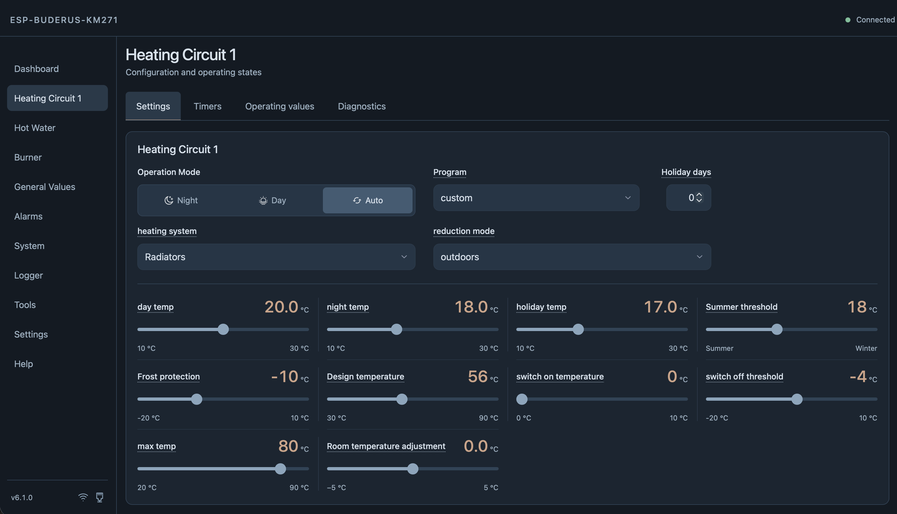

#### Weekly program

The weekly views for HC1 and HC2 show the **custom program**. Click a heating-period bar to edit or remove it; use **+** to add a period, including across multiple days. Times use 10-minute steps, and periods can cross midnight or end at 24:00.

Save sends the changes to the controller; Cancel discards the local edits. The active program can still be selected separately, and editing the timer does not change that selection.

Editing requires an active connection and a complete, current weekly program. Each circuit has 42 switching points for up to 21 complete heating periods; overlaps and stale edits are rejected. “Saved” is shown after transport acknowledgements for all associated telegrams, not an independent read-back. A failure may leave some changes applied. After a connection loss the result may be unknown: wait for current device data and inspect it before retrying.

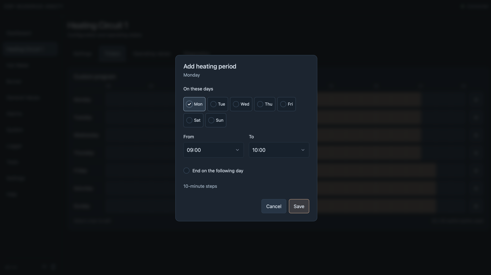

### Hot Water

Hot water has **Settings, Operating values and Diagnostics** tabs. Settings controls operating mode, hot water preparation, priority for HC2, target temperature and circulation. The other tabs show reported temperatures, pump states, operating states and faults.

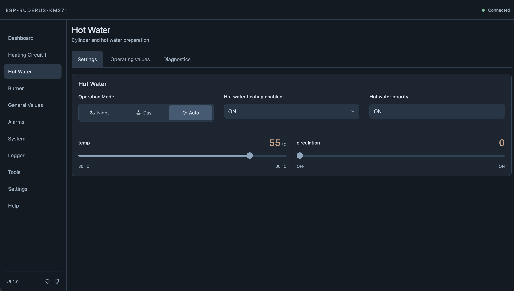

### Solar

The Solar page shows configuration, temperatures and operating states reported by the FM244 through the Logamatic. This requires an installed **FM244**, a suitable adapter solution for using it alongside the KM271 interface, and Solar enabled in the settings. See [Hardware: FM244 solar module](Doc/hardware.md#optional-fm244-solar-module).

Solar also uses **Settings, Operating values and Diagnostics**. Its displayed configuration is read-only; no solar write controls are provided.

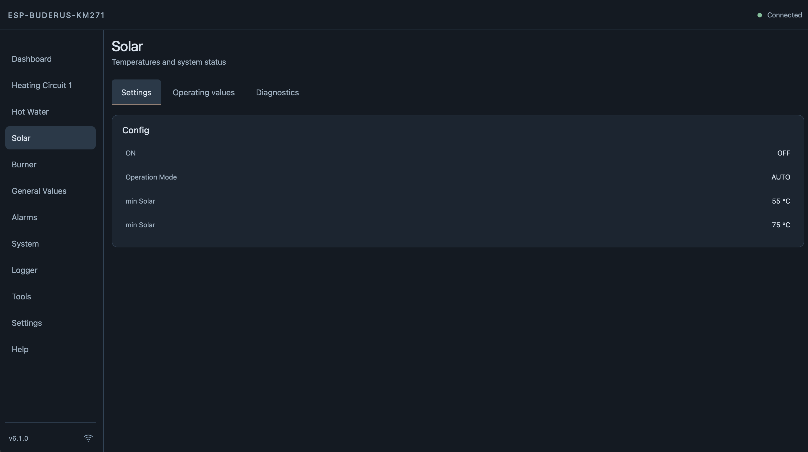

### Burner

The burner page shows boiler target and actual temperatures, switching temperatures, burner control, operating and fault states, and reported burner runtime. It is a display page; it does not write burner parameters.

### General

This page shows general Logamatic data such as building type, language, display setting, limits, and outdoor and exhaust temperatures. Clock correction is displayed in seconds per day (`s/d`). These received values are separate from the ESP settings under Settings → General.

## Alarms

When alarm messages are enabled, the page shows the Logamatic's four message-memory slots, divided into open messages without a cleared time and history entries with one. Occurred and cleared times show relative days (today, yesterday or n days ago) and the time of day when available. Active open messages highlight the alarm item in desktop and mobile navigation.

“No open alarms” is shown only after all four slots have been received. Incomplete data, disabled monitoring and connection loss are marked explicitly; after a connection loss, cached messages show only the last known state. This is a view of controller memory, not a complete event archive. Use the Logamatic's own display as a diagnostic source.

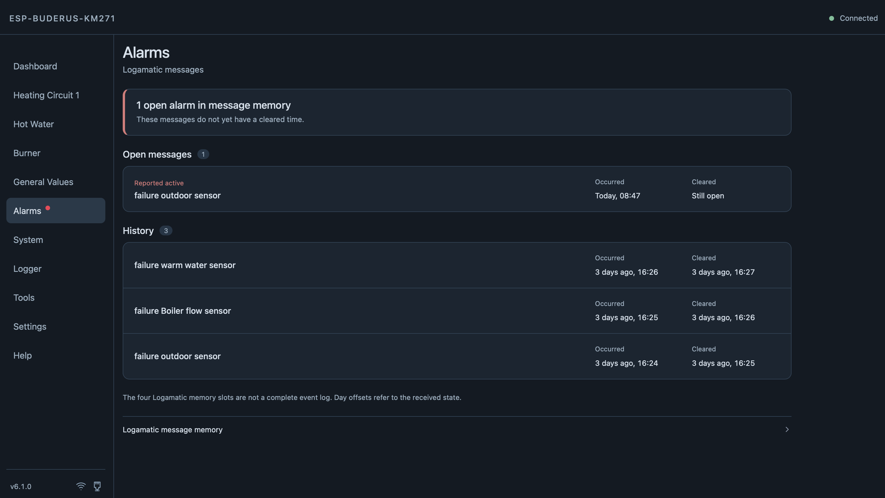

## System

Separate cards show WiFi, Ethernet, MQTT and KM271 connection information. A working network connection does not by itself prove communication with the heating controller. The last MQTT error is retained and may describe an earlier failure.

Device information includes firmware version, uptime and restart reason. Memory information distinguishes firmware-partition usage from free RAM, the largest free block and the lowest free RAM since startup.

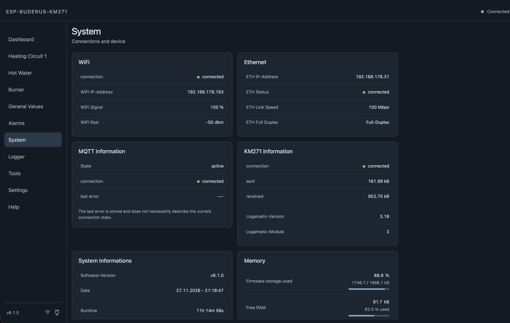

## Logger

Select **KM271** to inspect Logamatic communication and choose the relevant filter. The recording switch enables or disables logging. Use Refresh to retrieve the current log and Clear to remove its contents.

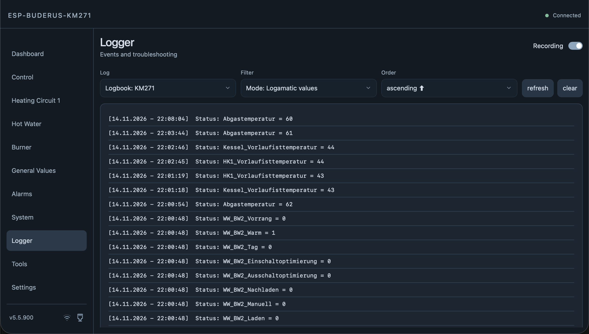

Select **SYSTEM** for startup, network, MQTT and other firmware messages. The level selects the displayed severity; Debug is useful for troubleshooting but produces more output. Both logs are bounded diagnostic buffers, not permanent archives.

Stored crash reports are covered separately under [Crash diagnostics](#crash-diagnostics).

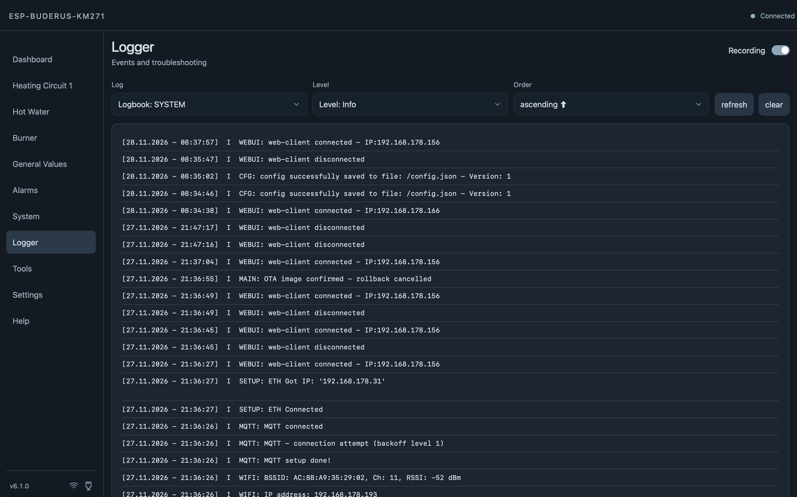

## Tools

The Tools page provides [firmware updates](#ota-updates) and [configuration backup and restore](#configuration-backup-and-restore). Install a local file, check a GitHub release, or create, restore and export the device backup there.

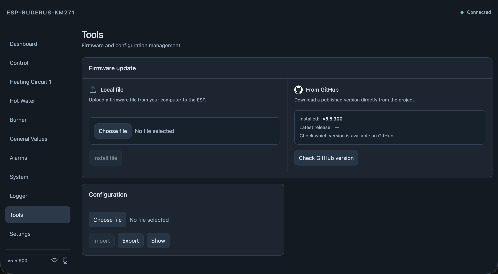

## Settings

Use the five categories described under [Configuration](#configuration). Within a category, opening another settings section closes the previous one. Home Assistant has its own section under Integrations and requires an enabled, working MQTT connection.

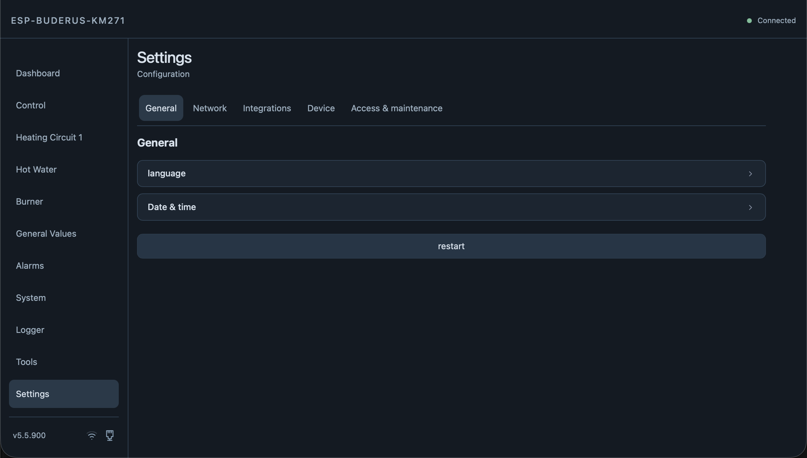

### Correct the oil meter reading

Under **Settings → Device → Oil meter**, enter the reading and select **Set**. The current implementation expects an integer in **hundredths of a litre**, as MQTT does: `12345` sets 123.45 L. The actual value beside it is instead displayed in litres and updates only after the ESP responds. Note the different units for input and display. This replaces the stored hardware counter; it is not an additional consumption measurement. See also the [MQTT reference](Doc/MQTT.md).

## Help

The offline Help page is available in German and English using the selected WebUI language. Shortcuts lead to operation, setup and troubleshooting. Expandable sections cover trends, board presets, RS232 wiring, MQTT/Home Assistant and service access. Only one section opens at a time. External links lead to the full project documentation and require internet access.

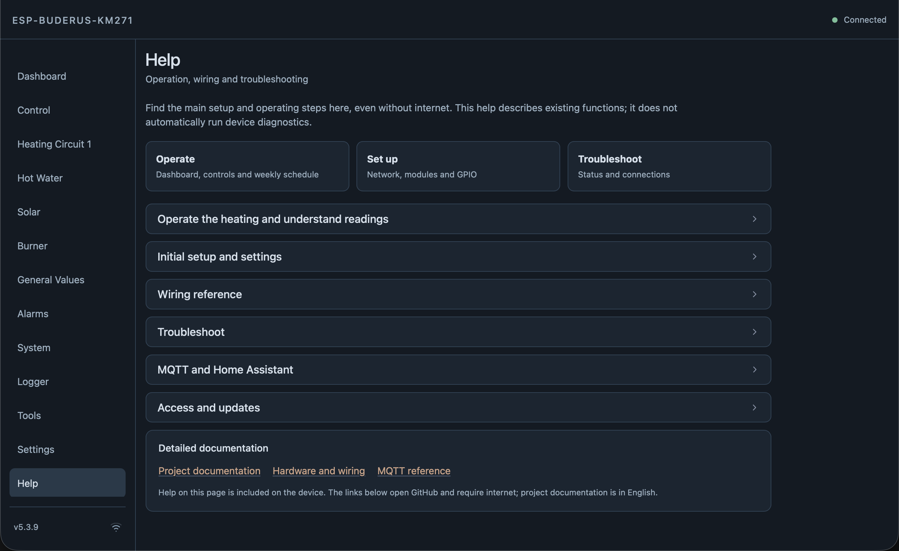

# Updates, backup and diagnostics

## OTA updates

The **Tools → Firmware update** card separates two update methods:

- **Local file:** select the OTA `.bin` file from your computer, then select **Install file**. Selecting a file does not start the update.
- **From GitHub:** select **Check GitHub version**, review the installed and available versions, then explicitly start the installation. The ESP downloads the release itself; internet access is required.

The version number in the navigation leads to the update area on the Tools page. Progress and the result are shown there. Wait for completion and the subsequent restart.

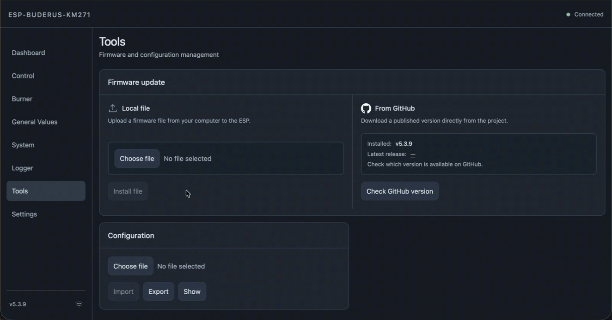

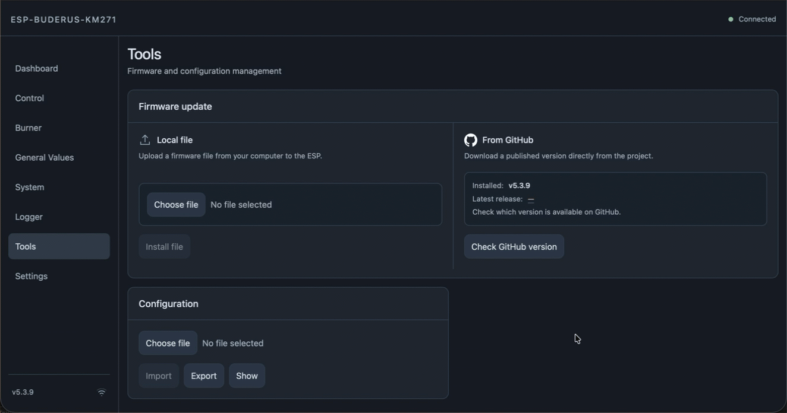

Remote ArduinoOTA is also available through PlatformIO. Configure the device address and OTA authentication in `platformio.ini`; this uses the **service password**, not the optional WebUI login.

The release workflow builds both variants sequentially. S3 assets are named `buderus_km271_esp32s3_flash_<Version>.bin`, `buderus_km271_esp32s3_update_<Version>.bin` and `buderus_km271_esp32s3_debug_<Version>.zip`. Existing ESP32 asset names are preserved. S3 update filenames deliberately omit `ota` so older ESP32 firmware cannot pick them with its substring search. GitHub OTA matches the complete filename for the chip and release tag; no update is offered without a matching asset. For manual uploads, also choose the OTA image for your chip. Selecting a GPIO preset does not change the firmware target chip.

## Configuration backup and restore

Under **Tools → Configuration**, view, export or import `config.json`. The selected import file may have any name; it is always stored as `config.json`. Valid JSON with the project's section is checked before replacement. The device restarts automatically after a successful import or restore.

**Backup on device** copies the already saved configuration to `config_backup.json`. Restoring replaces the current configuration and keeps the backup. Both files show their last save time, or “Time unknown” if no valid device time was available. Write or space errors preserve the previous destination file.

Use **Export backup** to download the saved snapshot as `config_backup.json` without restoring it first.

The local backup uses the same flash and does not replace exporting a copy to a computer. It contains credentials and covers configuration only, not separately stored counters or history. Treat exported files as private and do not publish them unredacted.

## Access and passwords

| Access | Authentication |
| --- | --- |
| Normal WebUI, including web firmware/configuration tools | Optional username and password under WebUI authentication; can be disabled |
| Setup Mode WebUI | Fixed recovery login: `admin` / `km271-2026!`, independent of the configuration |
| Telnet | Must be enabled explicitly; uses the service password |
| Remote ArduinoOTA | Uses the service password |
| Crash diagnostics: details, download and deletion | Additional service password; normal WebUI login still applies when enabled |

In normal operation, Telnet and remote ArduinoOTA require a non-empty service password. In Setup Mode, the recovery password is used for service access. The service password is separate from the normal WebUI password; the web updater has no additional password of its own.

## Telnet

Enable Telnet under **Access & maintenance → Service access** and set a service password. Connect to the ESP address, for example `telnet 192.168.178.31`, and authenticate with that password. Enter `help` for the available commands. Telnet is separate from the optional WebUI login and is not an encrypted connection.

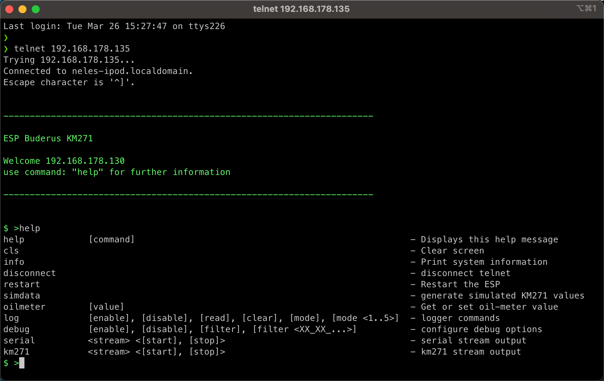

## Crash diagnostics

Under **Settings → Access & maintenance → Crash diagnostics**, use the service password to inspect, download or explicitly delete saved core dumps. Downloads preserve the report on the ESP. Each build also archives the matching firmware ELF in a debug ZIP. See [crash diagnostics](Doc/Absturzdiagnose.md) for analysis instructions and limitations (German).

Core dumps require a compatible flash partition; an application-only OTA update does not replace the partition table. They may contain sensitive memory contents. Retain the debug archive matching the affected build for analysis. A stored report can originate from an earlier crash and does not establish that its cause has been fixed.

See also [Logger](#logger), [System](#system) and [Troubleshooting and support](#troubleshooting-and-support).

# Integrations

## MQTT

Enable MQTT under **Settings → Integrations → MQTT** and configure the broker, credentials and base topic. MQTT language is independent of WebUI language and affects topic names and text payloads. Check the connection under **System → MQTT**.

With English MQTT language and base topic `esp_heizung`, send `21.5` to `esp_heizung/setvalue/hc1_day_temp` to set the day temperature. The reported configuration value is published on `esp_heizung/config/hc1_day_temp`. Send commands without retain.

The **[complete MQTT reference](Doc/MQTT.md)** covers all configuration and status topics, alarms, write commands, payloads and examples.

## Home Assistant

First enable MQTT and verify the broker connection. Under **Integrations → Home Assistant**, enable discovery and configure the discovery topic and device name. Home Assistant needs its MQTT integration connected to the same broker. The Logamatic appears as a device with measurements and supported controls.

HC1/HC2 maximum temperature and room temperature adjustment are exposed as
sliders; heating systems, hot-water processing and hot-water priority use
select entities. HC2 underfloor heating limits the maximum temperature to 60 °C.
The eight previous sensor discovery entries are removed automatically. Changing
from `sensor` to `number`/`select` changes entity IDs; update affected dashboards
and automations.

Topic and payload language follow the MQTT setting. Check existing entities and automations after changing it.

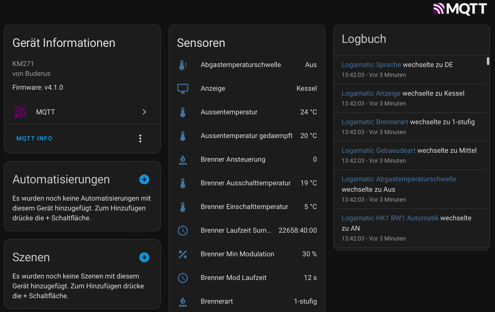

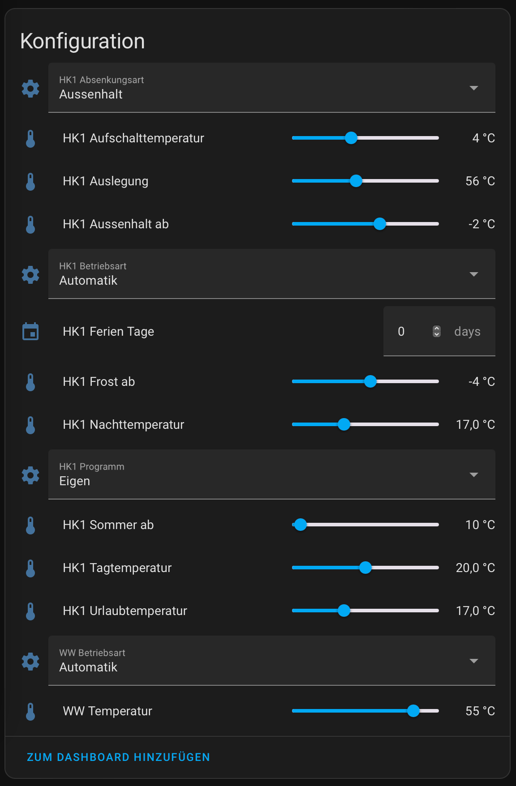

## Pushover

Configure API token, user key and message filter under **Integrations → Pushover**. Use the test message to check delivery. A Pushover account and internet access are required. Create the application's API token on the [Pushover website](https://pushover.net/apps/build).

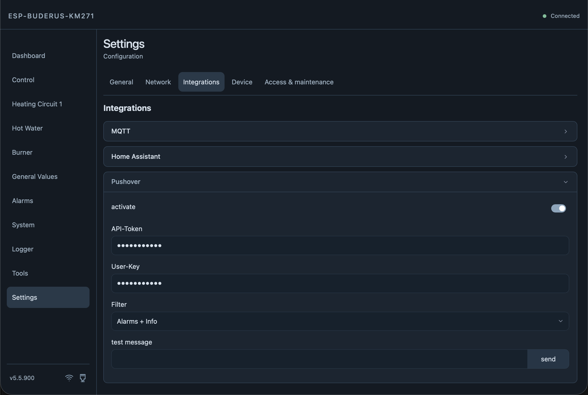

## Node-RED and Grafana

### node-red

For long-term recording, I use [Node-RED](https://nodered.org/) to receive MQTT messages and write them to [InfluxDB](https://www.influxdata.com/). This runs in Docker on my Synology NAS, but other MQTT-compatible recording systems can be used as well.

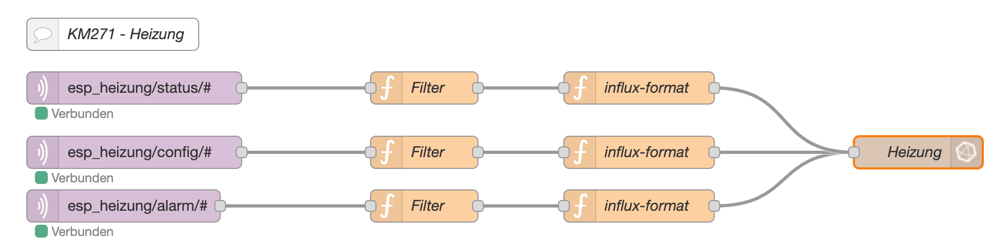

If you are interested in my flows, you can use this export file:
[node-red.json](/Doc/node-red.json)

### grafana

[Grafana](https://grafana.com) visualizes the recorded InfluxDB data and allows analysis over longer periods than the WebUI's short-term trends. These screenshots show examples of my heating dashboard:

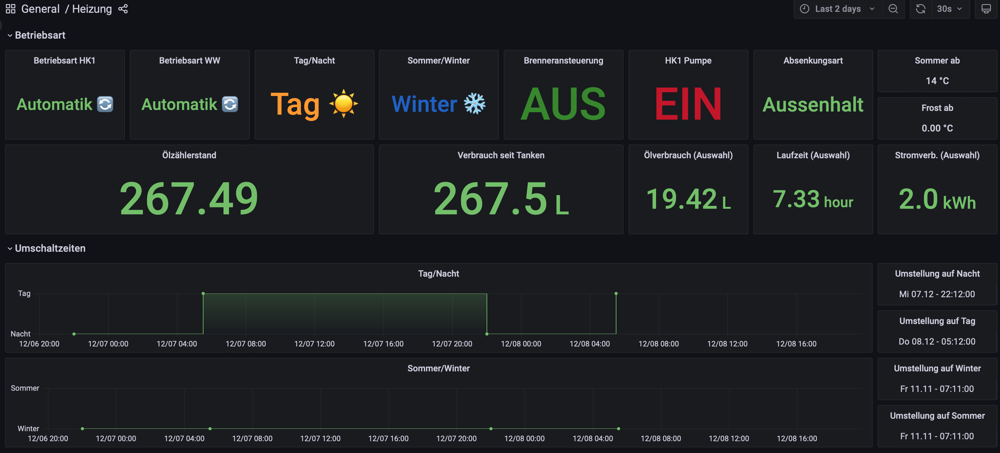
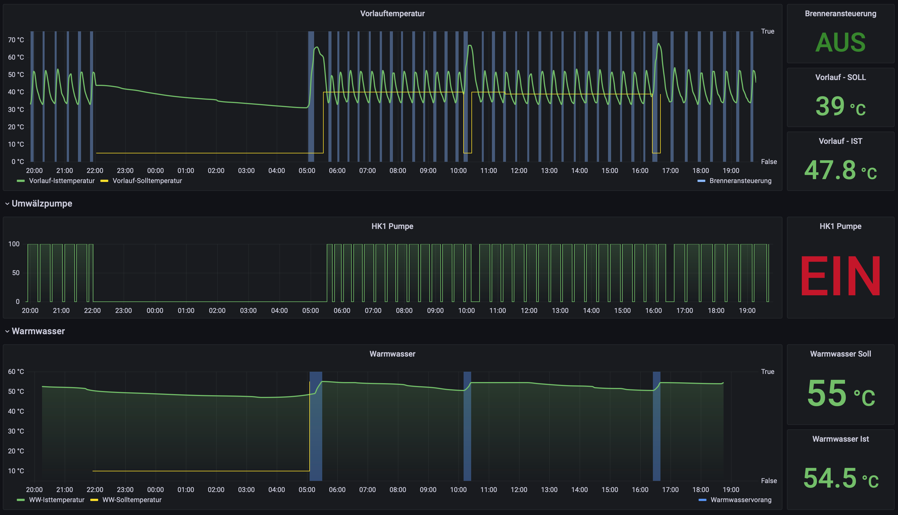
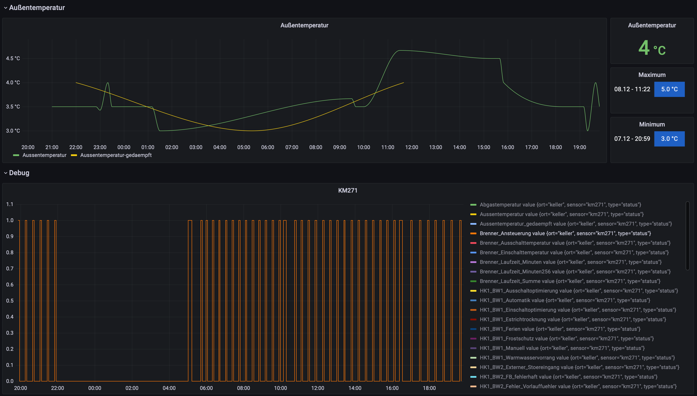

The example dashboard is available as an export:
[grafana.json](/Doc/grafana.json)

> [!NOTE]
> The example uses InfluxDB 2.0, Flux queries and German MQTT topics. Adapt the data source, topic names and queries to your own installation after importing it.

# Troubleshooting and support

## No connection to the Logamatic / no heating values

1. **Identify the hardware.** A KM271-WiFi board plugs into the controller directly. An original KM271 with an RS232 connector requires a suitable RS232/TTL converter. Never connect RS232 voltage levels directly to ESP GPIOs.
2. **Check GPIOs under Settings → Device.** See the [GPIO preset table](Doc/hardware.md#gpio-presets); presets are not automatic detection. Wiring must match the configured pins; avoid duplicate assignments and restart after GPIO changes.
3. **Check signal direction and cable continuity.** ESP TX must feed the converter's TTL input; its TTL output must feed ESP RX, with common ground. Converter labels vary. Verify the RS232 pinout and whether your converter requires straight or crossed wiring. A null-modem cable is not universally correct. See [discussion #174](https://github.com/dewenni/ESP_Buderus_KM271/discussions/174).
4. **Check System → KM271 and Logger → KM271.** A working WebUI/MQTT connection, received bytes or a successful loopback test alone do not prove valid Logamatic communication. Look for protocol setup followed by current heating values. After two minutes without serial reception, the firmware treats the link as down and retries setup.
5. **Check supply and connectors.** Follow the board's documentation, including any required identification resistor. Perform electrical checks with the equipment powered off.

The WebUI Help page contains an offline wiring and troubleshooting checklist. Simulation values are test data and do not establish that the physical heating connection works. For support, include controller/board model, firmware version, RX/TX GPIOs and a short relevant log excerpt, without credentials.

## Network or MQTT connection is lost

Check the System cards and SYSTEM log first. WiFi and Ethernet have separate IP addresses; a duplicate static IP can cause HTTP, WebSocket and OTA failures even while the Ethernet link remains up. Reserve addresses for the correct MACs.

The firmware retries network/MQTT connections automatically. MQTT uses reconnect backoff and transport recovery rather than restarting the ESP after five failed attempts. If WiFi remains unavailable and Ethernet is also unavailable, network recovery can eventually restart the ESP. The System page shows the last restart reason.

## Oil counter changes unexpectedly

Check **pulses per litre**, debounce time and GPIO wiring first. With 50 pulses/litre, one accepted cycle represents 0.02 L. The hardware input is active LOW; a cycle is counted after stable activation followed by stable release. The debounce setting must suit the actual output signal.

A counter correction received via `setvalue/oilcounter` is a separate action and is logged. Inspect MQTT for retained commands and automations that write to this topic. The status topic is `oilcounter`; writing a status value there does not clear a retained command on `setvalue/oilcounter`.

## Use with ioBroker

Use the read topics for status and the documented `setvalue` topics for changes. Disable **Publish states on subscribe** and **Publish own states when connecting** for command topics to avoid replaying commands when connecting.

## OTA update fails

Check that you selected the OTA image for the correct device and exported the configuration. Read the SYSTEM log for the exact error. Verify stable power and network connectivity; if WiFi and Ethernet are both configured, compare them and check for duplicate IPs. Do not interrupt power during installation. If the device cannot be recovered over the network, use the USB flash image.

# ❗️ use at own risk ❗️

**Feel free to use this project and adapt it to your needs.**

**Contributions and suggestions are welcome.**

❓ If you have a question, use the [Discussions](https://github.com/dewenni/ESP_Buderus_KM271/discussions)
🐞 If there is an issue or bug, use the [Issues](https://github.com/dewenni/ESP_Buderus_KM271/issues)
