<div align="center">


<h3 style="text-align: center;">ESP-Buderus-KM271</h3>
</div>

-----

**[🇬🇧  english version of this description](README.md)**

-----

<div align="center">

[](https://github.com/dewenni/ESP_Buderus_KM271/releases/latest)


[](https://github.com/dewenni/ESP_Buderus_KM271/stargazers/)

</div>

-----

<div align="center">
Wenn dir dieses Projekt gefällt, drücke gerne auf den <b>[Stern ⭐️]</b> Button und drücke <b>[Watch 👁]</b> um auf dem Laufenden zu bleiben.
<br><br>
Und wenn du meine Arbeit unterstützen möchtest, kannst auch folgendes nutzen <p>

[](https://github.com/sponsors/dewenni)

</div>

-----

Steuere deine Buderus Logamatic R2107 / HS 2105 mit ESP32 und MQTT

Die Informationen aus der Heizung ermöglichen ein besseres Verständnis der Funktionsweise der Heizung und bieten Möglichkeiten zur Optimierung.

Das Dashboard enthält kurzfristige Temperaturtrends. Über MQTT ist zusätzlich eine Langzeitaufzeichnung mit externen Systemen wie InfluxDB und Grafana möglich.

Die integrierte WebUI ermöglicht Anzeige und Bedienung ohne zusätzliche Hausautomationssoftware und unterstützt Deutsch und Englisch.


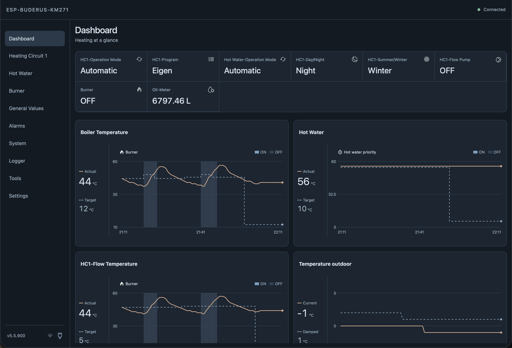
(Desktop Version)

Die WebUI ist responsiv und bietet auch ein mobiles Layout.

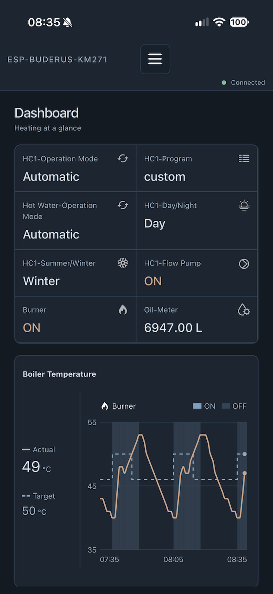
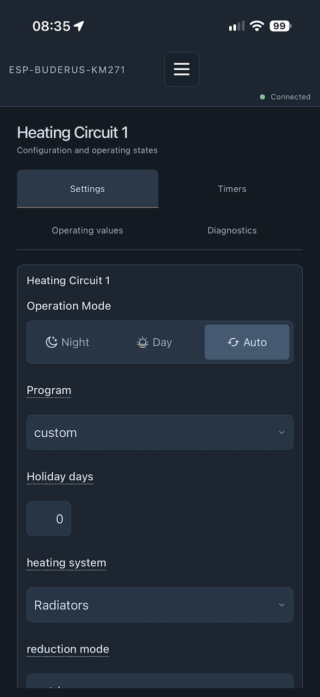
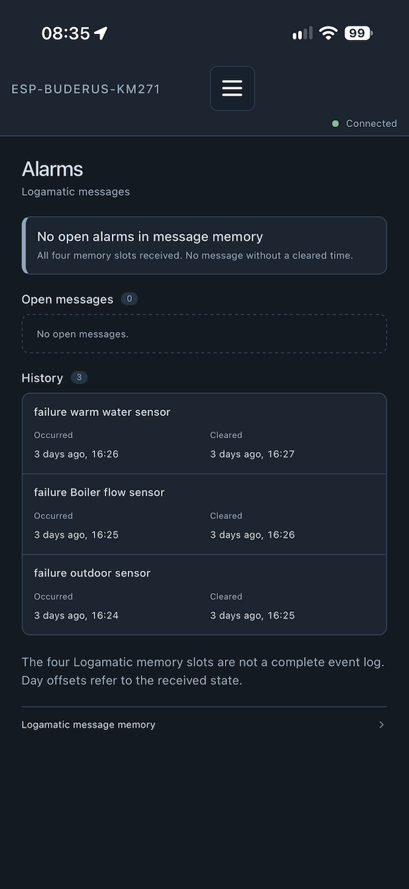
(Mobile Version)

Um sich einen ersten Eindruck von den Funktionen und der WebUI zu verschaffen, steht auch eine eingeschränkte Demo zur Verfügung.
Diese kann über den folgenden Link aufgerufen werden: [WebUI-DEMO](https://dewenni.github.io/ESP_Buderus_KM271/)

-----

# Inhaltsverzeichnis

- [Überblick](#überblick)
  - [Optionale Ölverbrauchserfassung](#optionale-ölverbrauchserfassung)
- [Hardware](#hardware)
  - [Option 1 - Board von the78mole](#option-1---board-von-the78mole)
  - [Option 2 - ESP32 mit original Buderus KM271](#option-2---esp32-mit-original-buderus-km271)
  - [Optional: Ethernet Modul W5500](#optional-ethernet-modul-w5500)
  - [Optional: Solarmodul FM244](#optional-solarmodul-fm244)
  - [Optional: Hardware Ölzähler](#optional-hardware-ölzähler)
  - [Optional: OneWire Sensor](#optional-onewire-sensor)
  - [Optional: Abgas Sensor](#optional-abgas-sensor)
- [Erste Schritte](#erste-schritte)
  - [PlatformIO](#platformio)
  - [Fertige Firmware](#fertige-firmware)
  - [OTA-Updates](#ota-updates)
  - [Setup Mode](#setup-mode)
  - [Konfiguration](#konfiguration)
  - [Zugänge und Passwörter](#zugänge-und-passwörter)
  - [Konfiguration sichern und wiederherstellen](#konfiguration-sichern-und-wiederherstellen)
- [WebUI](#webui)
  - [Dashboard](#dashboard)
  - [Bedienung](#bedienung)
  - [Heizkreise, Warmwasser, Solar und Brenner](#heizkreise-warmwasser-solar-und-brenner)
  - [Logbuch](#logbuch)
  - [System](#system)
  - [Alarme](#alarme)
  - [Tools](#tools)
  - [Einstellungen](#einstellungen)
  - [Hilfe](#hilfe)
- [MQTT](#mqtt)
  - [Empfangene Werte](#empfangene-werte)
  - [Kommandos](#kommandos)
  - [Home Assistant](#home-assistant)
- [Optionale Kommunikation](#optionale-kommunikation)
  - [Pushover](#pushover)
  - [Telnet](#telnet)
- [Optionale Komponenten](#optionale-komponenten)
  - [node-red](#node-red)
  - [grafana](#grafana)
- [FAQ](#faq)
  - [Keine Verbindung zur Logamatic / keine Heizungswerte](#keine-verbindung-zur-logamatic--keine-heizungswerte)
  - [Netzwerk- oder MQTT-Verbindung bricht ab](#netzwerk--oder-mqtt-verbindung-bricht-ab)
  - [Ölzähler verändert sich unerwartet](#ölzähler-verändert-sich-unerwartet)
  - [Verwendung mit ioBroker](#verwendung-mit-iobroker)
  - [OTA-Update schlägt fehl](#ota-update-schlägt-fehl)

-----

# Überblick

Das Projekt kommuniziert über die KM271-Schnittstelle und das 3964R-Protokoll mit der Buderus Logamatic. Der ursprüngliche Kommunikationscode basiert auf der Arbeit von **Michael Mayer** und wurde neben dem Lesen von Werten um gängige Schreibbefehle erweitert.

Die WebUI bietet Dashboard mit Trends, Bedienung, Heizungsinformationen, Logbücher, Systemstatus, Updates, gruppierte Einstellungen und Offline-Hilfe. Optional sind HK2, Solar, Ölzähler, OneWire-Sensoren, MQTT/Home Assistant und Pushover verfügbar. Welche Werte vorliegen, hängt von der angeschlossenen Heizung und den aktivierten Komponenten ab.

Die Übersetzungen stehen in [language.h](include/language.h) und [lang.js](web/js/lang.js). WebUI- und MQTT-Sprache können getrennt gewählt werden.

## Optionale Ölverbrauchserfassung

Ein Hardware-Impulszähler kann den Ölverbrauch messen, beispielsweise ein Braun HZ-5R/HZ-5DR oder ein geeigneter nachgerüsteter Reedkontakt. Konfiguriert werden GPIO, Impulse pro Liter und Entprellzeit. Der Zählerstand wird dauerhaft gespeichert und in Litern angezeigt.

Alternativ schätzt der virtuelle Ölzähler den Verbrauch anhand der Brennerlaufzeit, des eingestellten Öldurchsatzes, der Dichte und eines Offsets. Das ist eine Berechnung und keine unabhängige Messung.

# Hardware

## Option 1 - Board von the78mole

Eine Möglichkeit ist das integrierte KM271-WiFi-Interface von Daniel Glaser. Vielen Dank für seine Arbeit an dieser Hardware!
Weitere Informationen findest du hier: <https://github.com/the78mole/km271-wifi>
Bestellen kann man es hier: <https://www.tindie.com/products/24664/>

In diesem Fall brauchst du nur dieses DIY-Interface und nichts weiter.
Es beinhaltet den RS232/TTL Adapter und auch einen ESP32.

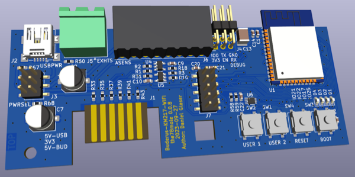


## Option 2 - ESP32 mit original Buderus KM271

Das originale KM271-Modul besitzt eine RS232-Schnittstelle. Ein geeigneter RS232/TTL-Wandler (MAX3232) verbindet sie mit dem ESP.

Die Pfeile zeigen die Signalrichtung. Wandler-Beschriftungen und RS232-Pinbelegungen sind modulabhängig; passende TX-/RX-Namen allein garantieren keine richtige Verbindung. Ob ein gerades oder ein Nullmodemkabel erforderlich ist, muss anhand der tatsächlichen Pinbelegung geprüft werden.

```text
(ESP32) TX-Ausgang -> TTL-Eingang des Wandlers -> RS232-Ausgang -> KM271-Empfang
(ESP32) RX-Eingang <- TTL-Ausgang des Wandlers <- RS232-Eingang <- KM271-Senden
(ESP32) GND <-> Wandler-GND <-> RS232-Signalmasse
```

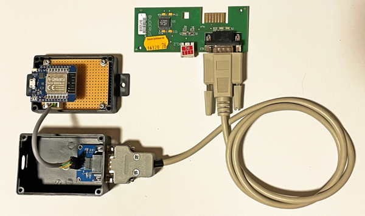

## Optional: Ethernet Modul W5500

### Option 1 - einzelnes W5500 Modul

Es ist auch möglich, ein W5500 Ethernet Modul an das Board oder einen generischen ESP32 anzuschließen. Bei den KM271-Boards von Daniel kann das W5500 an dem J7-Anschluss des Boards angeschlossen werden.

> [!IMPORTANT]
> Das Anschlusskabel sollte so kurz wie möglich sein (ca. 10 cm).

Board >= 0.0.6

| Signal | GPIO          | Pin (J7) |
|--------|---------------|----------|
| VCC    |               | J7.2     |
| GND    |               | J7.10    |
| CLK    |  18           | J7.9     |
| MOSI   |  23           | J7.7     |
| MISO   |  19           | J7.5     |
| CS     |  15           | J7.3     |
| INT    |  14           | J7.8     |
| RST    |  13           | J7.6     |


Beispiel für einen generischen ESP32-Mini (bei Überschneidung mit seriellen RX-/TX-GPIOs oder anderen Komponenten andere freie Pins wählen)

| Signal| GPIO |
|-------|------|
| CLK   | 18   |
| MOSI  | 23   |
| MISO  | 19   |
| CS    | 5    |
| INT   | 16   |
| RST   | 17   |

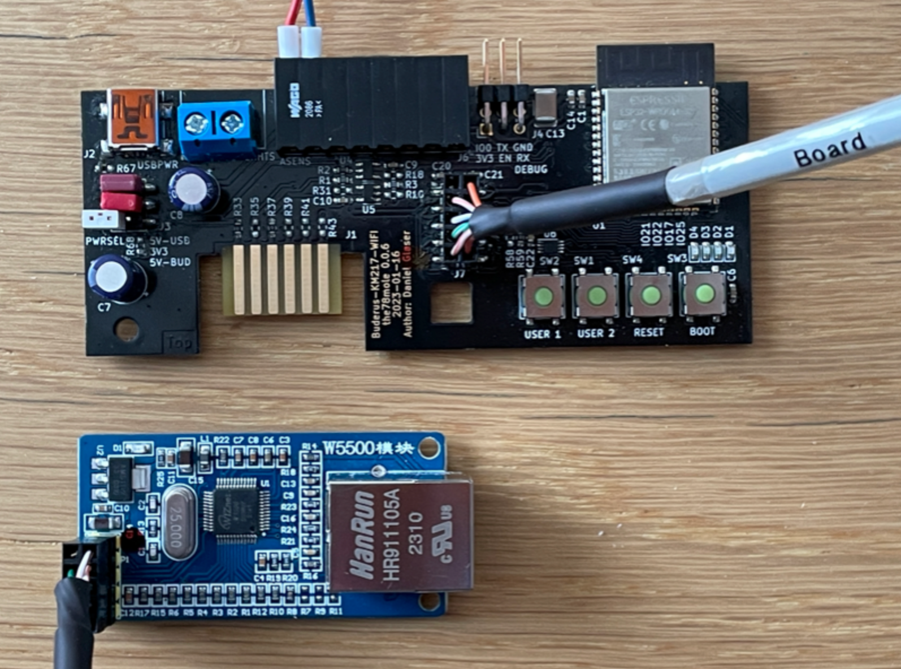

### Option 2 - Board von the78mole

Eine passende Ethernet-Erweiterung für das KM271-WiFi-Board ist hier dokumentiert:

https://www.tindie.com/products/the78mole/km271-wifi-ethernet-extension

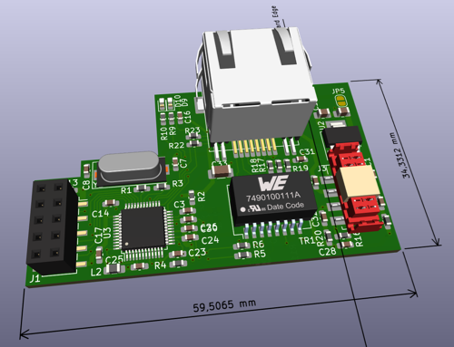

## Optional: Solarmodul FM244

Für die Solarwerte ist das **Buderus-Solarmodul FM244** erforderlich. Es belegt normalerweise denselben Steckplatz wie das KM271 beziehungsweise das KM271-WiFi-Interface. Für den gleichzeitigen Betrieb ist deshalb eine geeignete Adapter-/Erweiterungslösung erforderlich; die beiden Module können nicht einfach denselben Steckplatz belegen.

Die Solarwerte stammen vom FM244 über die Logamatic. Das Aktivieren von Solar in der WebUI allein stellt diese Werte nicht bereit. Hinweise zum gemeinsamen Betrieb und zur Solar-Unterstützung stehen in [Issue #64](https://github.com/dewenni/ESP_Buderus_KM271/issues/64).

## Optional: Hardware Ölzähler

Die Software ist auch für den Anschluss eines Ölzählers vorbereitet. Ein bekannter Hersteller von Ölzählern ist Braun mit den Modellen HZ-5 oder HZ6.
Diese sind bereits mit einem potentialfreien Kontakt erhältlich.
Ich habe einen ohne potentialfreien Kontakt verwendet und nachträglich einen Reedkontakt angebracht. Das war auch sehr einfach und funktioniert sehr zuverlässig.

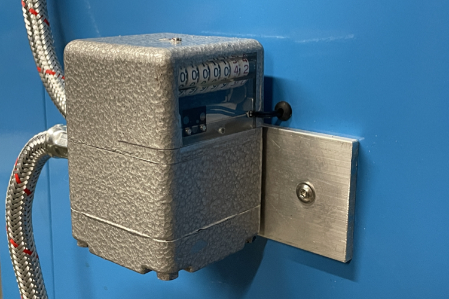

> [!NOTE]
> Dies ist jedoch nur optional und kann zusätzlich zu den Informationen, die die Software aus der Logamatic liest, verwendet werden.


Impulse pro Liter und Entprellzeit werden unter Gerät → Ölzähler eingestellt. Der Eingang benötigt ein geeignetes externes Signal beziehungsweise einen Pull-up. Reine Eingangs-GPIOs wie GPIO35 besitzen keinen internen Pull-up. Die GPIO-Pegel müssen bei maximal 3,3 V bleiben.

## Optional: OneWire Sensor

Es können auch zusätzliche OneWire-Sensoren (z. B. DS18B20) konfiguriert werden. In der Konfiguration kann man einen oder zwei Sensoren einrichten.
Der Sensorwert wird auf dem Dashboard angezeigt und wird auch von mqtt mit dem Topic `sensor` und dem Namen, den man konfigurieren kann, gesendet.
Abhängig von der verwendeten Hardware muss eventuell ein zusätzlicher Widerstand installiert werden. Klassischerweise werden die OneWire-Sensoren mit einem Widerstand von 4,7kOhm zwischen VCC und dem Sensorkabel angeschlossen und mit 3,3 V betrieben.
In der Konfiguration wird nur der GPIO angegeben, an dem das Sensorkabel angeschlossen ist. Der Rest ist eine hardwareabhängige Verdrahtung.


> [!NOTE]
> Der Sensor muss beim Start des ESP angeschlossen sein, sonst wird er nicht gefunden. Änderungen an der Verkabelung oder den GPIO-Einstellungen erfordern einen Neustart.


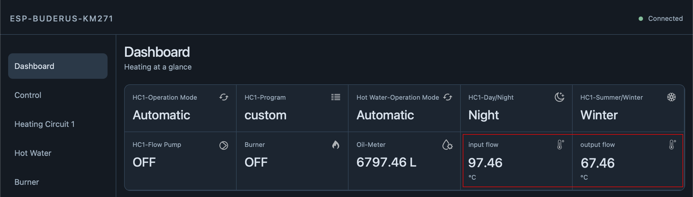

(Dashboard Elemente)

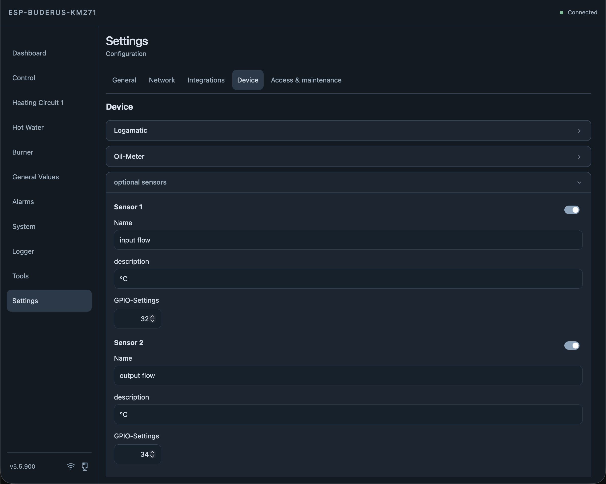

(Einstellungen)

> [!NOTE]
> Dies ist jedoch nur optional und kann zusätzlich zu den Informationen, die die Software aus der Logamatic liest, verwendet werden.

## Optional: Abgas Sensor

Es ist auch möglich, einen optionalen Abgassensor (NTC 100K) an den Anschluss J5 der Platine anzuschließen. In einigen Fällen müssen einige fehlende Komponenten auf der Platine ergänzt werden.


| Komponente | Wert        |
|-----------|--------------|
| D5        | BZX84C5V1    |
| R17       | 3.3K         |
| R11       | 100K         |
| C11       | 100nF        |
| C12       | 33nF         |
| R35       | 0            |
| R39       | 0            |

Es besteht keine Notwendigkeit, den Sensor in der Software zu konfigurieren. Die Logamatic selbst erkennt den Sensor automatisch und sendet den Wert wie die anderen Werte.

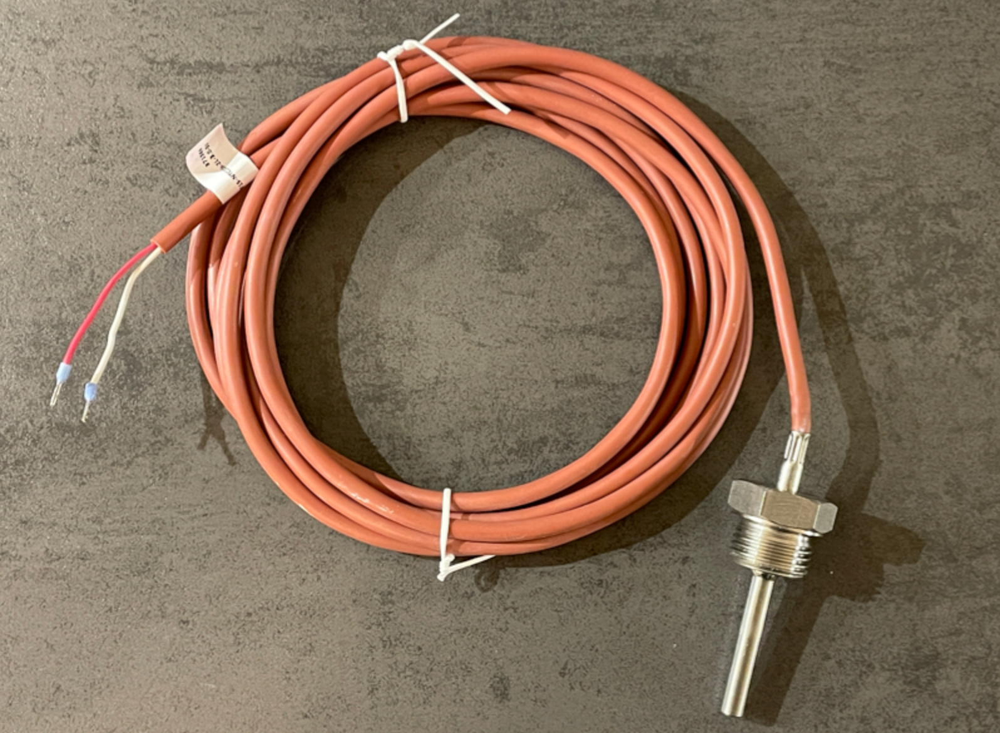

-----

# Erste Schritte

Installiere die Firmware, richte das Netzwerk ein und wähle das passende Hardware-Preset, bevor du Heizungsparameter veränderst. MQTT und zusätzliche Sensoren sind optional; die WebUI funktioniert auch eigenständig.

## PlatformIO

Klone das Repository und öffne es in Visual Studio Code mit PlatformIO. Wähle in `platformio.ini` die passende Umgebung und den USB-Upload-Port, baue das Projekt und lade es auf den ESP. Die Build-Skripte benötigen Python und erzeugen sowie komprimieren auch die WebUI-Dateien.

## Fertige Firmware

Fertige Binaries stehen unter [Releases](https://github.com/dewenni/ESP_Buderus_KM271/releases) bereit.

- **Erstinstallation per USB:** `buderus_km271_esp32_flash_vx.x.x.bin` verwenden. Dieses zusammengeführte Image enthält Bootloader, Partitionstabelle und Anwendung und wird mit einem geeigneten ESP-Flashtool an Adresse **0x00** geschrieben.
- **Update einer bestehenden Installation:** `buderus_km271_ota_update_vx.x.x.bin` über die WebUI installieren.

Verwende das für dein Board vorgesehene Image. Exportiere vor einem Update die vorhandene Konfiguration.

## OTA-Updates

Die Karte **Tools → Firmware-Update** trennt zwei Wege:

- **Lokale Datei:** OTA-Datei mit Endung `.bin` auf dem Computer auswählen und anschließend **Datei installieren** anklicken. Die Dateiauswahl allein startet kein Update.
- **Von GitHub:** **GitHub-Version prüfen** anklicken, installierte und verfügbare Version vergleichen und die Installation ausdrücklich starten. Der ESP lädt das Release selbst herunter; dafür benötigt er Internetzugang.

Die Versionsnummer in der Navigation führt zum Update-Bereich auf der Tools-Seite. Fortschritt und Ergebnis erscheinen dort. Warte den Abschluss und den anschließenden Neustart ab.

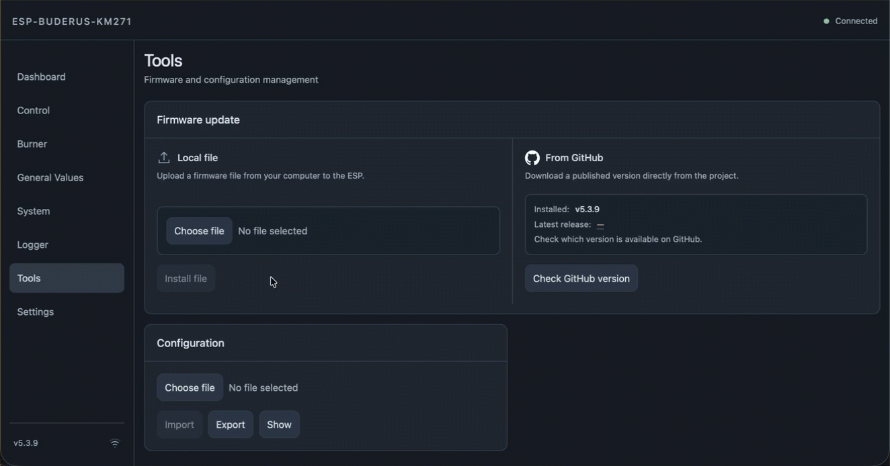

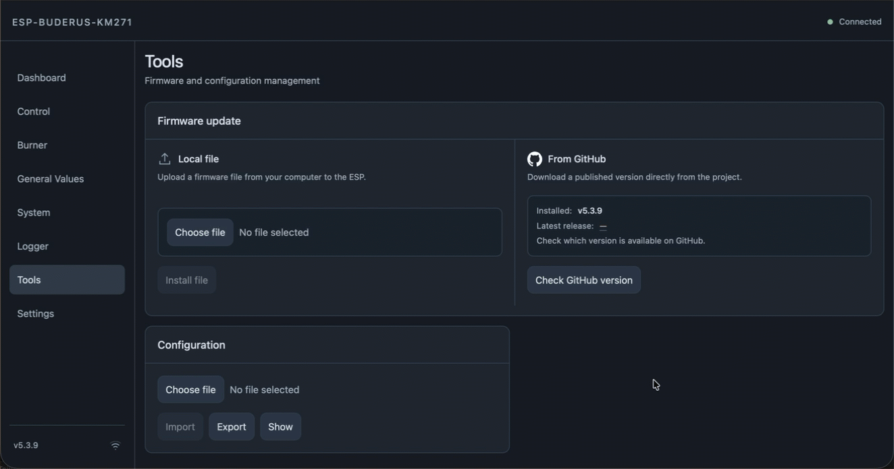

Remote ArduinoOTA ist zusätzlich über PlatformIO möglich. Geräteadresse und OTA-Authentifizierung werden in `platformio.ini` eingetragen. Dafür gilt das **Service-Passwort**, nicht die optionale WebUI-Anmeldung.

## Setup Mode

Ohne gültige anfängliche WLAN-Konfiguration startet der ESP im Setup-Mode und öffnet den Access Point **`ESP-Buderus-km271`**. Verbinde dich damit und öffne **http://192.168.4.1**.

Die Wiederherstellungs-Anmeldung lautet immer **`admin` / `km271-2026!`**, auch bei fehlender oder beschädigter `config.json`. Diese Zugangsdaten gelten im Setup-Mode unabhängig von der normalen WebUI-Anmeldung.

Der Setup-Mode lässt sich außerdem über die Mehrfach-Reset-Erkennung aufrufen: Aktuell sind **fünf erkannte Starts kurz hintereinander** mit weniger als **fünf Sekunden** Abstand eingestellt (`MRD_RETRIES` / `MRD_TIMEOUT` in `platformio.ini`).

Richte das Netzwerk ein und verwende nach dem Neustart die Netzwerkadresse des ESP. Die Setup-Adresse gilt nur für seinen Access Point.

## Konfiguration

Die Einstellungen sind in fünf Kategorien gegliedert:

| Kategorie | Inhalt |
| --- | --- |
| Allgemein | WebUI-Sprache, NTP-Server/Zeitzone, Datum und Uhrzeit der Logamatic setzen |
| Netzwerk | WLAN, SSID-Suche, optionale feste BSSID, W5500-Ethernet, IP-Konfiguration |
| Integrationen | MQTT, Home-Assistant-Discovery, Pushover |
| Gerät | Logamatic-Komponenten, Ölzähler, zusätzliche Sensoren, GPIO-Zuordnung und Board-Presets |
| Zugriff & Wartung | Optionale WebUI-Anmeldung, Service-Passwort, Telnet-Freigabe, Simulation |

Änderungen werden automatisch gespeichert. Starte neu, wenn eine Hardware- oder Netzwerkeinstellung dies erfordert. Aktiviere nur die tatsächlich vorhandenen Logamatic-Komponenten; davon hängen die sichtbaren Seiten und Dashboard-Elemente ab.

Die WLAN-Suche zeigt verfügbare SSIDs. Die AP-Suche zeigt Access Points der ausgewählten SSID und kann deren BSSID in das Eingabefeld übernehmen. Bei leerer BSSID wird der AP automatisch gewählt. Eine feste BSSID verhindert den Wechsel zu einem anderen AP; bei einer anderen SSID wird die bisherige Auswahl zurückgesetzt. Versteckte SSIDs können manuell eingegeben werden.

Reserviere eine feste IP für die MAC-Adresse der richtigen Schnittstelle oder wähle sie außerhalb des DHCP-Bereichs. WLAN und Ethernet haben eigene Adressen; vermeide doppelte IP-Vergaben.

Die MQTT-Sprache wird unabhängig von der WebUI-Sprache eingestellt. Eine Änderung kann Topic-Namen und Text-Payloads verändern. Prüfe deshalb vorher bestehende Automationen.

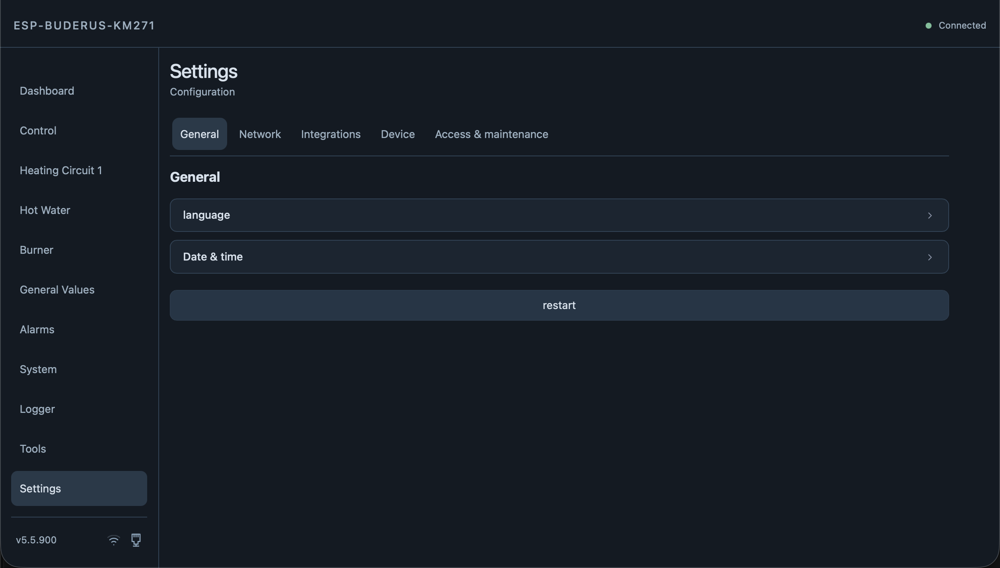

## Zugänge und Passwörter

| Zugang | Authentifizierung |
| --- | --- |
| Normale WebUI einschließlich Firmware- und Konfigurationstools | Optionaler Benutzername und Passwort unter WebUI-Authentifizierung; abschaltbar |
| WebUI im Setup-Mode | Feste Wiederherstellungs-Anmeldung: `admin` / `km271-2026!`, unabhängig von der Konfiguration |
| Telnet | Muss ausdrücklich aktiviert werden; verwendet das Service-Passwort |
| Remote ArduinoOTA | Verwendet das Service-Passwort |

Im normalen Betrieb benötigen Telnet und Remote ArduinoOTA ein nicht leeres Service-Passwort. Im Setup-Mode gilt für Service-Zugänge das Wiederherstellungs-Passwort. Das Service-Passwort ist vom normalen WebUI-Passwort getrennt; das Web-Update hat kein zusätzliches eigenes Passwort.

## Konfiguration sichern und wiederherstellen

Unter **Tools → Konfiguration** lässt sich `config.json` anzeigen, exportieren und importieren. Der Name der ausgewählten Importdatei ist beliebig; übernommen wird sie immer als `config.json`. Vor dem Ersetzen wird gültiges JSON mit dem projektspezifischen Abschnitt geprüft. Nach erfolgreichem Import oder Wiederherstellen startet das Gerät automatisch neu.

**Backup auf dem Gerät** kopiert die bereits gespeicherte Konfiguration nach `config_backup.json`. Das Wiederherstellen ersetzt die aktuelle Konfiguration; das Backup bleibt erhalten. Beide Dateien zeigen ihren letzten Speicherzeitpunkt, bei fehlender gültiger Gerätezeit „Zeitpunkt unbekannt“. Schreib- oder Platzfehler lassen die bisherige Zieldatei bestehen.

Mit **Backup exportieren** lässt sich der gesicherte Stand direkt als `config_backup.json` herunterladen, ohne ihn vorher wiederherzustellen.

Das lokale Backup liegt auf demselben Flash und ersetzt keinen Export auf den Computer. Es enthält Zugangsdaten und sichert ausschließlich die Konfiguration, keine separat gespeicherten Zähler oder Verlaufsdaten. Exportierte Dateien vertraulich behandeln und nicht unbereinigt veröffentlichen.

# WebUI

Die WebUI funktioniert am Desktop und auf Mobilgeräten. Bei schmalen Ansichten wechselt die Navigation in ein Dropdown. Optionale Komponenten erscheinen nur, wenn sie aktiviert sind. Die Verbindungsanzeige im Header zeigt die **WebSocket-Verbindung des Browsers zum ESP**, nicht die Verbindung zur Logamatic oder zum MQTT-Broker.


## Dashboard

Die Übersicht zeigt Betriebsarten, aktive Heizprogramme, Pumpen, Brenner und optionale Ölzähler/Sensoren. Aktive Pumpen- und Brennerzustände erhalten die orange Akzentfarbe.

Die Temperatur-Widgets zeigen aktuelle Werte und Trends:

| Trend | Kurven | Hintergrund-Overlay |
| --- | --- | --- |
| Kessel-Vorlauf | Soll / Ist | Brenner EIN |
| Heizkreis 1 und 2 | Vorlauf Soll / Ist | Brenner EIN |
| Warmwasser | Soll / Ist | Von HK1 gemeldeter Warmwasservorrang |
| Solar | Kollektor / Warmwasser | — |
| Außentemperatur | Aktuell / gedämpft | — |

Der ESP speichert die letzten **60 Minuten im Ein-Minuten-Raster in einem RAM-Ringpuffer**, auch ohne geöffneten Browser. Beim Öffnen der Seite und nach einem Verbindungsabbruch wird diese Historie übertragen. Sie geht bei einem ESP-Neustart verloren und ersetzt kein Langzeitarchiv wie InfluxDB/Grafana. Aktuelle Werte können häufiger aktualisiert werden als die Historie.

Beim Überfahren des Charts mit der Maus lassen sich Werte ablesen. Dünne, blassere Verbindungen kennzeichnen Datenlücken; sie verbinden bekannte Punkte, stellen aber keine zusätzlichen Messungen dar. Die Beschriftungen ordnen die Kurven zu: Der Istwert ist normalerweise durchgezogen orange, der Sollwert gestrichelt blau. Bei der Außentemperatur ist der aktuelle Wert hervorgehoben und der gedämpfte Wert gestrichelt.

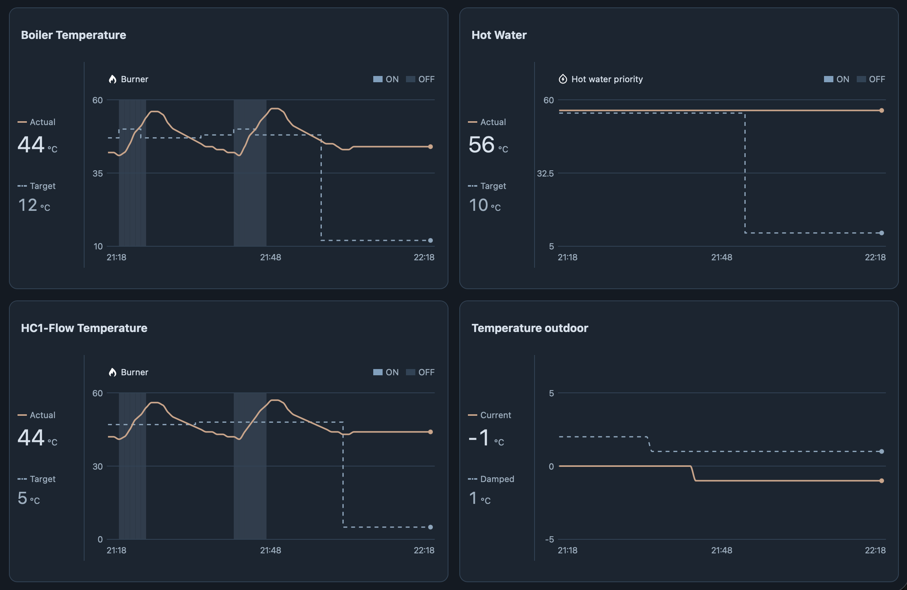

## Bedienung

Je Kategorie gibt es eine gemeinsame Karte: HK1, optional HK2, Warmwasser und optional Ölzähler. Hier lassen sich Betriebsart, Heizprogramm, Temperaturen und weitere unterstützte Parameter setzen. Hilfe-Symbole erklären die Werte und besondere Slider-Stellungen. Alle Controls bleiben sichtbar; Parameter sind nicht in zusätzlichen Untermenüs versteckt.

Am Ölzähler-Control wird ein Zählerstand gesetzt und der aktuelle Istwert als Rückmeldung angezeigt. Die Eingabe erfolgt in **Hundertsteln Liter**: **123,45 L → `12345`**. Damit wird der Zählerstand korrigiert, nicht eine Verbrauchsmenge hinzugefügt.

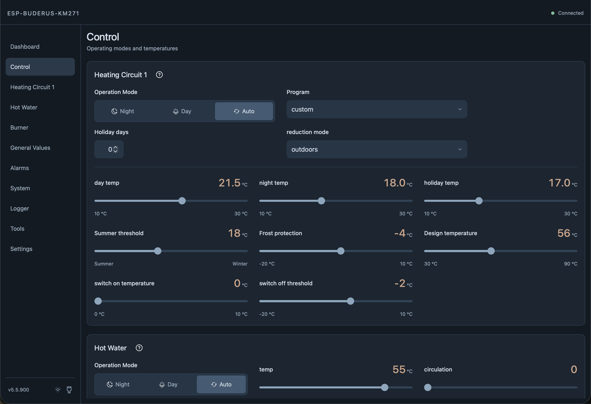

## Heizkreise, Warmwasser, Solar und Brenner

Die Informationsseiten trennen Konfiguration, aktuelle Werte und Betriebszustände. HK2 und Solar erscheinen bei entsprechender Aktivierung. Die Seiten helfen, das Verhalten der Regelung zu verstehen; die verfügbaren Schreibfunktionen befinden sich unter Bedienung.

### Heizkreise

Die Heizkreisseite fasst eingestellte Parameter, aktuelle Vorlauftemperaturen und Betriebszustände zusammen. Bei aktiviertem HK2 ist dessen Seite entsprechend aufgebaut.

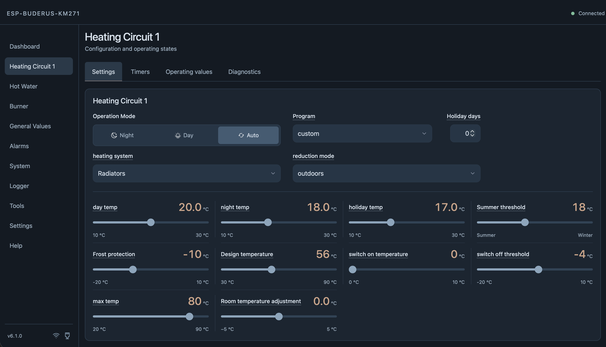

### Wochenprogramm

Der Wochenplan eines Heizkreises zeigt immer die Schaltzeiten des **Eigen-Programms**. Die Statusanzeige nennt das aktuell in der Logamatic ausgewählte Programm; dieses kann davon abweichen. Die Schaltpunktliste lässt sich für Details aufklappen. Ein Programm kann ausgewählt werden; das Bearbeiten einzelner Schaltzeiten des Wochenplans ist nicht implementiert.

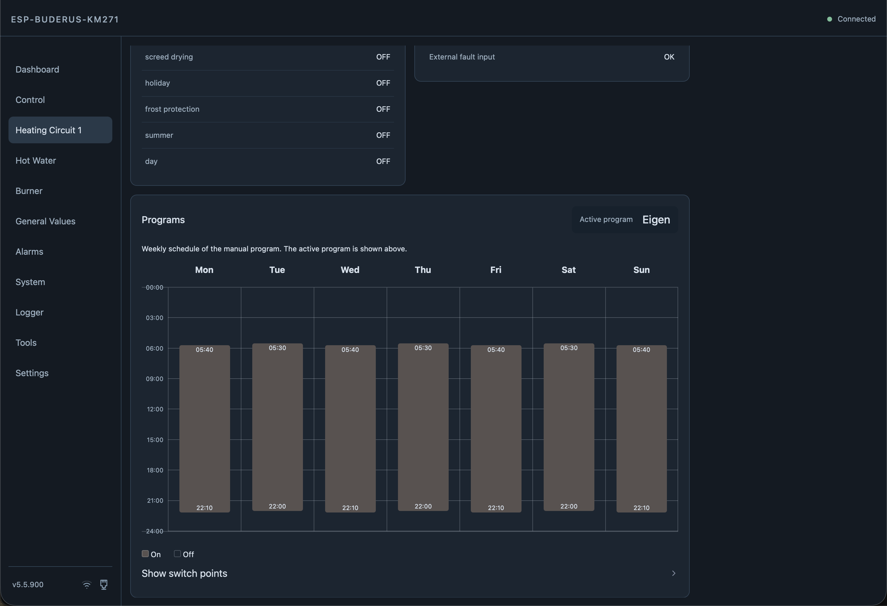

### Solar

Die Solarseite zeigt die vom FM244 über die Logamatic gemeldete Konfiguration, Temperaturen und Betriebszustände. Voraussetzung sind das installierte **FM244**, eine geeignete Adapterlösung für den gemeinsamen Betrieb mit dem KM271-Interface und die aktivierte Solarkomponente in den Einstellungen. Siehe [Hardware: Solarmodul FM244](#optional-solarmodul-fm244).

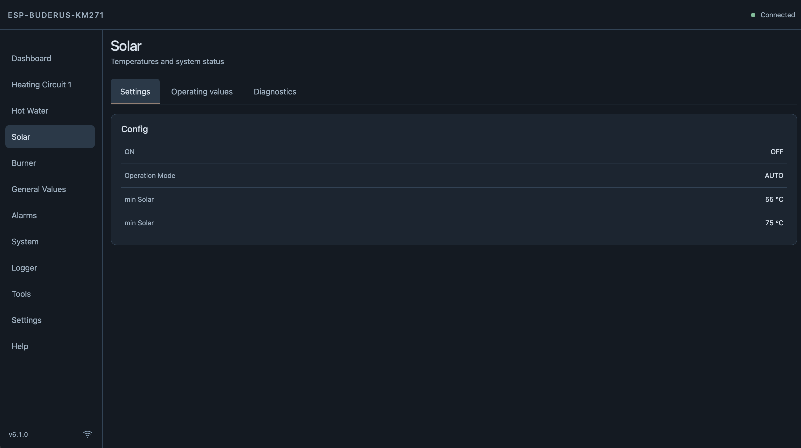

## Logbuch

Wähle **KM271**, um die Logamatic-Kommunikation zu untersuchen, und stelle den passenden Filter ein. Der Schalter Aufzeichnung aktiviert oder deaktiviert die Protokollierung. Aktualisieren lädt den aktuellen Inhalt, Löschen leert das Logbuch.

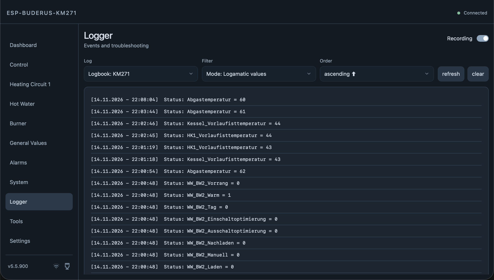

Unter **SYSTEM** stehen Meldungen zu Start, Netzwerk, MQTT und weiteren Firmware-Funktionen. Das Level wählt die angezeigte Schwere; Debug liefert zur Fehlersuche mehr Details. Beide Logbücher sind begrenzte Diagnosepuffer und keine dauerhaften Archive.

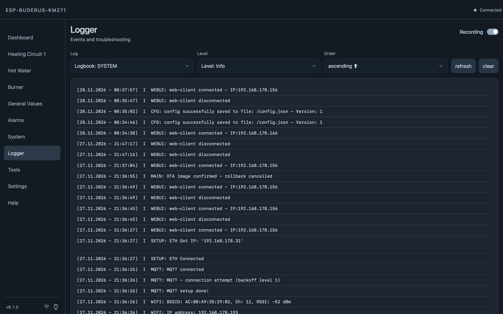

## System

Eigene Karten zeigen WLAN-, Ethernet-, MQTT- und KM271-Verbindungen. Eine funktionierende Netzwerkverbindung beweist noch keine Kommunikation mit der Heizungsregelung. Der letzte MQTT-Fehler bleibt gespeichert und kann einen früheren Ausfall beschreiben.

Zu den Geräteinformationen gehören Firmware-Version, Laufzeit und Neustartgrund. Die Speicheranzeige unterscheidet Firmware-Partitionsbelegung, freien RAM, größten freien Speicherblock und niedrigsten freien RAM seit dem Start.

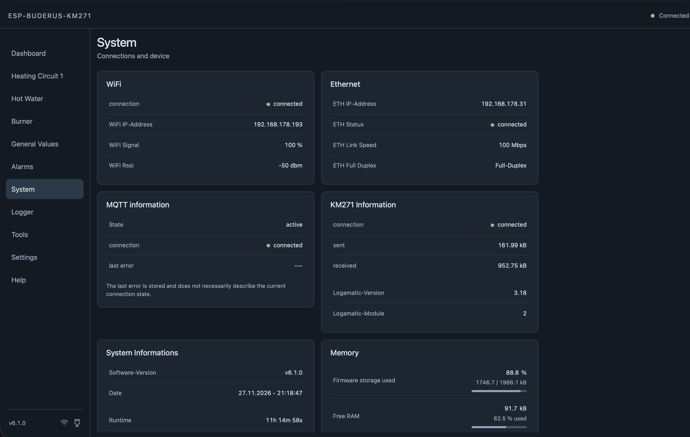

## Alarme

Bei aktivierten Alarmmeldungen zeigt der Meldungsspeicher die letzten vier Fehlereinträge der Logamatic. Darunter können bereits quittierte Meldungen sein; ein Eintrag bedeutet nicht zwingend einen noch aktiven Fehler. Berücksichtige bei der Diagnose auch die Anzeigen der Heizungsregelung selbst.


## Tools

Installiere eine lokale Firmware-Datei oder prüfe und installiere ein GitHub-Release in getrennten Bereichen. Der Konfigurationsimport und -export befindet sich in einer eigenen Karte. Fortschritt und Ergebnis eines Updates erscheinen auf derselben Seite; ein separates Versions-Popup ist nicht nötig.


## Einstellungen

Nutze die fünf unter [Konfiguration](#konfiguration) beschriebenen Kategorien. Innerhalb einer Kategorie wird beim Öffnen einer weiteren Untergruppe die bisherige geschlossen. Home Assistant hat einen eigenen Abschnitt unter Integrationen und benötigt eine aktivierte, funktionierende MQTT-Verbindung.


## Hilfe

Die Offline-Hilfe ist in der ausgewählten WebUI-Sprache auf Deutsch und Englisch verfügbar. Direkteinstiege führen zu Bedienung, Einrichtung und Fehlersuche. Aufklappbare Abschnitte erklären Trends, Board-Presets, RS232-Anschluss, MQTT/Home Assistant und Service-Zugänge. Es ist jeweils nur ein Abschnitt geöffnet. Externe Links zur vollständigen Projektdokumentation benötigen Internetzugang.

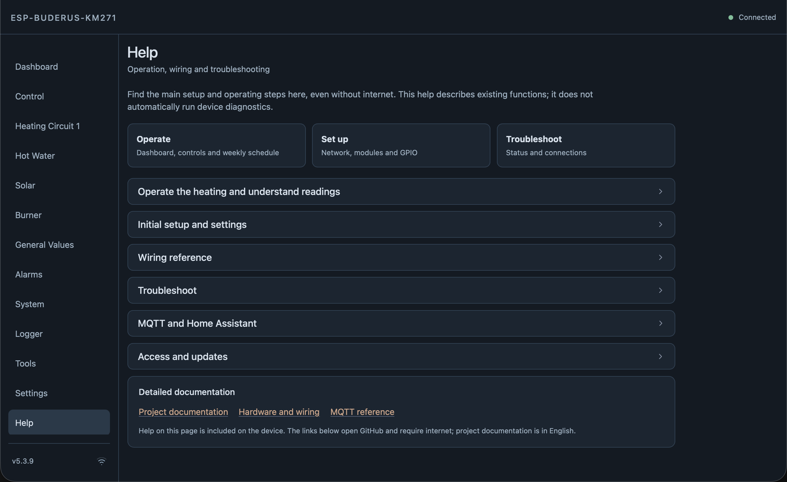

# MQTT

Die MQTT-Sprache wird unter Integrationen → MQTT unabhängig von der WebUI-Sprache gewählt. Im Folgenden steht `<basis>` für das konfigurierte Basis-Topic, zum Beispiel `esp_heizung`.

## Empfangene Werte

| Topic | Inhalt |
| --- | --- |
| `<basis>/config/...` | Aus der Logamatic gelesene Konfiguration; Retain für diese Nachrichten ist einstellbar |
| `<basis>/status/...` | Betriebszustände und Messwerte der Logamatic |
| `<basis>/sensor/<name>` | Optionaler OneWire-Sensor mit konfiguriertem Namen |
| `<basis>/oilcounter` | Hardware-Ölzähler als Ganzzahl in Hundertsteln Liter |
| `<basis>/alarm/...` | Alarmmeldungen bei aktivierter Verarbeitung |
| `<basis>/wifi`, `<basis>/info`, `<basis>/message` | Netzwerk- und Geräteinformationen sowie Meldungen |

Payloads sind je nach Parameter Zahlen, formatierte Werte mit Einheit oder sprachabhängige Texte. Die Parameterübersicht steht in [param.txt](Doc/param.txt); die Topic-Namen sind in [language.h](include/language.h) definiert.

## Kommandos

Gelesene Werte werden nicht auf demselben Topic zurückgeschrieben. Zum Setzen dient `<basis>/setvalue/...`, für Gerätebefehle `<basis>/cmd/...`. Beispiel: `esp_heizung/setvalue/hc1_day_temp` mit Payload `21.5` bei englischer MQTT-Sprache.

Die Tabelle enthält den Suffix **hinter `<basis>/`** und numerische Payloads. Temperaturen mit Nachkommastellen werden mit Dezimalpunkt übertragen. Unterstützte Textalternativen richten sich nach der MQTT-Sprache.

| Parameter | Topic DE | Topic EN | Payload |
| --- | --- | --- | --- |
| HK1: Betriebsart | `setvalue/HK1_Betriebsart` | `setvalue/hc1_operation_mode` | 0=Nacht, 1=Tag, 2=AUTO |
| HK1: Programm | `setvalue/HK1_Programm` | `setvalue/hc1_program` | 0=Eigen, 1=Familie, 2=Früh, 3=Spät, 4=Vormittag, 5=Nachmittag, 6=Mittag, 7=Single, 8=Senior |
| HK1: Tagtemperatur | `setvalue/HK1_Tagtemperatur` | `setvalue/hc1_day_temp` | 10…30 °C, 0,5-°C-Schritte |
| HK1: Nachttemperatur | `setvalue/HK1_Nachttemperatur` | `setvalue/hc1_night_temp` | 10…30 °C, 0,5-°C-Schritte |
| HK1: Urlaubtemperatur | `setvalue/HK1_Urlaubtemperatur` | `setvalue/hc1_holiday_temp` | 10…30 °C, 0,5-°C-Schritte |
| HK1: Urlaubstage | `setvalue/HK1_Ferien_Tage` | `setvalue/hc1_holiday_days` | 0…99 Tage |
| HK1: Auslegung | `setvalue/HK1_Auslegung` | `setvalue/hc1_interpretation` | 30…90 °C, 1-°C-Schritte |
| HK1: Aufschalttemperatur | `setvalue/HK1_Aufschalttemperatur` | `setvalue/hc1_switch_on_temperature` | 0…10 °C, 1-°C-Schritte |
| HK1: Außenhalt ab | `setvalue/HK1_Aussenhalt_ab` | `setvalue/hc1_switch_off_threshold` | −20…10 °C, 1-°C-Schritte |
| HK1: Frostschutz | `setvalue/HK1_Frost_ab` | `setvalue/hc1_frost_protection_threshold` | −20…10 °C, 1-°C-Schritte |
| HK1: Sommer ab | `setvalue/HK1_Sommer_ab` | `setvalue/hc1_summer_mode_threshold` | 9=Sommer, 10…30 °C=Schwelle, 31=Winter |
| HK1: Absenkungsart | `setvalue/HK1_Absenkungsart` | `setvalue/hc1_reduction_mode` | 0=Abschalt, 1=Reduziert, 2=Raumhalt, 3=Außenhalt |
| HK2: Betriebsart | `setvalue/HK2_Betriebsart` | `setvalue/hc2_operation_mode` | 0=Nacht, 1=Tag, 2=AUTO |
| HK2: Programm | `setvalue/HK2_Programm` | `setvalue/hc2_program` | 0=Eigen, 1=Familie, 2=Früh, 3=Spät, 4=Vormittag, 5=Nachmittag, 6=Mittag, 7=Single, 8=Senior |
| HK2: Tagtemperatur | `setvalue/HK2_Tagtemperatur` | `setvalue/hc2_day_temp` | 10…30 °C, 0,5-°C-Schritte |
| HK2: Nachttemperatur | `setvalue/HK2_Nachttemperatur` | `setvalue/hc2_night_temp` | 10…30 °C, 0,5-°C-Schritte |
| HK2: Urlaubtemperatur | `setvalue/HK2_Urlaubtemperatur` | `setvalue/hc2_holiday_temp` | 10…30 °C, 0,5-°C-Schritte |
| HK2: Urlaubstage | `setvalue/HK2_Ferien_Tage` | `setvalue/hc2_holiday_days` | 0…99 Tage |
| HK2: Auslegung | `setvalue/HK2_Auslegung` | `setvalue/hc2_interpretation` | 30…90 °C, 1-°C-Schritte |
| HK2: Aufschalttemperatur | `setvalue/HK2_Aufschalttemperatur` | `setvalue/hc2_switch_on_temperature` | 0…10 °C, 1-°C-Schritte |
| HK2: Außenhalt ab | `setvalue/HK2_Aussenhalt_ab` | `setvalue/hc2_switch_off_threshold` | −20…10 °C, 1-°C-Schritte |
| HK2: Frostschutz | `setvalue/HK2_Frost_ab` | `setvalue/hc2_frost_protection_threshold` | −20…10 °C, 1-°C-Schritte |
| HK2: Sommer ab | `setvalue/HK2_Sommer_ab` | `setvalue/hc2_summer_mode_threshold` | 9=Sommer, 10…30 °C=Schwelle, 31=Winter |
| HK2: Absenkungsart | `setvalue/HK2_Absenkungsart` | `setvalue/hc2_reduction_mode` | 0=Abschalt, 1=Reduziert, 2=Raumhalt, 3=Außenhalt |
| Warmwasser: Betriebsart | `setvalue/WW_Betriebsart` | `setvalue/ww_operation_mode` | 0=Nacht, 1=Tag, 2=AUTO |
| Warmwasser: Temperatur | `setvalue/WW_Temperatur` | `setvalue/ww_temp` | 30…60 °C, 1-°C-Schritte |
| Warmwasser: Zirkulation | `setvalue/WW_Zirkulation` | `setvalue/ww_circulation` | 0=AUS, 1…6 Zyklen/Stunde, 7=EIN |

### Geräte- und Diagnosebefehle

| Topic-Suffix | Payload / Wirkung |
| --- | --- |
| `setvalue/setdatetime` | Leer; aktuelle ESP-Zeit an die Logamatic übertragen |
| `setvalue/oilcounter` | Nicht negative Ganzzahl, z. B. `12345` für 123,45 L; ersetzt den Zählerstand |
| `cmd/restart` | Leer; ESP neu starten |
| `cmd/debug` | `0` / `1` für Debug-Aufzeichnung aus/ein |
| `cmd/setdebugflt` | 11 durch `_` getrennte Hex-Werte, `XX` als Platzhalter, z. B. `08_15_XX_XX_XX_XX_XX_XX_XX_XX_XX` |
| `cmd/getdebugflt` | Leer; aktuellen Filter abfragen |
| `cmd/service` | Expertenfunktion: 8 durch `_` getrennte Hex-Werte als Rohbefehl; nur mit gesichertem Protokollwissen verwenden |

Befehle nicht mit Retain senden: Ein gespeicherter Stellbefehl kann beim Wiederverbinden erneut ausgeführt werden. Alte retained Nachrichten auf `setvalue`-/`cmd`-Topics müssen am Broker gelöscht werden; ein neuer Statuswert auf einem anderen Topic überschreibt sie nicht. Ungültige Ölzähler-Payloads wie `offline` werden verworfen und im Log gemeldet.

## Home Assistant

Aktiviere zuerst MQTT und prüfe die Broker-Verbindung. Unter **Integrationen → Home Assistant** aktivierst du Discovery und konfigurierst Discovery-Topic sowie Gerätenamen. Home Assistant benötigt die MQTT-Integration am selben Broker. Die Logamatic wird mit Messwerten und unterstützten Bedienelementen als Gerät angelegt.

Topic- und Payload-Sprache hängen von der MQTT-Einstellung ab. Nach einer Änderung bestehende Entitäten und Automationen prüfen.

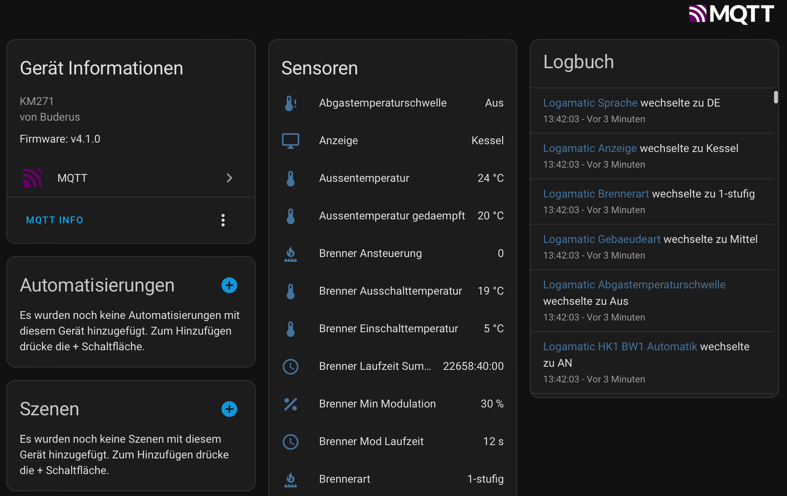


# Optionale Kommunikation

## Pushover

Trage API-Token, User-Key und Nachrichtenfilter unter **Integrationen → Pushover** ein. Mit einer Testnachricht lässt sich die Zustellung prüfen. Erforderlich sind ein Pushover-Konto und Internetzugang. Den API-Token der Anwendung kannst du auf der [Pushover-Webseite](https://pushover.net/apps/build) erstellen.

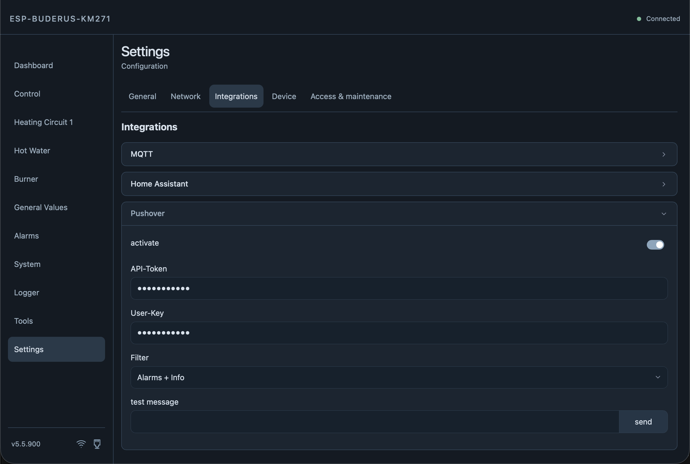

## Telnet

Aktiviere Telnet unter **Zugriff & Wartung → Service-Zugänge** und setze ein Service-Passwort. Verbinde dich mit der ESP-Adresse, beispielsweise `telnet 192.168.178.31`, und melde dich mit diesem Passwort an. `help` zeigt die verfügbaren Befehle. Telnet ist von der optionalen WebUI-Anmeldung getrennt und überträgt unverschlüsselt.

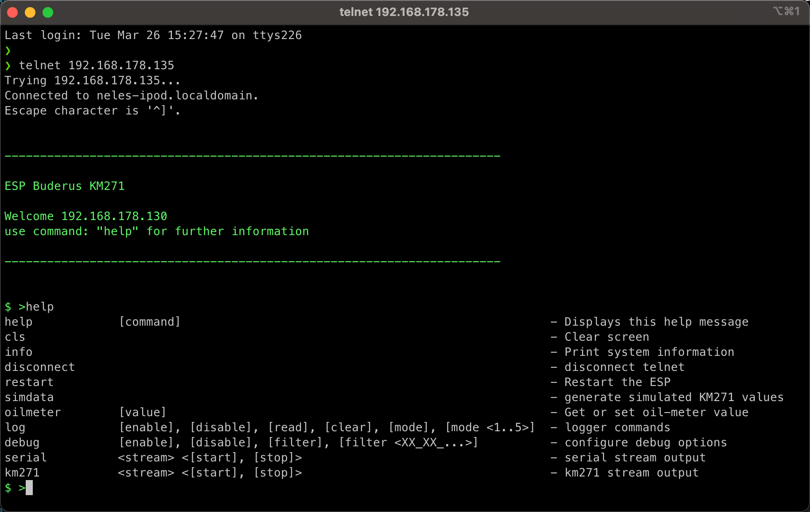

# Optionale Komponenten

## node-red

Ich schreibe alle Informationen, die über MQTT übertragen werden, in eine influxDB Datenbank.
In meinem Fall verwende ich [node-red](https://nodered.org/), um die MQTT-Nachrichten zu empfangen und sie in die [influxDB](https://www.influxdata.com/) zu schreiben.
Alles läuft in Docker auf meinem Synology NAS.
Aber es gibt noch viele andere Möglichkeiten - verwende die, die am besten zu dir passt.


Wenn du an meinen Abläufen interessiert bist, kannst du diese Exportdatei verwenden:
[node-red.json](/Doc/node-red.json)

## grafana

Um die Informationen zu visualisieren, verwende ich [grafana](https://grafana.com), das die Daten aus der influxDB bezieht.
Für mich bietet dies mehr Möglichkeiten, das Verhalten des Heizungssystems zu analysieren, als ein statisches Dashboard.

Hier sind einige Eindrücke davon, was ich mit den Informationen aus der Logamatic gemacht habe:


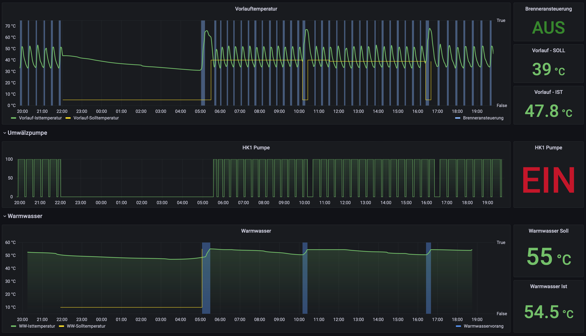
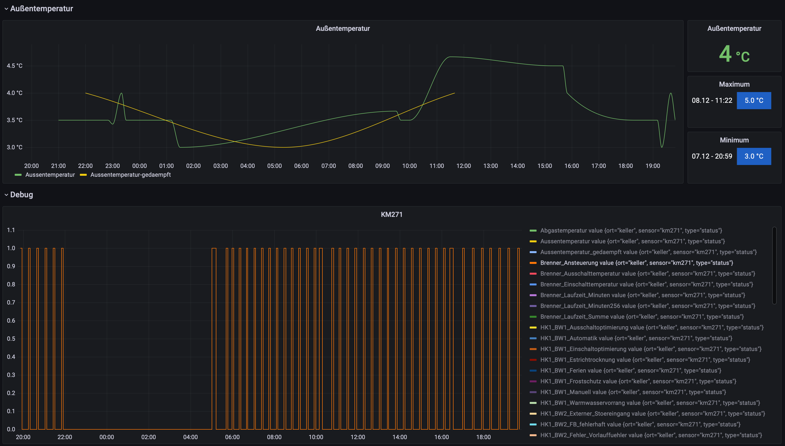

Wenn du an meinem Dashboard interessiert bist, können Sie diese Exportdatei verwenden:
[grafana.json](/Doc/grafana.json)

> [!NOTE]
> Das Beispiel verwendet InfluxDB 2.0, Flux-Abfragen und deutsche MQTT-Topics. Passe nach dem Import Datenquelle, Topic-Namen und Abfragen an deine Installation an.

# FAQ

## Keine Verbindung zur Logamatic / keine Heizungswerte

1. **Hardware identifizieren.** Ein KM271-WiFi-Board steckt direkt in der Regelung. Ein original KM271 mit RS232-Anschluss benötigt einen geeigneten RS232/TTL-Wandler. RS232-Pegel niemals direkt mit ESP-GPIOs verbinden.
2. **GPIOs unter Einstellungen → Gerät prüfen.** Das generische ESP32-Preset verwendet RX 16 / TX 17, die KM271-WiFi-Presets v0.0.5 und ≥ v0.0.6 verwenden RX 4 / TX 2. Das sind Vorgaben, keine automatische Erkennung. Die Verdrahtung muss dazu passen; Doppelbelegungen vermeiden und nach GPIO-Änderungen neu starten.
3. **Signalrichtung und Kabeldurchgang prüfen.** ESP TX muss zum TTL-Eingang des Wandlers führen, dessen TTL-Ausgang zu ESP RX; gemeinsame Masse nicht vergessen. Wandler-Beschriftungen variieren. RS232-Pinbelegung und die erforderliche gerade oder gekreuzte Verdrahtung prüfen. Ein Nullmodemkabel ist nicht grundsätzlich richtig. Siehe [Diskussion #174](https://github.com/dewenni/ESP_Buderus_KM271/discussions/174).
4. **System → KM271 und Logbuch → KM271 prüfen.** Eine funktionierende WebUI-/MQTT-Verbindung, empfangene Bytes oder ein erfolgreicher Loopback-Test allein beweisen keine gültige Logamatic-Kommunikation. Relevant sind Protokollaufbau und anschließende aktuelle Heizungswerte. Nach zwei Minuten ohne seriellen Empfang wird die Verbindung als unterbrochen gewertet und der Aufbau erneut versucht.
5. **Versorgung und Steckverbindungen prüfen.** Die Board-Dokumentation einschließlich eines gegebenenfalls erforderlichen Erkennungswiderstands beachten. Elektrische Prüfungen nur im spannungsfreien Zustand durchführen.

Die Hilfe-Seite der WebUI enthält eine Offline-Checkliste für Anschluss und Fehlersuche. Simulationswerte sind Testdaten und belegen keine funktionierende Heizungsverbindung. Für Support bitte Regelungs-/Board-Modell, Firmware-Version, RX-/TX-GPIOs und einen kurzen passenden Logauszug ohne Zugangsdaten angeben.

## Netzwerk- oder MQTT-Verbindung bricht ab

Prüfe zuerst die System-Karten und das SYSTEM-Logbuch. WLAN und Ethernet haben eigene IP-Adressen; eine doppelt vergebene feste IP kann HTTP-, WebSocket- und OTA-Ausfälle verursachen, obwohl der Ethernet-Link bestehen bleibt. Reserviere Adressen für die richtigen MACs.

Die Firmware versucht Netzwerk und MQTT automatisch wieder zu verbinden. MQTT nutzt ansteigende Wiederholungsabstände und eine Wiederherstellung der Transportverbindung statt eines ESP-Neustarts nach fünf Fehlversuchen. Bleibt WLAN dauerhaft unerreichbar und ist auch Ethernet nicht verfügbar, kann die Netzwerkwiederherstellung schließlich einen Neustart auslösen. Der letzte Neustartgrund steht auf der System-Seite.

## Ölzähler verändert sich unerwartet

Prüfe zuerst **Impulse pro Liter**, Entprellzeit und GPIO-Verdrahtung. Bei 50 Impulsen/Liter entspricht ein akzeptierter Zyklus 0,02 L. Der Hardware-Eingang ist aktiv LOW; gezählt wird nach stabiler Aktivierung und anschließend stabiler Freigabe. Die Entprellzeit muss zum tatsächlichen Ausgangssignal passen.

Eine über `setvalue/oilcounter` empfangene Zählerkorrektur ist ein separater Vorgang und wird protokolliert. Prüfe MQTT auf retained Befehle und Automationen, die dieses Topic beschreiben. Das Status-Topic lautet `oilcounter`; ein Statuswert dort löscht keinen retained Befehl auf `setvalue/oilcounter`.

## Verwendung mit ioBroker

Nutze Lese-Topics für den Status und die dokumentierten `setvalue`-Topics für Änderungen. Deaktiviere für Befehlstopics **Publish states on subscribe** und **Publish own states when connecting**, damit beim Verbinden keine alten Befehle erneut gesendet werden.

## OTA-Update schlägt fehl

Prüfe, ob das OTA-Image zum Gerät passt und die Konfiguration gesichert wurde. Lies die konkrete Fehlermeldung im SYSTEM-Logbuch. Stelle stabile Versorgung und Netzwerkverbindung sicher; vergleiche bei aktiviertem WLAN und Ethernet beide Wege und prüfe doppelte IP-Adressen. Während der Installation die Versorgung nicht unterbrechen. Ist das Gerät über das Netzwerk nicht wiederherstellbar, verwende das USB-Flash-Image.

# ❗️ Benutzung auf eigene Gefahr ❗️

**Fühl dich frei, es zu benutzen und an deine Bedürfnisse anzupassen!**

**Wenn du etwas zu verbessern hast, lass uns alle von deinen Ideen wissen!**

❓ Wenn du eine Frage hast, benutze die [Discussions](https://github.com/dewenni/ESP_Buderus_KM271/discussions)
🐞 Wenn es ein Problem oder einen Fehler gibt, benutze die [Issues](https://github.com/dewenni/ESP_Buderus_KM271/issues)
