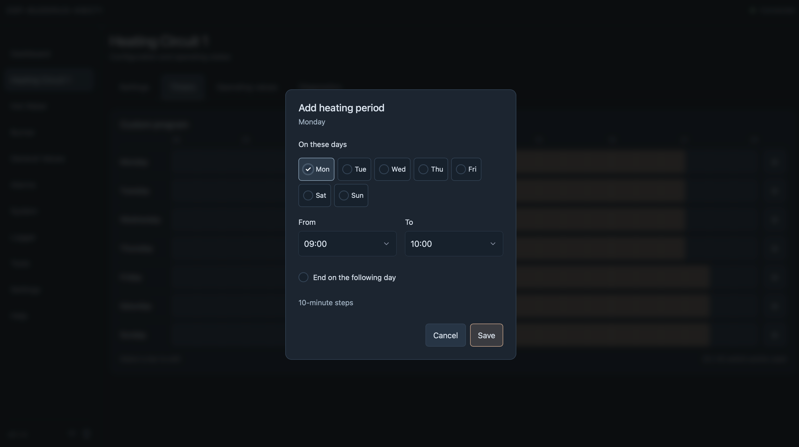
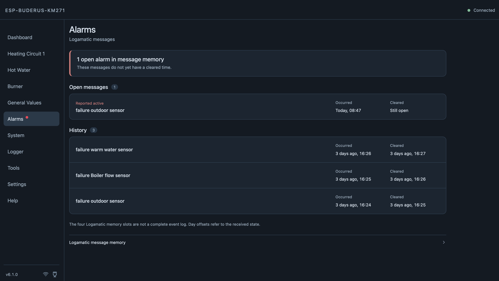
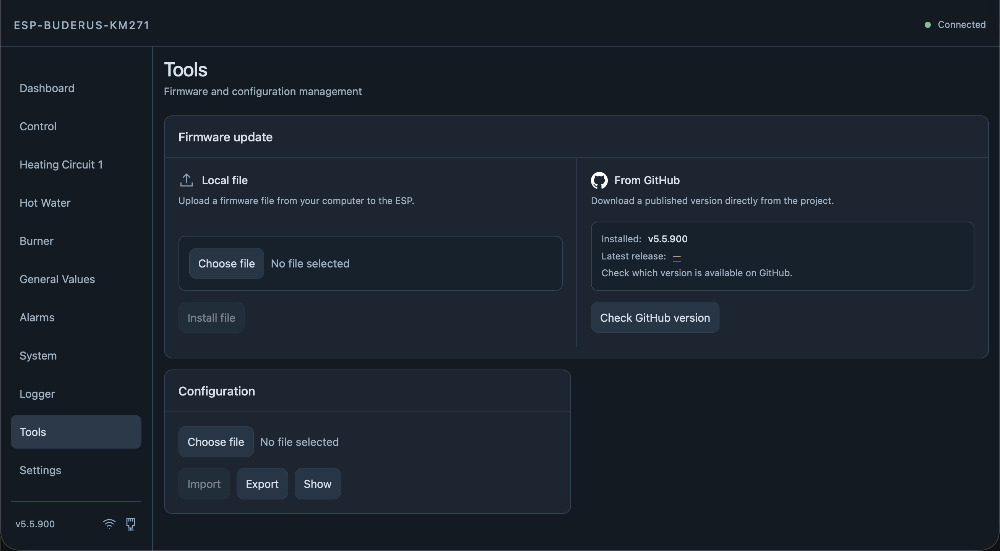
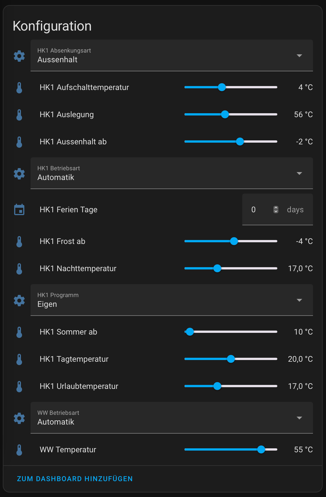
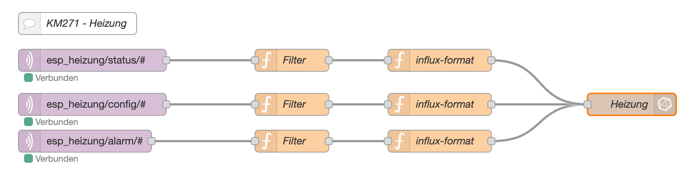
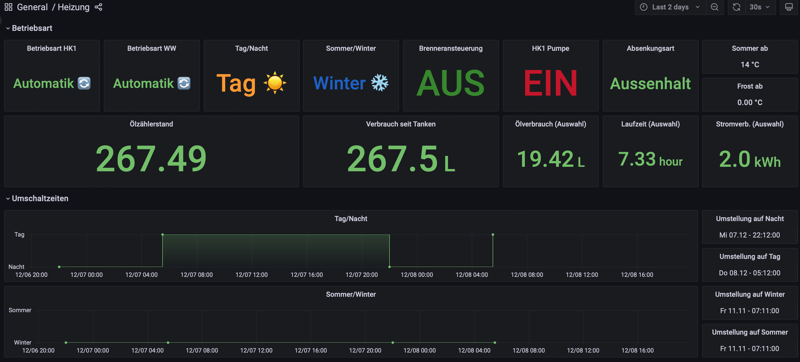

<h3 style="text-align: center;">ESP-Buderus-KM271</h3>

-----

**[🇬🇧  english version of this description](README.md)**

-----

-----

Wenn dir dieses Projekt gefällt, drücke gerne auf den <b>[Stern ⭐️]</b> Button und drücke <b>[Watch 👁]</b> um auf dem Laufenden zu bleiben.
  
Und wenn du meine Arbeit unterstützen möchtest, kannst auch folgendes nutzen 

-----

Steuere deine Buderus Logamatic R2107 / HS 2105 mit ESP32 und MQTT

Die Informationen aus der Heizung ermöglichen ein besseres Verständnis der Funktionsweise der Heizung und bieten Möglichkeiten zur Optimierung.

Das Dashboard enthält kurzfristige Temperaturtrends. Über MQTT ist zusätzlich eine Langzeitaufzeichnung mit externen Systemen wie InfluxDB und Grafana möglich.

Die integrierte WebUI ermöglicht Anzeige und Bedienung ohne zusätzliche Hausautomationssoftware und unterstützt Deutsch und Englisch.

(Desktop Version)

Die WebUI ist responsiv und bietet auch ein mobiles Layout.

 
(Mobile Version)

Um sich einen ersten Eindruck von den Funktionen und der WebUI zu verschaffen, steht auch eine eingeschränkte Demo zur Verfügung.
Diese kann über den folgenden Link aufgerufen werden: [WebUI-DEMO](https://dewenni.github.io/ESP_Buderus_KM271/)

-----

# Inhaltsverzeichnis

- [Überblick](#überblick)
  - [Optionale Ölverbrauchserfassung](#optionale-ölverbrauchserfassung)
- [Hardware](#hardware)
- [Inbetriebnahme](#inbetriebnahme)
  - [PlatformIO](#platformio)
  - [Fertige Firmware](#fertige-firmware)
  - [Setup Mode](#setup-mode)
  - [Konfiguration](#konfiguration)
- [WebUI bedienen](#webui-bedienen)
  - [Dashboard](#dashboard)
  - [Anlagenseiten](#anlagenseiten)
    - [Heizkreise](#heizkreise)
      - [Wochenprogramm](#wochenprogramm)
    - [Warmwasser](#warmwasser)
    - [Solar](#solar)
    - [Brenner](#brenner)
    - [Allgemein](#allgemein)
  - [Alarme](#alarme)
  - [System](#system)
  - [Logbuch](#logbuch)
  - [Tools](#tools)
  - [Einstellungen](#einstellungen)
    - [Ölzählerstand korrigieren](#ölzählerstand-korrigieren)
  - [Hilfe](#hilfe)
- [Updates, Sicherung und Diagnose](#updates-sicherung-und-diagnose)
  - [OTA-Updates](#ota-updates)
  - [Konfiguration sichern und wiederherstellen](#konfiguration-sichern-und-wiederherstellen)
  - [Zugänge und Passwörter](#zugänge-und-passwörter)
  - [Telnet](#telnet)
  - [Absturzdiagnose](#absturzdiagnose)
- [Integrationen](#integrationen)
  - [MQTT](#mqtt)
  - [Home Assistant](#home-assistant)
  - [Pushover](#pushover)
  - [Node-RED und Grafana](#node-red-und-grafana)
- [Fehlersuche und Support](#fehlersuche-und-support)
  - [Keine Verbindung zur Logamatic / keine Heizungswerte](#keine-verbindung-zur-logamatic--keine-heizungswerte)
  - [Netzwerk- oder MQTT-Verbindung bricht ab](#netzwerk--oder-mqtt-verbindung-bricht-ab)
  - [Ölzähler verändert sich unerwartet](#ölzähler-verändert-sich-unerwartet)
  - [Verwendung mit ioBroker](#verwendung-mit-iobroker)
  - [OTA-Update schlägt fehl](#ota-update-schlägt-fehl)

-----

# Überblick

Das Projekt kommuniziert über die KM271-Schnittstelle und das 3964R-Protokoll mit der Buderus Logamatic. Der ursprüngliche Kommunikationscode basiert auf der Arbeit von **Michael Mayer** und wurde neben dem Lesen von Werten um gängige Schreibbefehle erweitert.

Die WebUI bietet Dashboard mit Trends, Bedienung, Heizungsinformationen, Logbücher, Systemstatus, Updates, gruppierte Einstellungen und Offline-Hilfe. Optional sind HK2, Solar, Ölzähler, OneWire-Sensoren, MQTT/Home Assistant und Pushover verfügbar. Welche Werte vorliegen, hängt von der angeschlossenen Heizung und den aktivierten Komponenten ab.

Die Übersetzungen stehen in [language.h](include/language.h) und [lang.js](web/js/lang.js). WebUI- und MQTT-Sprache können getrennt gewählt werden.

## Optionale Ölverbrauchserfassung

Ein Hardware-Impulszähler kann den Ölverbrauch messen, beispielsweise ein Braun HZ-5R/HZ-5DR oder ein geeigneter nachgerüsteter Reedkontakt. Konfiguriert werden GPIO, Impulse pro Liter und Entprellzeit. Der Zählerstand wird dauerhaft gespeichert und in Litern angezeigt.

Alternativ schätzt der virtuelle Ölzähler den Verbrauch anhand der Brennerlaufzeit, des eingestellten Öldurchsatzes, der Dichte und eines Offsets. Das ist eine Berechnung und keine unabhängige Messung.

# Hardware

Wähle die Schnittstelle passend zu deiner Logamatic. Die [Hardware-Anleitung](Doc/hardware_DE.md) enthält Verdrahtungs-, Pin- und Bauteilangaben.

| Option | Kurzbeschreibung | Details |
| --- | --- | --- |
| Integriertes KM271-WiFi-Board | Ältere Revisionen verwenden den klassischen ESP32; v2.0 den ESP32-S3 mit passender Firmware. | [KM271-WiFi](Doc/hardware_DE.md#option-1---board-von-the78mole) |
| Originales KM271 mit ESP32 | Anschluss des Originalmoduls über einen geeigneten RS232/TTL-Wandler. | [Originales KM271](Doc/hardware_DE.md#option-2---esp32-mit-original-buderus-km271) |

| Erweiterung | Nutzen | Details |
| --- | --- | --- |
| W5500-Ethernet | Kabelgebundene Netzwerkverbindung. | [W5500](Doc/hardware_DE.md#optional-ethernet-modul-w5500) |
| Solarmodul FM244 | Solarwerte; gemeinsamer Betrieb mit dem KM271 benötigt einen geeigneten Steckplatzadapter. | [FM244](Doc/hardware_DE.md#optional-solarmodul-fm244) |
| Hardware-Ölzähler | Impulsbasierte Erfassung des Ölverbrauchs. | [Ölzähler](Doc/hardware_DE.md#optional-hardware-ölzähler) |
| DS18B20-Sensoren | Bis zu zwei OneWire-Temperatursensoren. | [OneWire](Doc/hardware_DE.md#optional-onewire-sensor) |
| Abgassensor | NTC100K-Messwerte, abhängig von der Platine. | [Abgassensor](Doc/hardware_DE.md#optional-abgas-sensor) |

-----

# Inbetriebnahme

Installiere die Firmware, richte das Netzwerk ein und wähle das passende Hardware-Preset, bevor du Heizungsparameter veränderst. MQTT und zusätzliche Sensoren sind optional; die WebUI funktioniert auch eigenständig.

## PlatformIO

Klone das Repository und öffne es in Visual Studio Code mit PlatformIO. Wähle in `platformio.ini` die passende Umgebung und den USB-Upload-Port, baue das Projekt und lade es auf den ESP. Die Build-Skripte benötigen Python und erzeugen sowie komprimieren auch die WebUI-Dateien.

Lokaler Build: `pio run -e esp32s3` (klassischer ESP32: `pio run -e esp32`). PSRAM wird nicht benötigt. Beide Builds verwenden die bestehende OTA-Partitionierung `min_spiffs.csv`; der zusätzliche Flash-Speicher wird zunächst nicht ausgenutzt.

## Fertige Firmware

Fertige Binaries stehen unter [Releases](https://github.com/dewenni/ESP_Buderus_KM271/releases) bereit.

- **Erstinstallation per USB:** `buderus_km271_esp32_flash_vx.x.x.bin` für ESP32 bzw. `buderus_km271_esp32s3_flash_vx.x.x.bin` für Board v2.0 verwenden. Dieses zusammengeführte Image enthält Bootloader, Partitionstabelle und Anwendung und wird mit einem geeigneten ESP-Flashtool an Adresse **0x00** geschrieben.
- **Update einer bestehenden Installation:** `buderus_km271_ota_update_vx.x.x.bin` für ESP32 bzw. `buderus_km271_esp32s3_update_vx.x.x.bin` für Board v2.0 über die WebUI installieren.

Verwende das für dein Board vorgesehene Image. Exportiere vor einem Update die vorhandene Konfiguration.

## Setup Mode

Ohne gültige anfängliche WLAN-Konfiguration startet der ESP im Setup-Mode und öffnet den Access Point **`ESP-Buderus-km271`**. Verbinde dich damit und öffne **http://192.168.4.1**.

Die Wiederherstellungs-Anmeldung lautet immer **`admin` / `km271-2026!`**, auch bei fehlender oder beschädigter `config.json`. Diese Zugangsdaten gelten im Setup-Mode unabhängig von der normalen WebUI-Anmeldung.

Der Setup-Mode lässt sich außerdem über die Mehrfach-Reset-Erkennung aufrufen: Aktuell sind **fünf erkannte Starts kurz hintereinander** mit weniger als **fünf Sekunden** Abstand eingestellt (`MRD_RETRIES` / `MRD_TIMEOUT` in `platformio.ini`).

Richte das Netzwerk ein und verwende nach dem Neustart die Netzwerkadresse des ESP. Die Setup-Adresse gilt nur für seinen Access Point.

## Konfiguration

Die Einstellungen sind in fünf Kategorien gegliedert:

| Kategorie | Inhalt |
| --- | --- |
| Allgemein | WebUI-Sprache, NTP-Server/Zeitzone, Datum und Uhrzeit der Logamatic setzen |
| Netzwerk | WLAN, SSID-Suche, optionale feste BSSID, W5500-Ethernet, IP-Konfiguration |
| Integrationen | MQTT, Home-Assistant-Discovery, Pushover |
| Gerät | Logamatic-Komponenten, Ölzähler, zusätzliche Sensoren, GPIO-Zuordnung und Board-Presets |
| Zugriff & Wartung | Optionale WebUI-Anmeldung, Service-Passwort, Telnet-Freigabe, Absturzdiagnose, Simulation |

Änderungen werden automatisch gespeichert. Starte neu, wenn eine Hardware- oder Netzwerkeinstellung dies erfordert. Aktiviere nur die tatsächlich vorhandenen Logamatic-Komponenten; davon hängen die sichtbaren Seiten und Dashboard-Elemente ab.

Die WLAN-Suche zeigt verfügbare SSIDs. Die AP-Suche zeigt Access Points der ausgewählten SSID und kann deren BSSID in das Eingabefeld übernehmen. Bei leerer BSSID wird der AP automatisch gewählt. Eine feste BSSID verhindert den Wechsel zu einem anderen AP; bei einer anderen SSID wird die bisherige Auswahl zurückgesetzt. Versteckte SSIDs können manuell eingegeben werden.

Reserviere eine feste IP für die MAC-Adresse der richtigen Schnittstelle oder wähle sie außerhalb des DHCP-Bereichs. WLAN und Ethernet haben eigene Adressen; vermeide doppelte IP-Vergaben.

Die MQTT-Sprache wird unabhängig von der WebUI-Sprache eingestellt. Eine Änderung kann Topic-Namen und Text-Payloads verändern. Prüfe deshalb vorher bestehende Automationen.

Der **WLAN-Energiesparmodus** reduziert den Stromverbrauch und ist standardmäßig aktiv. Bei Verbindungsproblemen kann er testweise abgeschaltet werden; die Änderung gilt ab der nächsten WLAN-Verbindung oder nach einem Neustart.

Bei W5500-Anbindungen mit bestücktem PCA9306 unter **Netzwerk → Ethernet → Level-Shifter aktivieren** den zur Platine passenden GPIO EN konfigurieren. Die Option gibt beim Ethernet-Start den Reset-Signalweg frei und wird nach einem Neustart wirksam. Ohne diesen Pegelwandler bleibt sie aus; die Ethernet-Hilfe erklärt die Verdrahtung.

# WebUI bedienen

Die WebUI funktioniert am Desktop und auf Mobilgeräten. Bei schmalen Ansichten wechselt die Navigation in ein Dropdown. Optionale Komponenten erscheinen nur, wenn sie aktiviert sind. Die Verbindungsanzeige im Header zeigt die **WebSocket-Verbindung des Browsers zum ESP**, nicht die Verbindung zur Logamatic oder zum MQTT-Broker.

## Dashboard

Die Übersicht zeigt Betriebsarten, aktive Heizprogramme, Pumpen, Brenner und optionale Ölzähler/Sensoren. Aktive Pumpen- und Brennerzustände erhalten die orange Akzentfarbe.

Die Temperatur-Widgets zeigen aktuelle Werte und Trends:

| Trend | Kurven | Hintergrund-Overlay |
| --- | --- | --- |
| Kessel-Vorlauf | Soll / Ist | Brenner EIN |
| Heizkreis 1 und 2 | Vorlauf Soll / Ist | Brenner EIN |
| Warmwasser | Soll / Ist | Von HK1 gemeldeter Warmwasservorrang |
| Solar | Kollektor / Warmwasser | — |
| Außentemperatur | Aktuell / gedämpft | — |

Der ESP speichert die letzten **60 Minuten im Ein-Minuten-Raster in einem RAM-Ringpuffer**, auch ohne geöffneten Browser. Beim Öffnen der Seite und nach einem Verbindungsabbruch wird diese Historie übertragen. Sie geht bei einem ESP-Neustart verloren und ersetzt kein Langzeitarchiv wie InfluxDB/Grafana. Aktuelle Werte können häufiger aktualisiert werden als die Historie.

Beim Überfahren des Charts mit der Maus lassen sich Werte ablesen. Dünne, blassere Verbindungen kennzeichnen Datenlücken; sie verbinden bekannte Punkte, stellen aber keine zusätzlichen Messungen dar. Die Beschriftungen ordnen die Kurven zu: Der Istwert ist normalerweise durchgezogen orange, der Sollwert gestrichelt blau. Bei der Außentemperatur ist der aktuelle Wert hervorgehoben und der gedämpfte Wert gestrichelt.

## Anlagenseiten

Die Informationsseiten trennen Konfiguration, aktuelle Werte und Betriebszustände. HK2 und Solar erscheinen bei entsprechender Aktivierung. Die Seiten helfen, das Verhalten der Regelung zu verstehen; die Bedienelemente befinden sich auf den jeweiligen Anlagenseiten.

### Heizkreise

HK1 und HK2 besitzen die Tabs **Einstellungen, Timer, Betriebswerte und Diagnose**. Unter Einstellungen lassen sich unter anderem Betriebsart, Programm, Urlaubstage, Temperaturen, Heizsystem und Absenkungsart ändern. Betriebswerte zeigen die gemeldeten Temperaturen, Heizkennlinie und weitere Regelungsdaten; Diagnose zeigt Betriebs- und Fehlerzustände. Erläuterungen zu Einstellungen erscheinen bei Mauszeiger, Tastaturfokus oder Antippen der Beschriftung.

#### Wochenprogramm

Die Wochenansichten von HK1 und HK2 zeigen das **Eigen-Programm**. Klicke auf einen Heizzeitbalken, um ihn zu bearbeiten oder zu entfernen. Über **+** lassen sich Heizzeiten auch für mehrere Tage hinzufügen. Die Zeiten werden in 10-Minuten-Schritten eingestellt; Zeiträume können über Mitternacht gehen oder um 24:00 enden.

Speichern überträgt die Änderungen an die Regelung; Abbrechen verwirft die lokalen Eingaben. Das aktive Programm lässt sich weiterhin separat auswählen und wird durch die Timerbearbeitung nicht umgeschaltet.

Bearbeiten ist nur bei bestehender Verbindung und vollständig empfangenem, aktuellem Wochenplan möglich. Je Heizkreis stehen 42 Schaltpunkte für höchstens 21 vollständige Heizzeiten zur Verfügung; Überschneidungen und veraltete Eingaben werden abgewiesen. „Gespeichert“ erscheint nach den Transportquittungen aller zugehörigen Telegramme und ist keine unabhängige Rücklesebestätigung. Bei einem Fehler können Teile bereits übernommen worden sein. Nach einem Verbindungsabbruch ist das Ergebnis möglicherweise unbekannt: Vor einem neuen Versuch den aktuellen Gerätestand abwarten und prüfen.

### Warmwasser

Warmwasser besitzt die Tabs **Einstellungen, Betriebswerte und Diagnose**. Betriebsart, Warmwasserbereitung, Vorrang für HK2, Solltemperatur und Zirkulation lassen sich unter Einstellungen ändern. Gemeldete Temperaturen sowie Pumpen-, Betriebs- und Fehlerzustände stehen in den anderen Tabs.

### Solar

Die Solarseite zeigt die vom FM244 über die Logamatic gemeldete Konfiguration, Temperaturen und Betriebszustände. Voraussetzung sind das installierte **FM244**, eine geeignete Adapterlösung für den gemeinsamen Betrieb mit dem KM271-Interface und die aktivierte Solarkomponente in den Einstellungen. Siehe [Hardware: Solarmodul FM244](Doc/hardware_DE.md#optional-solarmodul-fm244).

Solar verwendet ebenfalls **Einstellungen, Betriebswerte und Diagnose**. Die angezeigte Konfiguration ist hier nur lesbar; Schreibregler für Solar werden nicht angeboten.

### Brenner

Die Brennerseite zeigt Kessel-Soll- und Isttemperatur, Ein-/Ausschalttemperaturen, Ansteuerung, Betriebs- und Fehlerzustände sowie die gemeldete Brennerlaufzeit. Sie dient zur Anzeige; hier werden keine Brennerparameter geschrieben.

### Allgemein

Diese Seite zeigt allgemeine Logamatic-Daten wie Gebäudeart, Sprache, Displayeinstellung, Grenzen sowie Außen- und Abgastemperaturen. Die Uhrzeitkorrektur wird in Sekunden pro Tag (`s/d`) angezeigt. Diese Empfangswerte sind von den ESP-Einstellungen unter Einstellungen → Allgemein zu unterscheiden.

## Alarme

Bei aktivierten Alarmmeldungen zeigt die Seite die vier Meldungsspeicherplätze der Logamatic: offene Meldungen ohne Gegangen-Zeit und die Historie mit Gegangen-Zeit. Gekommen- und Gegangen-Zeit erscheinen, soweit verfügbar, mit relativen Tagesangaben wie heute, gestern oder vor n Tagen sowie der Uhrzeit. Aktive offene Meldungen heben den Alarmeintrag in der Desktop- und Mobilnavigation hervor.

„Keine offenen Alarme“ wird erst angezeigt, wenn alle vier Speicherplätze empfangen wurden. Unvollständiger Empfang, deaktivierte Überwachung und Verbindungsverlust werden ausdrücklich markiert. Nach einem Verbindungsverlust zeigen zwischengespeicherte Meldungen nur den zuletzt bekannten Stand. Die Seite zeigt den Meldungsspeicher der Regelung, kein vollständiges Ereignisarchiv. Berücksichtige für die Diagnose auch die Anzeige der Logamatic.

## System

Eigene Karten zeigen WLAN-, Ethernet-, MQTT- und KM271-Verbindungen. Eine funktionierende Netzwerkverbindung beweist noch keine Kommunikation mit der Heizungsregelung. Der letzte MQTT-Fehler bleibt gespeichert und kann einen früheren Ausfall beschreiben.

Zu den Geräteinformationen gehören Firmware-Version, Laufzeit und Neustartgrund. Die Speicheranzeige unterscheidet Firmware-Partitionsbelegung, freien RAM, größten freien Speicherblock und niedrigsten freien RAM seit dem Start.

## Logbuch

Wähle **KM271**, um die Logamatic-Kommunikation zu untersuchen, und stelle den passenden Filter ein. Der Schalter Aufzeichnung aktiviert oder deaktiviert die Protokollierung. Aktualisieren lädt den aktuellen Inhalt, Löschen leert das Logbuch.

Unter **SYSTEM** stehen Meldungen zu Start, Netzwerk, MQTT und weiteren Firmware-Funktionen. Das Level wählt die angezeigte Schwere; Debug liefert zur Fehlersuche mehr Details. Beide Logbücher sind begrenzte Diagnosepuffer und keine dauerhaften Archive.

Gespeicherte Absturzberichte werden separat unter [Absturzdiagnose](#absturzdiagnose) behandelt.

## Tools

Die Tools-Seite enthält [Firmware-Updates](#ota-updates) sowie [Konfiguration sichern und wiederherstellen](#konfiguration-sichern-und-wiederherstellen). Dort kannst du eine lokale Datei installieren, ein GitHub-Release prüfen oder das Geräte-Backup erstellen, wiederherstellen und exportieren.

## Einstellungen

Nutze die fünf unter [Konfiguration](#konfiguration) beschriebenen Kategorien. Innerhalb einer Kategorie wird beim Öffnen einer weiteren Untergruppe die bisherige geschlossen. Home Assistant hat einen eigenen Abschnitt unter Integrationen und benötigt eine aktivierte, funktionierende MQTT-Verbindung.

### Ölzählerstand korrigieren

Unter **Einstellungen → Gerät → Ölzähler** den Zählerstand eingeben und **Setzen** wählen. Die aktuelle Implementierung erwartet hier wie MQTT eine Ganzzahl in **Hundertsteln Liter**: `12345` setzt 123,45 L. Der Istwert daneben wird dagegen in Litern angezeigt und erst mit der ESP-Rückmeldung aktualisiert. Diese unterschiedlichen Einheiten bei Eingabe und Anzeige beachten. Die Aktion ersetzt den gespeicherten Hardware-Zählerstand; es ist keine zusätzliche Verbrauchsmessung. Siehe auch [MQTT-Referenz](Doc/MQTT_DE.md).

## Hilfe

Die Offline-Hilfe ist in der ausgewählten WebUI-Sprache auf Deutsch und Englisch verfügbar. Direkteinstiege führen zu Bedienung, Einrichtung und Fehlersuche. Aufklappbare Abschnitte erklären Trends, Board-Presets, RS232-Anschluss, MQTT/Home Assistant und Service-Zugänge. Es ist jeweils nur ein Abschnitt geöffnet. Externe Links zur vollständigen Projektdokumentation benötigen Internetzugang.

# Updates, Sicherung und Diagnose

## OTA-Updates

Die Karte **Tools → Firmware-Update** trennt zwei Wege:

- **Lokale Datei:** OTA-Datei mit Endung `.bin` auf dem Computer auswählen und anschließend **Datei installieren** anklicken. Die Dateiauswahl allein startet kein Update.
- **Von GitHub:** **GitHub-Version prüfen** anklicken, installierte und verfügbare Version vergleichen und die Installation ausdrücklich starten. Der ESP lädt das Release selbst herunter; dafür benötigt er Internetzugang.

Die Versionsnummer in der Navigation führt zum Update-Bereich auf der Tools-Seite. Fortschritt und Ergebnis erscheinen dort. Warte den Abschluss und den anschließenden Neustart ab.

Remote ArduinoOTA ist zusätzlich über PlatformIO möglich. Geräteadresse und OTA-Authentifizierung werden in `platformio.ini` eingetragen. Dafür gilt das **Service-Passwort**, nicht die optionale WebUI-Anmeldung.

Der Release-Workflow baut beide Varianten nacheinander. S3-Dateien heißen `buderus_km271_esp32s3_flash_<Version>.bin`, `buderus_km271_esp32s3_update_<Version>.bin` und `buderus_km271_esp32s3_debug_<Version>.zip`. Die bisherigen ESP32-Dateinamen bleiben erhalten. S3-Updates enthalten bewusst kein `ota` im Dateinamen, damit ältere ESP32-Firmware sie bei der bisherigen Teilstringsuche nicht auswählt. GitHub-OTA wählt den vollständigen Dateinamen passend zu Chip und Release-Tag; fehlt das passende Asset, wird kein Update angeboten. Beim manuellen Upload ebenfalls das OTA-Image für den eigenen Chip wählen. Ein GPIO-Preset ändert den Zielchip einer Firmware nicht.

## Konfiguration sichern und wiederherstellen

Unter **Tools → Konfiguration** lässt sich `config.json` anzeigen, exportieren und importieren. Der Name der ausgewählten Importdatei ist beliebig; übernommen wird sie immer als `config.json`. Vor dem Ersetzen wird gültiges JSON mit dem projektspezifischen Abschnitt geprüft. Nach erfolgreichem Import oder Wiederherstellen startet das Gerät automatisch neu.

**Backup auf dem Gerät** kopiert die bereits gespeicherte Konfiguration nach `config_backup.json`. Das Wiederherstellen ersetzt die aktuelle Konfiguration; das Backup bleibt erhalten. Beide Dateien zeigen ihren letzten Speicherzeitpunkt, bei fehlender gültiger Gerätezeit „Zeitpunkt unbekannt“. Schreib- oder Platzfehler lassen die bisherige Zieldatei bestehen.

Mit **Backup exportieren** lässt sich der gesicherte Stand direkt als `config_backup.json` herunterladen, ohne ihn vorher wiederherzustellen.

Das lokale Backup liegt auf demselben Flash und ersetzt keinen Export auf den Computer. Es enthält Zugangsdaten und sichert ausschließlich die Konfiguration, keine separat gespeicherten Zähler oder Verlaufsdaten. Exportierte Dateien vertraulich behandeln und nicht unbereinigt veröffentlichen.

## Zugänge und Passwörter

| Zugang | Authentifizierung |
| --- | --- |
| Normale WebUI einschließlich Firmware- und Konfigurationstools | Optionaler Benutzername und Passwort unter WebUI-Authentifizierung; abschaltbar |
| WebUI im Setup-Mode | Feste Wiederherstellungs-Anmeldung: `admin` / `km271-2026!`, unabhängig von der Konfiguration |
| Telnet | Muss ausdrücklich aktiviert werden; verwendet das Service-Passwort |
| Remote ArduinoOTA | Verwendet das Service-Passwort |
| Absturzdiagnose: Details, Download und Löschen | Zusätzliches Service-Passwort; normale WebUI-Anmeldung gilt weiterhin, wenn aktiviert |

Im normalen Betrieb benötigen Telnet und Remote ArduinoOTA ein nicht leeres Service-Passwort. Im Setup-Mode gilt für Service-Zugänge das Wiederherstellungs-Passwort. Das Service-Passwort ist vom normalen WebUI-Passwort getrennt; das Web-Update hat kein zusätzliches eigenes Passwort.

## Telnet

Aktiviere Telnet unter **Zugriff & Wartung → Service-Zugänge** und setze ein Service-Passwort. Verbinde dich mit der ESP-Adresse, beispielsweise `telnet 192.168.178.31`, und melde dich mit diesem Passwort an. `help` zeigt die verfügbaren Befehle. Telnet ist von der optionalen WebUI-Anmeldung getrennt und überträgt unverschlüsselt.

## Absturzdiagnose

Unter **Einstellungen → Zugriff & Wartung → Absturzdiagnose** lassen sich gespeicherte Core-Dumps mit dem Service-Passwort anzeigen, herunterladen und ausdrücklich löschen. Downloads erhalten den Bericht auf dem ESP. Die passende Firmware-ELF wird beim Build als Debug-ZIP archiviert. Hinweise zur Auswertung und zu den Grenzen stehen unter [Absturzdiagnose](Doc/Absturzdiagnose.md).

Core-Dumps benötigen eine passende Flash-Partition; ein reines OTA-Anwendungsupdate ändert die Partitionstabelle nicht. Sie können vertrauliche Speicherinhalte enthalten. Für die Auswertung das Debug-Archiv des tatsächlich betroffenen Builds aufbewahren. Ein vorhandener Bericht kann von einem früheren Absturz stammen und belegt keine behobene Fehlerursache.

Weitere Diagnoseinformationen stehen unter [Logbuch](#logbuch), [System](#system) und [Fehlersuche und Support](#fehlersuche-und-support).

# Integrationen

## MQTT

Aktiviere MQTT unter **Einstellungen → Integrationen → MQTT** und trage Broker, Zugangsdaten und Basis-Topic ein. Die MQTT-Sprache ist unabhängig von der WebUI-Sprache und beeinflusst Topic-Namen und Text-Payloads. Prüfe die Verbindung unter **System → MQTT**.

Beispiel bei englischer MQTT-Sprache und Basis-Topic `esp_heizung`: `esp_heizung/setvalue/hc1_day_temp` mit Payload `21.5` setzt die Tagtemperatur. Der gemeldete Konfigurationswert erscheint unter `esp_heizung/config/hc1_day_temp`. Befehle ohne Retain senden.

Die **[vollständige MQTT-Referenz](Doc/MQTT_DE.md)** enthält sämtliche Konfigurations- und Statustopics, Alarmmeldungen, Schreibbefehle, Payloads und Beispiele.

## Home Assistant

Aktiviere zuerst MQTT und prüfe die Broker-Verbindung. Unter **Integrationen → Home Assistant** aktivierst du Discovery und konfigurierst Discovery-Topic sowie Gerätenamen. Home Assistant benötigt die MQTT-Integration am selben Broker. Die Logamatic wird mit Messwerten und unterstützten Bedienelementen als Gerät angelegt.

Topic- und Payload-Sprache hängen von der MQTT-Einstellung ab. Nach einer Änderung bestehende Entitäten und Automationen prüfen.

Maximaltemperatur und Raumtemperaturabgleich für HK1/HK2 werden als Slider,
Heizsystem sowie Warmwasserbereitung und Warmwasservorrang als Auswahllisten
bereitgestellt. Bei HK2-Fußbodenheizung ist die Maximaltemperatur auf 60 °C
begrenzt. Die bisherigen acht Sensor-Discovery-Einträge werden automatisch
entfernt. Durch den Wechsel zu `number`/`select` ändern sich die Entity-IDs;
betroffene Dashboards und Automationen anpassen.

## Pushover

Trage API-Token, User-Key und Nachrichtenfilter unter **Integrationen → Pushover** ein. Mit einer Testnachricht lässt sich die Zustellung prüfen. Erforderlich sind ein Pushover-Konto und Internetzugang. Den API-Token der Anwendung kannst du auf der [Pushover-Webseite](https://pushover.net/apps/build) erstellen.

## Node-RED und Grafana

### node-red

Ich schreibe alle Informationen, die über MQTT übertragen werden, in eine influxDB Datenbank.
In meinem Fall verwende ich [node-red](https://nodered.org/), um die MQTT-Nachrichten zu empfangen und sie in die [influxDB](https://www.influxdata.com/) zu schreiben.
Alles läuft in Docker auf meinem Synology NAS.
Aber es gibt noch viele andere Möglichkeiten - verwende die, die am besten zu dir passt.

Wenn du an meinen Abläufen interessiert bist, kannst du diese Exportdatei verwenden:
[node-red.json](/Doc/node-red.json)

### grafana

Um die Informationen zu visualisieren, verwende ich [grafana](https://grafana.com), das die Daten aus der influxDB bezieht.
Für mich bietet dies mehr Möglichkeiten, das Verhalten des Heizungssystems zu analysieren, als ein statisches Dashboard.

Hier sind einige Eindrücke davon, was ich mit den Informationen aus der Logamatic gemacht habe:

Wenn du an meinem Dashboard interessiert bist, können Sie diese Exportdatei verwenden:
[grafana.json](/Doc/grafana.json)

> [!NOTE]
> Das Beispiel verwendet InfluxDB 2.0, Flux-Abfragen und deutsche MQTT-Topics. Passe nach dem Import Datenquelle, Topic-Namen und Abfragen an deine Installation an.

# Fehlersuche und Support

## Keine Verbindung zur Logamatic / keine Heizungswerte

1. **Hardware identifizieren.** Ein KM271-WiFi-Board steckt direkt in der Regelung. Ein original KM271 mit RS232-Anschluss benötigt einen geeigneten RS232/TTL-Wandler. RS232-Pegel niemals direkt mit ESP-GPIOs verbinden.
2. **GPIOs unter Einstellungen → Gerät prüfen.** Siehe die [GPIO-Preset-Tabelle](Doc/hardware_DE.md#gpio-presets); die Presets erkennen die Hardware nicht automatisch. Die Verdrahtung muss zu den konfigurierten Pins passen; Doppelbelegungen vermeiden und nach GPIO-Änderungen neu starten.
3. **Signalrichtung und Kabeldurchgang prüfen.** ESP TX muss zum TTL-Eingang des Wandlers führen, dessen TTL-Ausgang zu ESP RX; gemeinsame Masse nicht vergessen. Wandler-Beschriftungen variieren. RS232-Pinbelegung und die erforderliche gerade oder gekreuzte Verdrahtung prüfen. Ein Nullmodemkabel ist nicht grundsätzlich richtig. Siehe [Diskussion #174](https://github.com/dewenni/ESP_Buderus_KM271/discussions/174).
4. **System → KM271 und Logbuch → KM271 prüfen.** Eine funktionierende WebUI-/MQTT-Verbindung, empfangene Bytes oder ein erfolgreicher Loopback-Test allein beweisen keine gültige Logamatic-Kommunikation. Relevant sind Protokollaufbau und anschließende aktuelle Heizungswerte. Nach zwei Minuten ohne seriellen Empfang wird die Verbindung als unterbrochen gewertet und der Aufbau erneut versucht.
5. **Versorgung und Steckverbindungen prüfen.** Die Board-Dokumentation einschließlich eines gegebenenfalls erforderlichen Erkennungswiderstands beachten. Elektrische Prüfungen nur im spannungsfreien Zustand durchführen.

Die Hilfe-Seite der WebUI enthält eine Offline-Checkliste für Anschluss und Fehlersuche. Simulationswerte sind Testdaten und belegen keine funktionierende Heizungsverbindung. Für Support bitte Regelungs-/Board-Modell, Firmware-Version, RX-/TX-GPIOs und einen kurzen passenden Logauszug ohne Zugangsdaten angeben.

## Netzwerk- oder MQTT-Verbindung bricht ab

Prüfe zuerst die System-Karten und das SYSTEM-Logbuch. WLAN und Ethernet haben eigene IP-Adressen; eine doppelt vergebene feste IP kann HTTP-, WebSocket- und OTA-Ausfälle verursachen, obwohl der Ethernet-Link bestehen bleibt. Reserviere Adressen für die richtigen MACs.

Die Firmware versucht Netzwerk und MQTT automatisch wieder zu verbinden. MQTT nutzt ansteigende Wiederholungsabstände und eine Wiederherstellung der Transportverbindung statt eines ESP-Neustarts nach fünf Fehlversuchen. Bleibt WLAN dauerhaft unerreichbar und ist auch Ethernet nicht verfügbar, kann die Netzwerkwiederherstellung schließlich einen Neustart auslösen. Der letzte Neustartgrund steht auf der System-Seite.

## Ölzähler verändert sich unerwartet

Prüfe zuerst **Impulse pro Liter**, Entprellzeit und GPIO-Verdrahtung. Bei 50 Impulsen/Liter entspricht ein akzeptierter Zyklus 0,02 L. Der Hardware-Eingang ist aktiv LOW; gezählt wird nach stabiler Aktivierung und anschließend stabiler Freigabe. Die Entprellzeit muss zum tatsächlichen Ausgangssignal passen.

Eine über `setvalue/oilcounter` empfangene Zählerkorrektur ist ein separater Vorgang und wird protokolliert. Prüfe MQTT auf retained Befehle und Automationen, die dieses Topic beschreiben. Das Status-Topic lautet `oilcounter`; ein Statuswert dort löscht keinen retained Befehl auf `setvalue/oilcounter`.

## Verwendung mit ioBroker

Nutze Lese-Topics für den Status und die dokumentierten `setvalue`-Topics für Änderungen. Deaktiviere für Befehlstopics **Publish states on subscribe** und **Publish own states when connecting**, damit beim Verbinden keine alten Befehle erneut gesendet werden.

## OTA-Update schlägt fehl

Prüfe, ob das OTA-Image zum Gerät passt und die Konfiguration gesichert wurde. Lies die konkrete Fehlermeldung im SYSTEM-Logbuch. Stelle stabile Versorgung und Netzwerkverbindung sicher; vergleiche bei aktiviertem WLAN und Ethernet beide Wege und prüfe doppelte IP-Adressen. Während der Installation die Versorgung nicht unterbrechen. Ist das Gerät über das Netzwerk nicht wiederherstellbar, verwende das USB-Flash-Image.

# ❗️ Benutzung auf eigene Gefahr ❗️

**Fühl dich frei, es zu benutzen und an deine Bedürfnisse anzupassen!**

**Wenn du etwas zu verbessern hast, lass uns alle von deinen Ideen wissen!**

❓ Wenn du eine Frage hast, benutze die [Discussions](https://github.com/dewenni/ESP_Buderus_KM271/discussions)
🐞 Wenn es ein Problem oder einen Fehler gibt, benutze die [Issues](https://github.com/dewenni/ESP_Buderus_KM271/issues)
