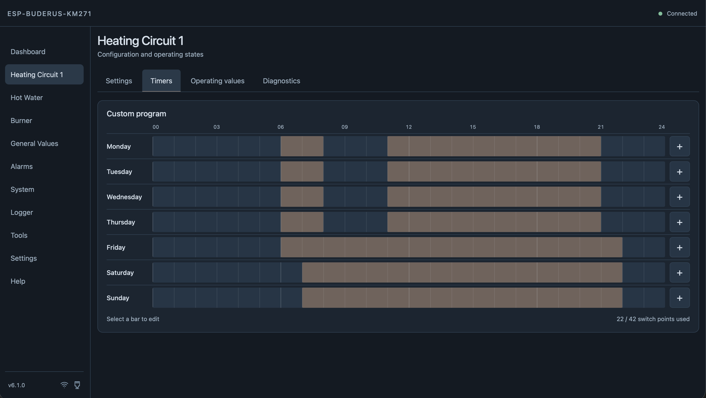
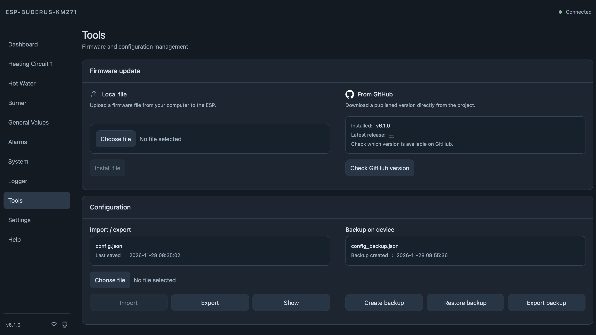
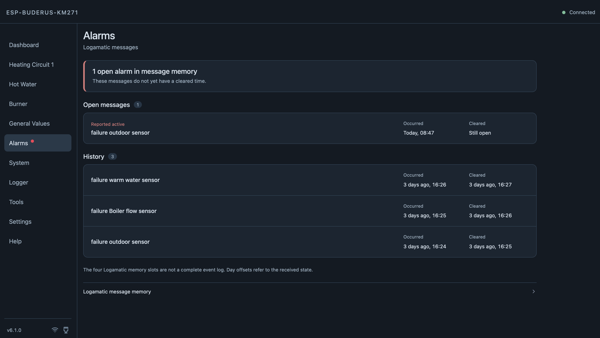

# v6.1.0

Editable weekly heating programs, more configuration controls, on-device backups and a clearer alarm view. This release also adds ESP32-S3 support for KM271-WiFi v2.0.

## Highlights

### Weekly programs and equipment controls

- **Weekly timer editor for heating circuits 1 and 2:** view the custom program as a seven-day timeline and add, change or remove heating periods. Supports multiple selected days, ten-minute steps, midnight crossings and an end time of 24:00. Saving reports completion only after all associated transport acknowledgements; incomplete or outdated controller data prevents editing.
- **Eight additional configuration controls** in the WebUI, MQTT and Home Assistant: maximum flow temperature, room temperature offset and heating system for each heating circuit, plus hot water preparation enable and hot water priority for heating circuit 2. Maximum temperatures use 20–90 °C, limited to 60 °C for underfloor heating on circuit 2; room temperature offsets use −5 to +5 °C in 0.5 °C steps.
- Reorganized heating circuit pages into Settings, Timer, Operating values and Diagnostics tabs. Hot water and solar pages follow the same structure without a timer tab. Controls now sit alongside their associated equipment; the separate central control page has been removed.

### Configuration backup and restore

- **Configuration backups on the device:** create, restore and export `config_backup.json` in addition to importing and exporting configuration files on the computer. The WebUI shows configuration and backup timestamps.

### Open alarms and history at a glance

- Redesigned the alarm page to separate currently open alarms from the controller's alarm history and show reported start/end times. An indicator in desktop and mobile navigation highlights active alarms.
- Alarm presentation distinguishes loading, incomplete data, disabled monitoring and disconnected states. Cached alarms after a connection loss are marked as last known; missing data is not presented as an all-clear.

### Hardware support and crash diagnostics

- **ESP32-S3 support for the KM271-WiFi v2.0 board**, with separate matching flash, update and debug assets and a dedicated GPIO preset.
- **Persistent crash diagnostics** under Settings → Access & Maintenance: inspect, download and delete a stored core dump using the separate service password. Dumps survive normal restarts. Builds now include a debug ZIP with the matching firmware ELF and build metadata for analysis.
- **Optional W5500 level shifter enable GPIO** for boards such as KM271-WiFi. When enabled, the configured GPIO is driven high before Ethernet initialization so the W5500 reset signal can pass through the level shifter. The Ethernet help dialog includes wiring and configuration guidance (#196).

## WebUI improvements

- Grouped heating circuit mode, program and holiday settings together, with heating system and setback type below. Hot water mode, preparation and priority are grouped above the temperature and circulation controls. Layouts adapt to narrow screens.
- Moved the oil meter reading adjustment to Settings → Device → Oil meter.
- Added contextual setting help through hover, keyboard focus or tap, with German and English texts.

## Fixes and communication improvements

- Fixed hot water dashboard mode updates when switching between manual day and night operation (#193).
- Wi-Fi signal strength and quality now update independently of MQTT, including when MQTT is disabled or disconnected.
- Corrected clock correction decoding and units: the value is signed seconds per day (`s/d`), rather than a scaled value in hours. Updated MQTT, WebUI and Home Assistant presentation accordingly.
- Corrected negative room temperature offset decoding for both heating circuits.
- Improved KM271 writes with an ordered, bounded queue, separate send and completion acknowledgements, limited retries after explicit rejection, and resynchronization after ambiguous responses or timeouts.
- Successful parameter writes resume logging directly, preserving live connection, alarm and chart validity instead of triggering a full refresh after every write.
- After a transport acknowledgement, supported configuration values are updated in the local cache, WebUI and existing MQTT topics. These updates assume acceptance; subsequent controller reports remain authoritative. A transport acknowledgement is not an independent read-back confirmation.
- Initial NTP time setting waits for an established KM271 logging connection and retries queue admission through the existing cycle if necessary. Rejected daylight-saving adjustments remain eligible for a later attempt.
- GitHub OTA selects the exact release asset for the device chip and version, preventing ESP32/ESP32-S3 firmware mix-ups.
- Unified MQTT and WebUI configuration command handling and tightened numeric input validation, rejecting empty, incomplete, non-finite, overflowing and inappropriate fractional values.
- Home Assistant discovery exposes the eight new controls as `number` or `select` entities, updates the circuit 2 maximum temperature limit when the heating system changes, and removes obsolete sensor discovery definitions. Discovery reset now also clears retained definitions on the broker.

## Build and project maintenance

- Updated EspWebUI from v0.0.14 to **v0.0.16**, including configuration backup support and reproducible WebUI simulation generation from source.
- Release binaries and the demo WebUI are now built from source in GitHub Actions. Generated `release/` and `web/output/` files are no longer versioned; the Pages workflow deploys its generated artifact from `main`.
- Release creation validates the version tag against the firmware version and release notes, and uploads the matching firmware files and debug archive.
- Pinned ESP_Git_OTA to v0.0.3.
- Local builds recreate missing release exports without recompiling unchanged firmware and preserve unrelated or older release files.
- Reorganized the guides, updated screenshots and added complete bilingual [MQTT](https://github.com/dewenni/ESP_Buderus_KM271/blob/v6.1.0/Doc/MQTT.md) and [hardware](https://github.com/dewenni/ESP_Buderus_KM271/blob/v6.1.0/Doc/hardware.md) references, replacing the former `param.txt` documentation.
- Added regression coverage for KM271 writes, weekly timers, equipment pages, alarms, crash diagnostics, Home Assistant discovery and simulation generation, plus build and protocol documentation.
- Kept the project README visible on the repository homepage and updated contributor instructions.

## Upgrade notes

- **Home Assistant entity migration:** the eight former configuration sensors become `number` or `select` entities with new entity IDs. Update dashboards and automations that reference the old sensor IDs. Automatic cleanup applies to the currently configured discovery prefix, device name and MQTT language.
- **Crash diagnostics:** core dumps require a compatible core-dump partition; an application-only OTA update does not replace an older partition table. Protected diagnostic operations require a configured service password. Dumps may contain credentials or other sensitive memory contents; keep them private and retain the debug archive matching the affected firmware.
- **Weekly timer writes can partially succeed:** multi-block changes are not atomic on the controller. After a failure or connection loss, obtain fresh data and inspect the actual program before retrying. The editor changes the custom program without changing the active program selector.
- When upgrading from v5.x, also read the [v6.0.0 release notes](https://github.com/dewenni/ESP_Buderus_KM271/releases/tag/v6.0.0) and the [v6.0.1 release notes](https://github.com/dewenni/ESP_Buderus_KM271/releases/tag/v6.0.1).
